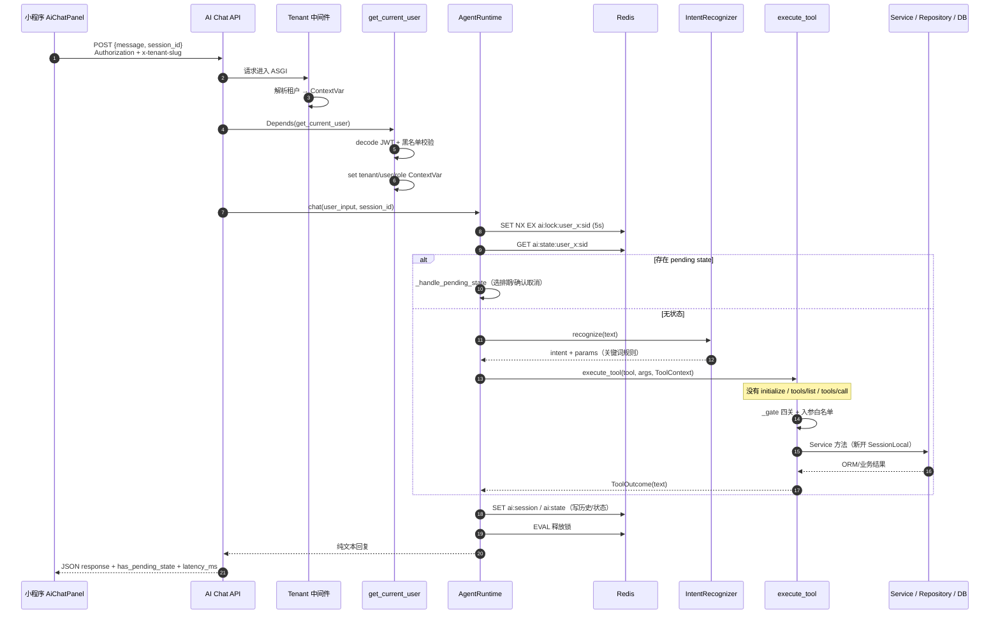
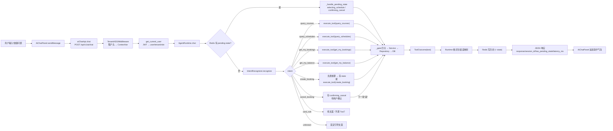

# 小程序 AI 助手 → MCP Tool 真实调用链路审计

> 审计对象：多租户舞蹈机构约课 SaaS（当前工作区）
> 审计方式：只读代码追踪，不运行业务、不改代码
> 审计时间：2026-11-06
> 结论口径：**已实现 / 部分实现 / 未实现 / 未经验证**（每条结论附 `文件:行号` 或类/函数依据）
> **已按交叉验证修订（依据：`apps/api/src/app/ai/mcp_server.py:99-106,391-475,664-723,726-728`、`agent/runtime.py:700-755`，commit `08031c4`）**。修订明细见 `miniapp-mcp-validation-report.md` §1/§9。

---

## 0. 结论速览

| 关键问题 | 结论 | 依据 |
|---|---|---|
| 谁发起 | 小程序组件 `AiChatPanel.vue`（学员整页 `ai-assistant/index.vue`、教师端 `AiAssistant.vue` 复用同一组件） | `apps/miniapp/src/components/AiChatPanel.vue:135,235-289` |
| 请求走哪条 API | `POST /api/v1/ai/chat`（一次性 JSON，非 SSE） | `apps/miniapp/src/api/index.ts:735-744`；`apps/api/src/app/modules/ai/router.py:59-81` |
| 谁做工具发现 | **不存在动态发现**。工具清单是硬编码常量 `INTENT_TOOL_MAP`，System Prompt 中的“可用能力”也由它拼接 | `apps/api/src/app/ai/agent/runtime.py:23-30,65-75` |
| 谁决定调用哪个工具 | 规则引擎 `IntentRecognizer`（关键词包含判断）+ `AgentRuntime._execute_intent` 的 `if/elif` 分支 | `apps/api/src/app/ai/agent/intent.py:25-43,116-127`；`runtime.py:273-406` |
| 谁执行 | 进程内函数 `execute_tool()` → `globals()[spec.handler_name]` 直调 Tool 函数 | `apps/api/src/app/ai/mcp_server.py:664-723`；`runtime.py:19,246-260` |
| 是否经过 MCP 协议握手 | **不存在**：没有 `initialize` / `tools/list` / `tools/call`，Runtime 直接 import 并调用 Python 函数 | `runtime.py:19`；`mcp_server.py:690-694,726-728` |
| 是否有 LLM 调用 | **无 LLM**（全仓无任何 LLM SDK/HTTP 调用点；`system_messages` 只组装不发送） | `apps/api/src/app/ai/agent/prompts.py:6-9`；`runtime.py:100-102`；全仓 grep `deepseek/volc/openai/langchain` 无命中 |
| 是否有 Agent Loop | **无**（没有 LLM 驱动的 ReAct/多步规划；仅有一个两轮状态机：选排期、确认取消） | `runtime.py:415-573` |
| 多轮状态存哪 | Redis 三个 key：会话历史 / 中间状态 / 并发锁 | `apps/api/src/app/ai/agent/session.py:22-57,119-152` |
| MCP Server 是否独立进程运行 | **否**（仓库内无任何部署/CI 启动 `mcp_server.py` 的证据） | `apps/api/Dockerfile:29`；`infra/docker/docker-compose.prod.yml:32-61`；`.github/workflows/ci.yml:65-69` |
| FastMCP / MCP SDK 版本 | `fastmcp 3.4.7`、`mcp 1.29.0` | `uv run python -c "importlib.metadata..."`（本次实测） |

---

## 1. 真实链路逐跳追踪

### 1.1 客户端：输入与发送

1. 学员端页面渲染 `AiChatPanel`：
   - `apps/miniapp/src/pages/student/ai-assistant/index.vue:17-23,45-54`
   - `sessionId` 由 `student_{userId}_{entryTs}` 生成，**每次进入页面都是新会话**（`auto-restore-history=false`）。
2. 用户按发送/回车 → `sendMessage()` 做空值与 loading 防重 → `doSend()`：
   - `AiChatPanel.vue:281-289`（`sendMessage`）
   - `AiChatPanel.vue:235-279`（`doSend`，含本地消息 push、loading、错误气泡、重试入口）
3. 请求封装 `aiChatApi.chat(message, session_id)`：
   - `apps/miniapp/src/api/index.ts:735-744`
   - 底层 `request()` 统一注入 `Authorization: Bearer <token>` 与 `x-tenant-slug`：`index.ts:241-245`
   - `BASE_URL` 来自 `VITE_API_BASE_URL`，缺省硬编码 `https://api.seplume.com/api/v1`：`index.ts:3-4`
   - 401 会先 refresh 再重放一次：`index.ts:286-305`（AI 也走同一逻辑）
4. 前端**不在请求体传身份**：body 只有 `{ message, session_id }`（`index.ts:740`），符合 `ai-architecture.md` 的身份注入约束。

### 1.2 服务端：HTTP 入口

5. ASGI 中间件栈：
   - `TenantASGIMiddleware` 从 `x-tenant-id` / `x-tenant-slug` 解析租户并写 ContextVar：`apps/api/src/app/main.py:205`；`apps/api/src/app/middleware/tenant_middleware.py:56-103,112-147`
   - `/api/v1/ai/*` **不在跳过白名单**（白名单见 `tenant_middleware.py:24-38`），因此缺失租户头会直接 400（`tenant_middleware.py:80-92`）
6. 路由依赖注入：
   - `get_agent_runtime()` 依赖 `get_redis_client` + `get_current_user`：`apps/api/src/app/modules/ai/router.py:47-56`
   - `get_current_user` 校验 `Bearer`、解码 JWT、查 Redis 黑名单，并把 `tenant_id/user_id/role_id` 写入 ContextVar：`apps/api/src/app/deps/auth.py:40-66`
   - 因此 **未认证请求在依赖层即 401，不会进入 Runtime**。
7. 请求体校验：`ChatRequest` 仅 `message(1..500)` 与 `session_id`（**无长度/字符集约束**）：`modules/ai/router.py:30-32`。
8. 处理器 `chat()` 调 `agent_runtime.chat(...)`，然后用 `session.get_state()` 计算 `has_pending_state`，返回一次性 JSON：`modules/ai/router.py:59-81`。
   - 响应字段：`response/session_id/timestamp/has_pending_state/latency_ms`。
   - **不是 SSE，不返回工具 trace**（`ai-architecture.md` 已声明该契约限制）。

### 1.3 Runtime：加锁、状态、意图

9. `AgentRuntime.__init__` 保存 `Redis / user_id / tenant_id / role_id`，并组装 `SessionManager`：`runtime.py:45-59`。
10. `chat()` 主流程：`runtime.py:86-181`
    - 组装 system messages（仅入日志指纹，不发 LLM）：`runtime.py:100-102,77-84`
    - Redis 分布式锁 `SET NX EX`，key `ai:lock:user_{id}:{session_id}`，TTL 5s：`runtime.py:104-116,618-637`
    - 读取中间状态；有状态则进入 `_handle_pending_state()` 并直接 return：`runtime.py:118-129`
    - 无状态 → 记录 user 历史 → `IntentRecognizer.recognize()`：`runtime.py:135-144`
    - `unknown` → 固定引导文案；其余 → `_execute_intent()`：`runtime.py:150-160`
    - 记录 assistant 历史；`finally` 输出结构化 trace 并释放锁（Lua 原子比较删除）：`runtime.py:162-181,639-664`
11. 意图识别（纯规则，无模型）：
    - 意图表与关键词：`apps/api/src/app/ai/agent/intent.py:25-43`
    - `可以预约/可以约` 特判为查询：`intent.py:116-127`
    - 参数提取（课程关键词、今天/明天/后天或 `YYYY-MM-DD`、预约状态、3 位以上数字作 booking_id）：`intent.py:129-194`

### 1.4 Runtime → Tool：进程内“伪 MCP”调用

12. `_call_tool()` 统一走 `execute_tool(tool_name, arguments, self._tool_context())`：`runtime.py:246-260`。
13. `_tool_context()` 只从构造参数（来自 JWT）生成 `ToolContext(user_id, tenant_id, role_id)`；缺失返回 `None`：`runtime.py:232-244`。
14. `_execute_intent()` 按 intent 直调对应 Tool 名称：`runtime.py:273-406`
    - `query_courses / query_schedules / get_my_bookings / get_my_balance / create_booking / cancel_booking`
    - `card_rule` 是**纯文案**，不调 Tool：`runtime.py:327-334`
15. 两轮状态机：`_handle_pending_state()`：`runtime.py:415-573`
    - `selecting_schedule`：解析用户选择的序号（数字/中文），调 `create_booking`，成功/失败都清状态
    - `confirming_cancel`：只有“是/yes/y/确认/确定”才调 `cancel_booking`，其余不写
16. `execute_tool()`：
    - 查 `TOOL_SPECS`（名称、必需角色、是否写、允许入参）：`mcp_server.py:161-180,674-676`
    - 无可信上下文 → 返回“请先登录”的 `ToolOutcome(business_error, 401)`，**不进入任何 DB/Service**：`mcp_server.py:678-687`
    - `_filter_arguments()` 白名单过滤入参（身份字段会被丢弃）：`mcp_server.py:659-661,689`
    - `with tool_context(ctx)` 绑定 ToolContext 并同步 `tenant_id/user_id` ContextVar：`mcp_server.py:126-141,692`
    - `handler(**args, user_id=ctx.user_id, tenant_id=ctx.tenant_id)`：`mcp_server.py:694`
    - 异常统一封套：`ToolBusinessError` / `DanceSaasException` → 可读业务文本（`_sanitize_business_message`），其它 → 统一兜底文本 + 日志：`mcp_server.py:698-723`

### 1.5 Tool → Service → Repository → DB

17. 每个 Tool 内部自建 `SessionLocal`（**不是 HTTP 请求的同一个 session**）：`mcp_server.py:364,406,490,532,567,629`。
18. `_gate()` 四关：`mcp_server.py:212-250`（详见安全审计文档）
    - Authentication：`_tool_ctx` 必须存在且 user/tenant 为正整数
    - Authorization：`get_user_role_codes()` 与 `ToolSpec.required_roles` 求交
    - Tenant：`get_tenant_id() == ctx.tenant_id` 且 `UserService.is_user_in_tenant()`
    - Input：各 Tool 在 `_gate` 之后调 `_validate_id/_validate_text/_validate_enum/_parse_date/_validate_days`
19. 实际调用链：
    - `query_courses` → `CourseService.list_courses`：`mcp_server.py:371-380`
    - `query_schedules` → `ScheduleService.list_schedules`：`mcp_server.py:417-425`
    - `get_my_bookings` → `BookingService.list_bookings(self_only=True)`：`mcp_server.py:498-507`
    - `get_my_balance` → `MembershipCardService.get_user_balance`：`mcp_server.py:537-545`
    - `create_booking` →（私教课先 `recommend_card_for_schedule`）→ `BookingService.create_booking`：`mcp_server.py:579-605`
    - `cancel_booking` → `BookingService.cancel_booking`：`mcp_server.py:637-643`
    - Service 之间的业务规则在 Service 层：`apps/api/src/app/modules/booking/service.py:72-180,254-271`；`modules/membership/service.py:1194-1206`；`modules/user/service.py:519-531`
20. Repository 层租户自动注入：
    - `setup_tenant_query_injection()` 在 lifespan 注册：`apps/api/src/app/main.py:62`
    - `do_orm_execute` 对含 `tenant_id` 的实体追加 `with_loader_criteria`：`apps/api/src/app/core/tenant_query.py:29-80`
    - 无租户 ContextVar 时**跳过注入**：`tenant_query.py:40-45`（这也是 Tool 必须显式设置 ContextVar 的原因）

### 1.6 返回：Tool → Runtime → HTTP → 前端

21. Tool 主要返回**自然语言纯文本**，但 `query_schedules` 已同时返回结构化 `ToolOutcome.data`（`mcp_server.py:449-460`）；MCP 入口 `query_schedules` 只返回文本（`463-475`）。排期文本协议：
    `- ID:{id} | {date} | {start}-{end} | {teacher} | 剩余:{remaining} | {course}`：`mcp_server.py:432-448`（`_safe_cell` 转义，`651-656`）
22. Runtime 优先使用 `data`，缺失时才用字符串前缀/正则回退解析：`runtime.py:700-755`；格式化输出：`runtime.py:682-770`。
23. 业务错误在 Runtime 再映射一次（关键词 → 友好提示，兜底不回显原文）：`runtime.py:579-612`。
24. HTTP 返回 JSON → 小程序 `doSend` 取 `res.data.response` 追加气泡：`AiChatPanel.vue:246-258`。
25. 历史/清空：
    - `GET /api/v1/ai/history?session_id=`：`modules/ai/router.py:84-99` → `SessionManager.get_history`（取最近 50 条）
    - `DELETE /api/v1/ai/history`：`modules/ai/router.py:102-107` → 只删历史 key，**不删 state/lock key**（`session.py:100-106`）
    - 教师端弹窗默认恢复历史（`AiChatPanel.vue:205-207`）；学员端整页传 `false` 且 sessionId 每次不同，实际不会恢复。

---

## 2. 当前架构图（真实，非目标）

```mermaid
flowchart TD
    subgraph MP["微信小程序 apps/miniapp"]
        UI["AiChatPanel.vue<br/>消息/输入/快捷问题"]
        API["src/api/index.ts request()<br/>注入 Bearer + x-tenant-slug"]
        UI --> API
    end

    subgraph API_SRV["FastAPI apps/api"]
        MW["TenantASGIMiddleware<br/>x-tenant-id / x-tenant-slug → ContextVar"]
        DEP["get_current_user<br/>JWT + Redis 黑名单<br/>覆盖 ContextVar(user/tenant/role)"]
        R["POST /api/v1/ai/chat<br/>modules/ai/router.py"]
        RT["AgentRuntime.chat<br/>锁/状态/意图/格式化"]
        INT["IntentRecognizer<br/>关键词规则（无 LLM）"]
        SM["SessionManager<br/>Redis 历史/状态/锁"]
        EX["execute_tool()<br/>四关 + 错误封套"]
        FMC["FastMCP('dance-saas-agent')<br/>@mcp.tool 注册 6 个函数"]
        T["Tool 函数（普通 Python 函数）<br/>query_* / get_my_* / create/cancel"]
        S["Service 层<br/>Booking / Schedule / Course / Membership / User"]
        RP["Repository（TenantAware）"]
        DB[(PostgreSQL)]
        RD[(Redis)]
    end

    API -->|HTTPS JSON| MW --> DEP --> R --> RT
    RT --> INT
    RT --> SM --> RD
    RT -->|进程内直接函数调用<br/>无 initialize/tools/list/tools/call| EX --> T --> S --> RP --> DB

    FMC -.->|仅注册；HTTP 路径不引用<br/>只在 __main__ 里 mcp.run(stdio)| T
```

> 关键点：图中的 `FastMCP` 是**注册容器**，不是运行时调用通道；`execute_tool` 用 `globals()[spec.handler_name]` 直接拿到原函数（`mcp_server.py:690-694`）。实测 `@mcp.tool` 返回的仍是普通 `function`（`type(...) == function`，`inspect.iscoroutinefunction == True`）。注意 `query_schedules` 的 `handler_name` 是 `query_schedules_impl`，MCP 注册同名函数只是文本包装（`mcp_server.py:391-475`）。

---

## 3. MCP 调用时序图（当前真实时序）



> **不存在**的部分：没有 MCP Client 进程、没有 stdio 管道、没有 `initialize` 握手、没有 `tools/list` 发现、没有 `tools/call` RPC。证据：`runtime.py:19`（直接 `from app.ai.mcp_server import ... execute_tool`）、`mcp_server.py:690-694`（直接取 `globals()` 函数调用）、`mcp_server.py:726-728`（`mcp.run(transport="stdio")` 仅在 `__main__`）。

---

## 4. 用户请求完整链路图（含状态分支）



---

## 5. 八个必答问题（细化）

### Q1 谁发起？
小程序 `AiChatPanel.vue`。学员端整页 `pages/student/ai-assistant/index.vue` 与教师端弹窗 `components/AiAssistant.vue` 复用该组件（`AiAssistant.vue:42-48`）。

### Q2 谁做工具发现？
**没有运行时发现机制**。
- 工具清单是 `INTENT_TOOL_MAP` 常量（`runtime.py:23-30`）；
- System Prompt 的“可用能力”由该常量去重拼接（`runtime.py:65-75`、`prompts.py:37-56`）；
- FastMCP 侧虽有 `mcp.list_tools()`（本次实测返回 6 个 Tool 且 schema 已排除身份参数），但 **HTTP 运行路径从未调用**。

### Q3 谁决定调用哪个工具？
- 第一层：`IntentRecognizer._match_intent` 关键词包含匹配（`intent.py:116-127`），参数由正则/前缀提取；
- 第二层：`AgentRuntime._execute_intent` 的 `if/elif` 硬编码映射（`runtime.py:291-406`）；
- 模型/LLM **不参与决策**。

### Q4 谁执行？
`execute_tool()`（`mcp_server.py:664`）→ `globals()[spec.handler_name]`（`mcp_server.py:690`）→ Tool 函数 → Service。执行者始终是 FastAPI 进程内的 Python 协程。

### Q5 有无 LLM？
**无 LLM**。证据：
- `prompts.py:6-9` 明确“当前 Runtime 仍是关键词规则引擎 + Tool 调度，未接入真实 LLM”；
- `runtime.py:100` 注释“当前无真实 LLM 调用点”；
- 全仓检索 `deepseek / volc / ark / openai / langchain / anthropic / dashscope / doubao`，无 LLM SDK 或 HTTP 调用代码。

### Q6 有无 Agent Loop？
**无 Agent Loop**。Runtime 是确定性流程：一次请求最多一次意图识别 + 一次 Tool 调用（`create_booking` 例外：先查排期再存状态）。唯一“多步”是跨请求的两轮状态机（`runtime.py:415-573`），不是自主循环。

### Q7 多轮状态如何保存？
见 §6 表格。核心：`SessionManager` 用 `user_id + session_id` 双层命名空间（`session.py:27-31`），防跨用户串台。

### Q8 是否经过 MCP 协议？
**否**。协议层（Client/Server RPC）在当前 HTTP 链路中完全缺席；只有 `FastMCP` 的**注册元数据**（工具名/描述/schema）存在。

---

## 6. Redis 用途与结构（AI 会话）

| Key 模板 | Value 结构 | TTL | 用途 | 依据 |
|---|---|---|---|---|
| `ai:session:user_{user_id}:{session_id}`（未登录退化 `anon`） | JSON 数组，元素 `{role, content, timestamp(ISO8601 UTC)}`，最多 `max_history*2 = 20` 条 | 3600s | 对话历史（`GET/DELETE /ai/history` 也读写它） | `session.py:36-47,59-98,100-106` |
| `ai:state:user_{user_id}:{session_id}` | JSON 对象，如 `{"action":"selecting_schedule","schedules":[...],"keyword","date"}` 或 `{"action":"confirming_cancel","booking_id":N}` | 600s | 两轮状态机中间态 | `session.py:49-52,119-147`；写入点 `runtime.py:356-364,384-392` |
| `ai:lock:user_{user_id}:{session_id}` | 字符串 `"1"` | 5s（`SET NX EX`） | 同用户同会话串行化，防重复预约 | `session.py:54-57`；`runtime.py:618-664` |

补充：
- Redis 客户端是延迟初始化的模块级单例（`deps/auth.py:12-37`），`lifespan` 中必须可达否则启动失败（`main.py:65-72`）。
- 若 Redis 不可用（`session.redis is None`），锁直接放行、历史/状态静默丢失（`runtime.py:631-637`；`session.py:61-69`）。
- `session_id` 来自客户端，服务端未做长度/字符白名单校验（`modules/ai/router.py:32`）；但 key 前缀含可信 `user_id`，无法读取他人会话。

---

## 7. 明确「不存在」的环节（附证据）

| 环节 | 状态 | 证据 |
|---|---|---|
| MCP Client（任何 transport） | 不存在 | 全仓无 `fastmcp.Client`/`mcp.client` 引用；`mcp_server.py:5-13` 只描述 Server |
| `initialize` / `tools/list` / `tools/call` 握手 | 不存在 | `runtime.py:19,256` 直接函数调用；`mcp_server.py:690-694,726-728` |
| MCP Server 独立进程 / 端口 | 不存在 | Dockerfile 只启 uvicorn（`apps/api/Dockerfile:29`）；compose 只有 postgres/redis/api（`infra/docker/docker-compose.prod.yml:2-61`）；CI 只跑 lint/mypy/pytest（`.github/workflows/ci.yml:48-95`） |
| LLM / 模型网关（火山方舟、DeepSeek 等） | 不存在 | 全仓无相关 SDK/HTTP 调用；`prompts.py:6-9` |
| 动态工具发现与权限过滤 | 不存在 | 静态 `TOOL_SPECS`（`mcp_server.py:161-180`） |
| SSE 流式/工具 trace 回传 | 不存在 | `ChatResponse` 一次性 JSON（`modules/ai/router.py:35-38,71-81`） |
| RAG 检索参与回答 | 不存在 | `apps/api/src/app/ai/rag/retriever.py` 仅定义未被引用（全仓无 `from app.ai.rag`） |
| `/ai/chat` 限流 | 未实现 | `RATE_LIMIT_CONFIG` 定义于 `main.py:209-213` 但从未注册；`RateLimiterMiddleware` 定义于 `apps/api/src/app/middleware/rate_limiter.py:235` 未被 `add_middleware` |

---

## 8. 部署与运行方式核对

- **API 容器**：`CMD ["uv","run","uvicorn","app.main:app","--host","0.0.0.0","--port","8000"]`（`apps/api/Dockerfile:29`）→ 只跑 HTTP 服务。
- **生产 compose**：`postgres`、`redis`、`api` 三个 service（`infra/docker/docker-compose.prod.yml:2,18,32`），**没有 mcp 进程**；api 仅暴露 `127.0.0.1:8000`（同文件 `60-61`）。
- **CI**：unit + integration pytest（`.github/workflows/ci.yml:65-95`），无 MCP 进程启动步骤。
- **stdio 入口存在但无人调用**：`if __name__ == "__main__": mcp.run(transport="stdio")`（`mcp_server.py:726-728`）。该入口即使被手动运行，因无 HTTP 上下文 → `_tool_ctx is None` → 所有 Tool 返回“请先登录”（`mcp_server.py:678-687`），**不会退化全表查询**。
- 由此可以确认：**“MCP” 在当前系统里是“Tool 注册与命名规范 + 统一执行入口”，不是运行时协议**。

---

## 9. 依赖与实现细节（影响后续接入）

- `fastmcp>=3.4.7`（`apps/api/pyproject.toml:20`）；实测 `fastmcp 3.4.7` + `mcp 1.29.0`。
- `@mcp.tool(..., exclude_args=["user_id","tenant_id"])` 已在 FastMCP 3.4.7 中**弃用**（运行时产生 `FastMCPDeprecationWarning`，建议改用 `Depends()`）；不影响当前行为，但升级前需处理（`mcp_server.py:348,463,478,526,553,615`）。
- 实测 Tool schema：
  - `query_courses`: `keyword/category/level`
  - `query_schedules`: `date/keyword/days`
  - `get_my_bookings`: `status`
  - `get_my_balance`: 无
  - `create_booking`: `schedule_id`(required)/`membership_card_id`
  - `cancel_booking`: `booking_id`(required)/`reason`
  → **身份参数不在 schema 中**，外部客户端无法通过参数传身份。

---

## 10. 未经验证（明确列出）

1. **未经验证**：生产环境是否存在仓库外的常驻进程/外部系统直接 `python -m app.ai.mcp_server` 或以其它 transport 连接该 Server。仓库内（Dockerfile / compose / CI / systemd / supervisor / k8s）均无证据。
2. **未经验证**：线上实际部署的小程序包是否与当前仓库代码一致（本地只审源码）。
3. **未经验证**：`VITE_API_BASE_URL` 在生产构建中的真实取值（仅看到默认回退值 `https://api.seplume.com/api/v1`）。
4. **未经验证**：线上 Redis 的实际 TTL 表现与内存占用（代码层面为 3600/600/5 秒）。
5. **未经验证**：`has_pending_state` 在客户端是否有消费逻辑（`AiChatPanel.vue` 未读取该字段，其它端未在本次范围检索）。
