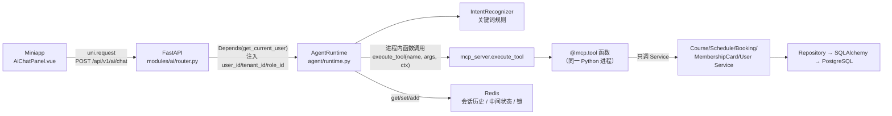
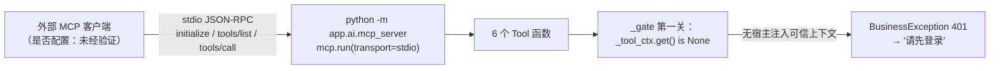
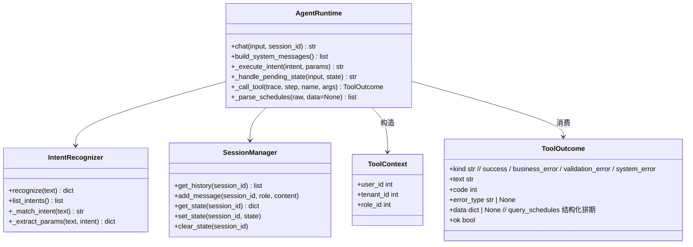

# 小程序 AI 助手 / MCP 现状审计（一）总体概览

> 审计性质：**只读**。本文件不修改任何业务代码、配置、迁移或测试。
> 审计日期：2026-11-06
> 代码基线：当前工作区（未提交改动未纳入比对）
> 审计范围：`apps/api/src/app/ai/`、`apps/api/src/app/modules/ai/router.py`、`apps/miniapp` 的 AI 入口、`apps/api/tests` 中 AI/MCP 相关测试。
> 不在本文件范围：call-flow、深度安全审计、Agent 集成（由并行审计文档负责）。
> **已按交叉验证修订（依据：`apps/api/src/app/ai/mcp_server.py:99-106,161-180,391-475,664-723,726-728`、`agent/runtime.py:700-755`，commit `08031c4`）**。修订明细见 `miniapp-mcp-validation-report.md` §1/§9。

---

## 1. 结论速览

| 问题 | 结论 | 依据 |
|------|------|------|
| FastMCP 实例在哪里 | `apps/api/src/app/ai/mcp_server.py:64`，名称 `dance-saas-agent` | `mcp = FastMCP("dance-saas-agent")` |
| `mcp.run(transport="stdio")` 是否只在 `__main__` 下 | **是**，仅 `mcp_server.py:726-728` | `if __name__ == "__main__": mcp.run(transport="stdio")` |
| `/api/v1/ai/chat` 是否走 MCP 协议 | **否**。没有 MCP Client、initialize、tools/list、tools/call；运行时在**进程内**直接调用 `execute_tool()` | `agent/runtime.py:19,256` → `mcp_server.py:664-723`；全仓无 `fastmcp.Client` / `mcp.Client` / `stdio_client` |
| 是否存在 LLM 调用 | **无**。意图由关键词规则引擎决定，System Prompt 只组装不消费 | `agent/intent.py:5-6,25-43,116-127`；`agent/prompts.py:5-8`；`agent/runtime.py:57,100` |
| 是否有 Resources / Prompts | **无**。全仓只有 `@mcp.tool`，无 `@mcp.resource` / `@mcp.prompt` | `grep` 仅命中 6 处 `@mcp.tool`：`mcp_server.py:348,463,478,526,553,615` |
| Tool 数量 | **6 个**（`TOOL_SPECS` 为单一元数据源） | `mcp_server.py:161-180` |
| FastMCP / MCP SDK 版本 | `fastmcp==3.4.7`、`mcp==1.29.0`（本机已安装环境实测） | `pyproject.toml:20` 声明 `fastmcp>=3.4.7`；`uv run python` 读取 `importlib.metadata` |
| Miniapp 是不是 MCP Client | **不是**。它只通过 `uni.request` 调 HTTP API | `apps/miniapp/src/api/index.ts:219-245,735-754`；`package.json` 无 MCP 依赖 |
| 限流是否生效 | **未生效**。`modules/ai/router.py` 文档声称“请求限流”，但没有 `@rate_limit`，`main.py` 也只定义了 `RATE_LIMIT_CONFIG`，未注册 `RateLimiterMiddleware` | `modules/ai/router.py:5`；`main.py:207-213`；`grep add_middleware(RateLimiter` 仅命中示例注释 |
| RAG 是否可用 | **否**，`Retriever.search()` 返回硬编码假数据，`Embedder.embed()` 返回全 0 向量 | `ai/rag/retriever.py:30-42`；`ai/rag/embedder.py:29-38` |

**一句话判定**：本项目当前是「**FastMCP 注册的 Tool 平台 + 进程内规则引擎 Agent + 普通 REST 入口 + 微信小程序 HTTP 客户端**」；
MCP 协议本身**只具备 stdio 独立运行能力，未被业务链路使用**。

---

## 2. 状态口径

本文所有条目严格使用四类状态：

| 标签 | 含义 |
|------|------|
| **已实现** | 代码中可完整闭环，且可定位到实现点 |
| **部分实现** | 有代码但与声明/契约/消费方不一致，或只覆盖部分场景 |
| **未实现** | 代码中不存在，或只有注释/TODO |
| **未经验证** | 仅凭静态代码无法确认运行时行为（外部配置、真实 MCP 客户端、数据库数据等） |

---

## 3. 项目结构定位

本仓库为 pnpm monorepo（`pnpm-workspace.yaml`：`apps/*` + `packages/*`），AI 相关位置如下：

| 组件 | 路径 | 与 AI/MCP 的关系 |
|------|------|------------------|
| 后端 API | `apps/api` | FastAPI 唯一数据出入口；AI 的 HTTP 出口与 Tool 实现都在这里 |
| AI 能力目录 | `apps/api/src/app/ai/` | `agent/`（规则引擎运行时）、`mcp_server.py`（Tool 注册与执行）、`rag/`（stub） |
| AI HTTP 出口 | `apps/api/src/app/modules/ai/router.py` | `/api/v1/ai/chat`、`/ai/history`、`/ai/intents` |
| 微信小程序 | `apps/miniapp` | 学员端 AI 整页 + 教师端 AI 弹窗；唯一真实消费方 |
| 共享 HTTP 客户端 | `packages/api-client` | **无 AI 方法**；`src` 仅有 auth/bookings/classrooms/common/courses/home-config/index/membership/roles/schedules/teachers/tenant/users |
| 共享类型 | `packages/api-types` | 未见 AI DTO 生成产物（小程序 `AiChatResult` 为本地手写 interface） |

### 3.1 `apps/api/src/app/ai/` 文件清单与作用

| 文件 | 行数 | 作用 | 状态 |
|------|------|------|------|
| `ai/__init__.py` | 2 | 仅注释：唯一 Tool 注册点 + Runtime + RAG | **已实现**（目录声明） |
| `ai/mcp_server.py` | 728 | FastMCP 实例、6 个 `@mcp.tool`、`ToolSpec/TOOL_SPECS`、四关 `_gate`、`ToolBusinessError`、`execute_tool`、stdio 入口 | **已实现** |
| `ai/agent/__init__.py` | 5 | 导出 `AgentRuntime / IntentRecognizer / SessionManager` | **已实现** |
| `ai/agent/intent.py` | 217 | 关键词意图识别 + 参数提取（无 LLM） | **已实现**（规则引擎口径） |
| `ai/agent/runtime.py` | 810 | 对话编排：锁 → 会话状态 → 意图 → `execute_tool` → 文案格式化 → trace | **已实现** |
| `ai/agent/session.py` | 155 | Redis 会话历史 / 中间状态 / 锁 key；`user_id + session_id` 双层隔离 | **已实现**（Redis 不可用时降级为空/无锁） |
| `ai/agent/prompts.py` | 82 | System Prompt 与运行约束文本；当前无 LLM 消费 | **部分实现**（仅日志指纹，无实际注入模型） |
| `ai/rag/retriever.py` | 42 | FAQ 检索类，硬编码返回 1 条假 FAQ | **未实现**（stub） |
| `ai/rag/embedder.py` | 38 | 文本向量化类，返回全 0 向量 | **未实现**（stub） |
| `ai/tools/` | 0 | **空目录**，无任何文件 | **历史残留** |
| `ai/auth/` | 0 | **空目录**，无任何文件 | **历史残留** |
| `modules/ai/router.py` | 119 | `POST /chat`、`GET/DELETE /history`、`GET /intents` | **已实现**（限流声明未实现） |
| `main.py` | — | `include_router(ai_router)`（`main.py:230`） | **已实现** |
| `tests/test_mcp_tool_authorization.py` | — | Tool 四关（401/403/400）测试 | **已实现** |
| `tests/unit/test_ai_p1_tool_platform.py` | — | `execute_tool` / 错误封套 / `TOOL_SPECS` 覆盖测试 | **已实现** |
| `tests/unit/test_ai_p0_stability.py` | — | 意图关键词、card_rule、history 时间戳 | **已实现** |
| `tests/test_agent_runtime.py` | — | Runtime 编排、Tool 结果解析（含 monkeypatch） | **已实现** |
| `tests/test_multi_turn_booking.py` | — | 多轮选课、取消确认 | **已实现** |

> 注：`ai/tools/` 与 `ai/auth/` 在文件系统中存在但为空（`ls` 验证），符合 `.trae/rules/ai/ai-architecture.md` 中“`ai/tools/` 为历史残留”的描述。

---

## 4. 真实调用链

### 4.1 业务主链路（当前线上唯一链路）

关键点：
- 小程序只发 HTTP，不感知 MCP。
- FastAPI 进程内直接 `import` 并调用 `mcp_server.execute_tool`，**没有**经过 MCP 的 JSON-RPC。
- `execute_tool` 通过 `globals()[spec.handler_name]` 取函数（`mcp_server.py:690`），即普通 Python 函数调用。

### 4.2 MCP stdio 链路（存在但未被业务使用）

- `mcp.run` 仅在 `__main__` 分支执行（`mcp_server.py:726-728`），被 FastAPI `import` 时不会启动。
- stdio 模式下没有 HTTP 请求，`tool_context()` 不会被 Runtime 调用（`mcp_server.py:126-141`），因此 `_gate` 第一关必然失败（`mcp_server.py:224-230`）。
- 仓库内**未发现**任何 MCP 客户端配置（`.trae/mcp.json` 不存在，全仓 `Glob **/mcp*.json` 无结果）。外部是否已手动配置 → **未经验证**。

### 4.3 三个角色的真实定位

| 角色 | 真实定位 | 证据 |
|------|----------|------|
| **Miniapp** | **HTTP Client**，不是 MCP Client；也不是“Agent”，只做消息渲染、快捷问题、调接口 | `apps/miniapp/src/api/index.ts:735-754`（`aiChatApi` 三个方法）；`request()` 使用 `uni.request`（同文件 219-269）；`apps/miniapp/package.json` 无 MCP 依赖 |
| **FastAPI** | HTTP 入口 + “MCP Tool 的宿主进程”；负责认证、租户中间件、把身份注入 `AgentRuntime` | `modules/ai/router.py:47-56`；`main.py:205,230`；`mcp_server.py:126-141` |
| **FastMCP** | **Tool 注册与描述层**（`@mcp.tool` 生成 JSON Schema）；可选 stdio Server。**不是** `/ai/chat` 的执行通道 | `mcp_server.py:64,348-643,726-728`；`runtime.py:246-260` |

---

## 5. 核心类 / 函数调用关系

| 调用点 | 被调用方 | 行号 |
|--------|----------|------|
| `chat()` 组装 System Messages | `prompts.build_system_messages` | `runtime.py:101` |
| `chat()` 取分布式锁 | `_acquire_lock` → Redis `SET NX EX` | `runtime.py:107-116,618-637` |
| `chat()` 读中间状态 | `SessionManager.get_state` | `runtime.py:118-129` |
| `chat()` 意图识别 | `IntentRecognizer.recognize` | `runtime.py:139-144` |
| `_execute_intent()` 调 Tool | `execute_tool` | `runtime.py:246-260` |
| 多轮选排期后预约 | `execute_tool("create_booking")` | `runtime.py:453-470` |
| 取消二次确认 | `execute_tool("cancel_booking")` | `runtime.py:512-541` |
| HTTP `/chat` | `AgentRuntime.chat` | `modules/ai/router.py:59-81` |
| HTTP `/history` | `SessionManager.get_history` | `modules/ai/router.py:84-99` |

---

## 6. MCP / Function Calling / REST API 概念区分（落到本项目）

| 概念 | 一般含义 | 本项目实际情况 | 证据 |
|------|----------|----------------|------|
| **REST API** | HTTP + JSON 的业务接口 | `/api/v1/ai/chat` 是普通 FastAPI 端点，返回统一信封 `{code,msg,data}` | `modules/ai/router.py:35-81` |
| **Function Calling** | 由 LLM 输出结构化“要调哪个函数 + 参数” | **不存在**。没有 LLM；意图与参数由正则/关键词产生 | `intent.py:116-194`；`prompts.py:5-8` |
| **MCP Tools** | 通过 MCP 协议暴露给外部客户端的工具（JSON-RPC） | **只注册、未协议调用**。6 个函数被 `@mcp.tool` 装饰，Schema 已生成；Runtime 用 `execute_tool` 直接执行 | `mcp_server.py:348-643,664-723`；`runtime.py:19,256` |
| **Agent Runtime** | 多轮对话编排器 | 存在，但本质是“规则路由 + Tool 调度 + 文案模板”，不是 LLM Agent | `runtime.py:33-175` |

> 误区提醒：不能因为存在 `FastMCP` 就判定“本项目已接入 MCP”。当前 MCP 的价值主要是**统一 Tool 元数据与 JSON Schema**，业务链路并未使用协议层。

---

## 7. 总览级实现状态矩阵

| 能力 | 状态 | 说明 |
|------|------|------|
| FastMCP Tool 注册（6 个） | **已实现** | `mcp_server.py:348-643` |
| Tool JSON Schema（排除身份参数） | **已实现** | 实测 `query_courses/query_schedules/get_my_bookings/get_my_balance/create_booking/cancel_booking` Schema 均无 `user_id/tenant_id`；`create_booking` 必填 `schedule_id`，`cancel_booking` 必填 `booking_id` |
| 四关校验（认证→授权→租户→入参） | **已实现** | `_gate`（`mcp_server.py:212-250`）+ 各 Tool 内校验（`253-310`） |
| `execute_tool` 统一错误封套 | **已实现** | `mcp_server.py:664-723`；业务错误脱敏 `183-188`；`ToolBusinessError`→`business_error`（`99-106,698-705`） |
| stdio MCP Server 可启动 | **已实现**（代码层） | `mcp_server.py:726-728` |
| stdio 下可真实执行 Tool | **未实现**（设计为拒绝） | 无宿主上下文 → 401（`mcp_server.py:224-230`） |
| 外部 MCP 客户端接入 | **未经验证** | 仓库无 MCP 配置；是否有外部手工配置无法从代码确认 |
| LLM 语义理解 / Function Calling | **未实现** | `prompts.py:5-8` 明示“未接入真实 LLM” |
| RAG / 向量检索 | **未实现** | `retriever.py:30-42`、`embedder.py:29-38` 均为假数据 |
| MCP Resources / Prompts | **未实现** | 无 `@mcp.resource` / `@mcp.prompt` |
| HTTP 接口 | **已实现** | `POST /chat`、`GET /history`、`DELETE /history`、`GET /intents` |
| AI 接口限流 | **未实现**（仅注释/配置） | `router.py:5` 声明；`main.py:207-213` 只定义配置；无装饰器、无中间件注册 |
| 小程序 AI 多轮 UI | **已实现** | `AiChatPanel.vue:235-278` |
| 小程序消费 `has_pending_state` | **未实现** | 后端返回（`router.py:78`），小程序 `AiChatResult` 只声明、未使用（`api/index.ts:88-94`、`AiChatPanel.vue:248-258`） |
| 会话隔离 | **已实现** | key 带 `user_id`（`session.py:39-57`） |
| 并发锁 | **部分实现** | Redis 不可用时退化为“无锁直接放行”（`runtime.py:631-637`） |

---

## 8. 主要风险（概览级，细节见代码分析与工具清单文档）

1. **“MCP = 已接入”的认知偏差**：协议层没有客户端；核心链路是进程内函数调用。
2. **写操作 Tool 的错误分类（已修复）**：`create_booking` 在“无可用会员卡”“排期不存在”时改为 `raise ToolBusinessError`（`mcp_server.py:581,588-592`），`execute_tool` 统一映射为 `business_error`（`mcp_server.py:698-705`）；08031c4 之前的“假成功”结论已过期。当前 Runtime 对 `business_error` 直接返回 `outcome.text`，不再追加“预约成功”模板（`runtime.py:453-470`）。
3. **预约结果文本字段为空**：`BookingService.create_booking` / `cancel_booking` 返回 `_to_response(booking)` 未带 `schedule_info`（`booking/service.py:252,368`），导致 Tool 输出“课程：None”“时间：”（`mcp_server.py:606-612,637-643`）。状态：**部分实现**。
4. **`upcoming` 参数死代码**：意图层写入 `params["upcoming"]`（`intent.py:143-146`），Runtime 调 Tool 时未传（`runtime.py:309-315`），`get_my_bookings` 也未接收该参数（`mcp_server.py:478-523`）。
5. **限流声明与实现不一致**：AI 路由无任何限流保护。
6. **RAG 假数据风险**：若未来有人把 `Retriever` 接入对话，会把硬编码 FAQ 当作真实知识库。
7. **Service 异常细节可能透出**：`booking/service.py:360-362` 将原始异常拼进业务消息；Tool 仅靠正则 `_sanitize_business_message`（`mcp_server.py:183-188`）过滤，存在漏网风险（详见安全审计文档）。

---

## 9. 未经验证清单

| 项 | 原因 |
|----|------|
| 外部 MCP 客户端是否真实调用 `tools/list` / `tools/call` | 仓库内无 MCP 配置；运行外部客户端需环境与人工操作，本次仅做静态审计 |
| FastMCP 3.4.7 对 `exclude_args` 的长期支持 | 运行时导入出现 deprecation warning（`exclude_args` 在 2.14 起标记废弃），未来升级可能失效；本次不升级依赖，无法验证后续行为 |
| 小程序真机/开发者工具上的 AI 会话 key 是否与预期一致 | `ai-assistant/index.vue:47` 的 `sessionId` 依赖 `onMounted` 后才赋值的 `userId`；`AiChatPanel.vue:200` 在 setup 阶段一次性取值，静态推断 key 中可能保留 `default`，需真机日志验证 |
| `/ai/chat` 在真实 Redis + PostgreSQL 下的端到端表现 | 本次未启动服务，也未写入任何数据 |
| 真实租户数据下 `query_schedules` 的时间/容量展示 | 依赖数据库数据，静态代码无法确认 |
| 外部是否已有监控采集 `ai_chat_trace` 日志 | 仅能看到日志语句（`runtime.py:212-220`），采集侧未验证 |
