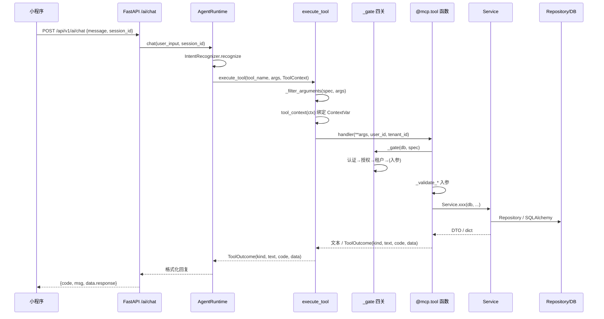

# 小程序 AI 助手 / MCP 现状审计（三）Tool 清单与追踪

> 审计性质：只读。未修改任何业务代码、配置、迁移或测试。
> 事实来源：`apps/api/src/app/ai/mcp_server.py` 实际函数体 + FastMCP 实例反射得到的 JSON Schema + 被调用 Service 的实际签名。
> 重要前提：本项目的 Tool **已通过 `@mcp.tool` 注册**，但业务链路**不经过 MCP 协议**，而是由 `AgentRuntime` 在进程内调用 `execute_tool()`。
> **已按交叉验证修订（依据：`apps/api/src/app/ai/mcp_server.py:99-106,161-180,391-475,664-723,726-728`、`agent/runtime.py:700-755`，commit `08031c4`）**。修订明细见 `miniapp-mcp-validation-report.md` §1/§9。

---

## 1. 注册机制与元数据

### 1.1 注册位置

| 项 | 值 | 行号 |
|----|----|------|
| FastMCP 实例 | `mcp = FastMCP("dance-saas-agent")` | `mcp_server.py:64` |
| 装饰器 | `@mcp.tool(name=..., exclude_args=["user_id", "tenant_id"])` | `348,463,478,526,553,615` |
| 元数据源 | `TOOL_SPECS: dict[str, ToolSpec]` | `161-180` |
| 统一执行入口 | `async def execute_tool(...)` | `664-723` |
| stdio 运行 | `if __name__ == "__main__": mcp.run(transport="stdio")` | `726-728` |

### 1.2 `TOOL_SPECS` 全量

| Tool | 注册行 | 角色（required_roles） | 写操作 | `input_fields` |
|------|--------|------------------------|--------|----------------|
| `query_courses` | `348` | student / teacher / admin / super_admin | 否 | keyword, category, level |
| `query_schedules` | `463` | student / teacher / admin / super_admin | 否 | date, keyword, days |
| `get_my_bookings` | `478` | student / teacher / admin / super_admin | 否 | status |
| `get_my_balance` | `526` | **student only** | 否 | 无 |
| `create_booking` | `553` | **student only** | **是** | schedule_id, membership_card_id |
| `cancel_booking` | `615` | **student only** | **是** | booking_id, reason |

> 角色集合定义：`_READ_ROLES`（`158`）、`_STUDENT_ONLY`（`159`）。
> 注意：`TOOL_SPECS["query_schedules"].handler_name` 已改为 `query_schedules_impl`（`161-180`）；MCP 注册的 `query_schedules`（`463-475`）只是文本入口包装，真实实现在 `391-460` 且返回 `ToolOutcome`（含结构化 `data`）。

### 1.3 实测 JSON Schema（FastMCP 反射结果）

| Tool | required | properties（类型 / 默认 / 描述） |
|------|----------|-----------------------------------|
| `query_courses` | 无 | `keyword: string = ""`；`category: string|null = null`；`level: string|null = null` |
| `query_schedules` | 无 | `date: string|null = null`；`keyword: string = ""`；`days: integer = 7` |
| `get_my_bookings` | 无 | `status: string|null = null` |
| `get_my_balance` | 无 | `{}` |
| `create_booking` | `["schedule_id"]` | `schedule_id: integer`；`membership_card_id: integer|null = null` |
| `cancel_booking` | `["booking_id"]` | `booking_id: integer`；`reason: string|null = null` |

- `exclude_args` 生效：全部 Schema 均**不含** `user_id/tenant_id`。
- `additionalProperties: false`：MCP 客户端传未声明字段会被协议层拒绝（**未经验证**，需真实客户端复现）。
- 版本：`fastmcp==3.4.7`、`mcp==1.29.0`（环境实测）；`pyproject.toml:20` 声明 `fastmcp>=3.4.7`。

---

## 2. 通用执行链路（注册 → 调用 → 参数解析 → Service → 返回）

### 2.1 关键代码点

| 步骤 | 位置 | 行为 |
|------|------|------|
| 参数过滤 | `mcp_server.py:659-661,689` | 只保留 `spec.input_fields` |
| 上下文绑定 | `mcp_server.py:678-687,692` | 无 `ToolContext` → 401；有则同步 3 个 ContextVar |
| 函数解析 | `mcp_server.py:690` | `globals()[spec.handler_name]`（普通 Python 调用，非 JSON-RPC） |
| 调用 | `mcp_server.py:694` | `handler(**args, user_id=..., tenant_id=...)` |
| 错误封套 | `mcp_server.py:698-723` | `ToolBusinessError`/`DanceSaasException` → business_error；其他 → system_error |
| Runtime 调用点 | `runtime.py:246-260` | `execute_tool(tool_name, arguments, self._tool_context())` |

### 2.2 四关校验实现位置

| 关卡 | 实现 | 行号 |
|------|------|------|
| Authentication | `_tool_ctx.get()` 非空 + `user_id/tenant_id` 正整数 | `mcp_server.py:213-223`（Tool 内）+ `678-687`（execute_tool） |
| Authentication（显式身份一致性） | 传入的 `user_id/tenant_id` 必须等于可信上下文 | `224-228` |
| Authorization | `get_user_role_codes` 与 `required_roles` 交集 | `196-209,231-232` |
| Tenant Validation | `get_tenant_id()==ctx.tenant_id` + `UserService.is_user_in_tenant` | `236-239,245-248` |
| Input Validation | 各 Tool 内 `_validate_id/_validate_text/_validate_enum/_parse_date/_validate_days` | `253-310` + 各函数体 |

---

## 3. 逐个 Tool 详情

### 3.1 `query_courses`（注册 `348`，函数体 `348-388`）

| 项 | 内容 |
|----|------|
| 描述 | 搜索课程列表，支持关键词 / 分类 / 难度筛选 |
| 参数 | `keyword: str=""`、`category: str|None`、`level: str|None` |
| 必填 | 无 |
| 校验 | `keyword` 去空格、≤50（`367`）；`category ∈ {yoga,dance,fitness,kids,other}`（`337,368`）；`level ∈ {beginner,intermediate,advanced}`（`338,369`） |
| 执行 | `CourseService().list_courses(db, keyword=..., category=..., level=..., status=1, page=1, page_size=10)`（`371-380`） |
| Service | `CourseService.list_courses`（`modules/course/service.py:532`） |
| 返回 | `"未找到匹配的课程"` 或 `"共 N 门课程：\n- {name}（{category}·{level}）{duration}分钟 ¥{price}"`（`381-388`） |
| 异常 | 本函数不 catch；由 `execute_tool` 统一封套 |
| 权限 | `_READ_ROLES`（学员/教师/管理员/超管） |
| 状态 | **已实现** |

**风险/缺口**
- Runtime 只传 `keyword`（`runtime.py:291-298`），`category/level` 无法从对话触发。
- 分类/等级使用**硬编码枚举**，而课程 DTO 中 `category/level` 是自由字符串（`course/schemas.py:136,138`）；租户自定义分类会被直接判为非法（`_validate_enum`，`mcp_server.py:266-274`）。
- `status=1` 硬编码为 `CourseStatus.ONLINE`（`course/models.py:39-41`），未暴露状态筛选。
- 输出含价格、分类英文 code，未做本地化名称展示（`category_name` 未使用）。

### 3.2 `query_schedules`（MCP 注册 `463`，包装体 `463-475`；真实实现 `query_schedules_impl` `391-460`）

| 项 | 内容 |
|----|------|
| 描述 | 查询指定日期范围内的排期 |
| 参数 | `date: str|None`、`keyword: str=""`、`days: int=7` |
| 必填 | 无 |
| 校验 | `date` 严格 `YYYY-MM-DD`，范围 today-30 ~ today+90（`288-302`）；`keyword` ≤50（`410`）；`days` 1-30（`305-310,411`） |
| 执行 | `start_from = parsed_date or now`；`start_to = start_from + days`（`414-415`）；`ScheduleService.list_schedules(db, course_name=keyword, status=1, start_from, start_to, page=1, page_size=20)`（`417-425`） |
| Service | `ScheduleService.list_schedules`（`modules/schedule/service.py:591`） |
| 返回 | 空：`"{start} 至 {to} 暂无排期"`（`427-430`）；否则每行 `"- ID:{id} | {YYYY-MM-DD} | {HH:MM}-{HH:MM} | {teacher} | 剩余:{n} | {course}"`（`432-448`），并返回 `ToolOutcome(data={"schedules": [...]})`（`449-460`）；MCP 入口只返回 `outcome.text`（`463-475`） |
| 异常 | 由 `execute_tool` 封套 |
| 权限 | `_READ_ROLES` |
| 状态 | **已实现** |

**风险/缺口**
- `status=1` 硬编码 `NORMAL`，不展示已取消/已完成排期（`420`）。
- `start_from` 为当天 00:00（当传入今天时），会包含**今天已过去的排期**；`create_booking` 的“已开始”校验会兜底，但展示层体验不佳。
- Runtime 不传 `days`（`runtime.py:300-307`），固定 7 天。
- 文本格式仍保留为跨层契约：`_safe_cell` 转义单元格（`651-656`），Runtime 优先消费结构化 `data`（`runtime.py:712-727`），文本回退解析仍存在（`runtime.py:729-755`）。风险由“高”降为“中低”（详见第 6 节）。
- 未返回教室信息（`ScheduleResponse` 有 `classroom_name`，但 Tool 未输出）。
- 剩余名额 = `capacity - booked_count`（`443`），未考虑并发实时变化（最终以 Service 预约时校验为准）。

### 3.3 `get_my_bookings`（注册 `478`，函数体 `478-523`）

| 项 | 内容 |
|----|------|
| 描述 | 查询当前用户的预约记录 |
| 参数 | `status: str|None` |
| 必填 | 无 |
| 校验 | `status ∈ {booked,cancelled,checked_in,completed,no_show}`（`339-345,495`） |
| 执行 | `BookingService().list_bookings(db, current_user={user_id,tenant_id}, status=..., page=1, page_size=20, self_only=True)`（`498-507`） |
| Service | `BookingService.list_bookings`（`modules/booking/service.py:1168`） |
| 返回 | `"暂无预约记录"` 或 `"共 N 条预约记录：\n- [{状态}] {MM/DD HH:MM-HH:MM} {课程} 教师：{name}（预约ID: {id}）"`（`509-523`） |
| 异常 | 由 `execute_tool` 封套 |
| 权限 | `_READ_ROLES`；Service `self_only=True` 强制只返回本人数据（`499-500`） |
| 状态 | **已实现**（`upcoming` 能力缺失） |

**风险/缺口**
- Tool 未接收 `upcoming`，`intent.py:145-146` 写入的 `params["upcoming"]` 到 Runtime 后被丢弃（`runtime.py:309-315`）；用户说“还有几节课”仍返回全部状态记录。
- Runtime 传 `status` 但意图对“已取消/取消”会命中 `cancelled`；而 `cancel_booking` 意图优先级更高，存在语义竞争（`intent.py:26-35,179-187`）。
- 列表最多 20 条，无分页参数暴露。
- 教师/管理员也可调用，但只会得到“自己作为学员”的预约（`461-462`），与角色直觉不一致。

### 3.4 `get_my_balance`（注册 `526`，函数体 `526-545`）

| 项 | 内容 |
|----|------|
| 描述 | 查询当前用户课时余额 |
| 参数 | 无业务参数（`Schema={}`） |
| 必填 | 无 |
| 校验 | 无入参；四关由 `_gate` 完成 |
| 执行 | `MembershipCardService().get_user_balance(db, student_id=ctx.user_id, tenant_id=ctx.tenant_id)`（`537-541`） |
| Service | `MembershipCardService.get_user_balance`（`membership/service.py:1194`）→ `MembershipCardRepository.get_balance_by_student`（`membership/repository.py:203-223`） |
| 返回 | `"您的课时余额：\n总购买：{total} 课时\n已消耗：{used} 课时\n剩余：{remaining} 课时"`（`542-545`） |
| 异常 | 由 `execute_tool` 封套 |
| 权限 | **仅 student**（`_STUDENT_ONLY`，`172`） |
| 状态 | **已实现** |

**风险/缺口**
- 只聚合 `status=ACTIVE` 的卡（`repository.py:217`），不含“待激活/冻结/已过期”提示；用户可能困惑“为什么余额是 0”。
- 不区分卡种/单卡余额，无法回答“我的私教卡还剩几次”。
- 汇总 SQL 显式带 `tenant_id`（`repository.py:216`），租户隔离正确。
- `_filter_arguments` 会清空任何外部参数（`spec.input_fields` 为空，`mcp_server.py:659-661`），安全但无法扩展筛选。

### 3.5 `create_booking`（注册 `553`，函数体 `553-612`，**写操作**）

| 项 | 内容 |
|----|------|
| 描述 | 为当前用户预约指定排期 |
| 参数 | `schedule_id: int`（必填）、`membership_card_id: int|None` |
| 必填 | `schedule_id`（Schema `required`） |
| 校验 | `_validate_id(schedule_id,"排期")`（`572`）；`membership_card_id` 非空时同样校验（`573-574`） |
| 执行 | ① 无卡时读排期（`579`），租户不符抛 `ToolBusinessError("排期不存在", 404)`（`580-581`）；② 私教课：`recommend_card_for_schedule` 自动选卡（`582-593`），无可用卡抛 `ToolBusinessError(..., 400, NoUsableCard)`（`587-592`）；③ 组装 `BookingCreate(schedule_id=..., source="self", membership_card_id=...)`（`596-600`）；④ `BookingService().create_booking(db, data, student_id=ctx.user_id)`（`601-605`） |
| Service | `ScheduleService.get_schedule_by_id`（`schedule/service.py:523`）；`MembershipCardService.recommend_card_for_schedule`（`membership/service.py:1139`）；`BookingService.create_booking`（`booking/service.py:72`） |
| 返回 | `"预约成功！\n课程：{result.course_name}\n时间：{MM/DD HH:MM}\n预约ID：{id}"` + 自动选卡提示（`606-612`） |
| 异常 | 本函数抛出的 `ToolBusinessError` 由 `execute_tool:698-705` 转 business_error；Service 的 `DanceSaasException` 由 `706-713` 转 business_error；其他异常走 `714-723` system_error |
| 权限 | **仅 student**（`174`），`_gate` 二次校验 |
| 幂等 | 依赖 Service 的重复预约检查（`booking/service.py:108-110`）+ 行锁/事务；Tool 层未另造幂等键 |
| 状态 | **部分实现**（见风险） |

**风险/缺陷**
1. **假成功（已修复，08031c4）**：无可用卡时改为 `raise ToolBusinessError`（`587-592`），`execute_tool` 映射为 `business_error`（`698-705`）；Runtime 返回失败文案，不再追加“预约成功”模板（`runtime.py:453-470`）。
2. **结果字段为空**：`BookingService.create_booking` 返回 `self._to_response(booking)`（`booking/service.py:252`），`schedule_info` 默认 `{}`，故 `course_name/start_at` 为 `None`（`booking/service.py:1513-1515`）→ Tool 输出“课程：None”“时间：”。
3. 租户不符分支已改为抛 `ToolBusinessError`（`580-581`），分类为 business_error；实际因 `TenantAwareRepository` 会先抛 404，该分支多为不可达的防御代码。
4. Runtime 从不传 `membership_card_id`（`runtime.py:368-373`），普通课无法指定卡；私教课只能自动选卡。
5. `auto_card_note` 只在自动选卡时拼接，未提示具体卡号，用户无法核对。
6. 写操作**没有二次确认**：多轮流程是“选排期即下单”，与 `ai/mcp.md` “写操作必须保留用户确认环节”的精神存在差距（取消流程有确认，预约流程没有）。

### 3.6 `cancel_booking`（注册 `615`，函数体 `615-643`，**写操作**）

| 项 | 内容 |
|----|------|
| 描述 | 取消当前用户的预约 |
| 参数 | `booking_id: int`（必填）、`reason: str|None` |
| 必填 | `booking_id` |
| 校验 | `_validate_id(booking_id,"预约")`（`634`）；`reason` 去空格、≤200（`635`） |
| 执行 | `BookingService().cancel_booking(db, booking_id=..., student_id=ctx.user_id, reason=...)`（`637-642`） |
| Service | `BookingService.cancel_booking`（`booking/service.py:254`）→ `_do_cancel_booking`（`309-368`）：行锁、状态重检、回补课时、commit |
| 返回 | `"取消成功！\n课程：{result.course_name}\n预约ID：{result.id}"`（`643`） |
| 异常 | 由 `execute_tool` 封套；Service 内部回补失败会抛 `BusinessException` 且消息含原始异常（`booking/service.py:358-362`） |
| 权限 | **仅 student**（`178`）；Service 还校验 `booking.student_id == student_id`（`booking/service.py:268-269`） |
| 确认 | Runtime 先进入 `confirming_cancel` 状态，用户回复“是/确认”后才执行（`runtime.py:384-403,505-541`） |
| 状态 | **部分实现**（确认流程已实现；结果字段为空） |

**风险/缺口**
- 结果中 `course_name` 同样为 `None`（`booking/service.py:368` 未传 `schedule_info`）。
- Runtime 没有把 `reason` 传给 Tool（`runtime.py:513-518`），用户即使说明理由也不会入库。
- 取消成功后 Runtime 输出“已成功取消预约 + 处理结果”，其中“处理结果”包含“课程：None”（`runtime.py:538-541`），文案可读性差。
- 未校验“已开始/已签到”等状态由 Service 负责；Tool 不重复实现，分层正确。
- Service 失败消息拼接原始异常（`booking/service.py:360-362`），Tool 仅靠正则脱敏（`mcp_server.py:183-188`），存在透出内部细节的残余风险。

---

## 4. 典型参数解析追踪

| 用户输入示例 | 意图 | 提取参数（`intent.py`） | Runtime 传给 Tool 的实参 | 结果 |
|--------------|------|--------------------------|---------------------------|------|
| “查一下有哪些课程” | `query_courses`（关键词“课程/查”，`42`） | 无 keyword（舞种词表未命中，`155-161`） | `{"keyword": ""}`（`runtime.py:296`） | 返回最多 10 门在线课程 |
| “帮我约明天的瑜伽课” | `create_booking`（“帮我约”，`36`） | `keyword="瑜伽"`、`date=明天`（`133-141`） | 先 `query_schedules {"date":..., "keyword":"瑜伽"}`（`341-346`） | 返回数字选项并存状态；用户选号后 `create_booking {"schedule_id": ...}` |
| “明天有什么课” | `query_schedules`（“明天/有什么课”，`40`） | `date=明天` | `{"date":..., "keyword":""}`（`300-305`） | 展示 7 天内排期 |
| “我的预约记录” | `get_my_bookings`（`32`） | `status=None` | `{"status": None}`（`314`） | 全部预约最多 20 条 |
| “还有几节课” | `get_my_bookings`（“还有几节”，`34`） | `upcoming=True`（`145-146`） | `{"status": None}`，`upcoming` **被丢弃** | 返回全部预约（含已取消/已完成）→ 语义不符 |
| “我的课时余额还剩多少” | `get_my_balance`（`27-30`） | 无 | `{}`（`318-325`） | 聚合余额 |
| “取消预约 1001” | `cancel_booking`（`26`） | `booking_id=1001`（`189-194`） | 先 `confirming_cancel`，确认后 `{"booking_id":1001}` | 取消成功；`reason` 不传 |
| “用常规卡约私教课” | `card_rule`（`37`） | 无 | **不调用任何 Tool**（`runtime.py:327-334`） | 返回硬编码卡规则文案 |

**追踪结论**：`intent.py` 中的参数提取能力 > Runtime 实际透传能力 > Tool 实际使用能力。三处存在“断点”，详见第 6 节。

---

## 5. 缺失的 Tool（能力有 Service / REST，但未暴露给 AI）

| 缺失能力 | 现有 Service / REST 证据 | 是否适合暴露 | 风险说明 |
|----------|--------------------------|--------------|----------|
| 会员卡列表 | `GET /membership/my-cards`（`membership/router.py:252`）；`MembershipCardService.get_student_active_cards`（`membership/service.py:1185`） | 高 | 用户问“我有哪些卡”无法回答 |
| 会员卡详情 | `GET /membership/cards/{card_id}`（`router.py:284`）；`get_card`（`service.py:495`）、`get_card_for_requester`（`505`） | 高 | 余额只能看聚合值 |
| 消费流水 | `GET /membership/transactions`（`router.py:589`）；`list_transactions`（`service.py:1208`） | 中 | 用户问“扣了几次”无法解释 |
| 冻结 / 解冻卡 | `POST /cards/{id}/freeze`（`router.py:333`）、`/unfreeze`（`425`）、`/student-unfreeze`（`476`）；`freeze_card`（`service.py:1291`）、`unfreeze_card`（`1502`）、`student_unfreeze_card`（`1544`） | 中（写操作） | 涉及金额/有效期状态机，L4 风险；必须有确认 |
| 课程详情 | `CourseService.get_course_by_id`（`course/service.py:521`）；`GET /courses/{id}` | 中 | 只能看列表摘要，不能回答“课程介绍/适合谁” |
| 排期详情 | `ScheduleService.get_schedule_by_id`（`schedule/service.py:523`）；`GET /schedules/{id}` | 中 | 选课阶段看不到教室/教师简介 |
| 教师列表 / 详情 | `TeacherService.get_teachers_by_tenant`（`teacher/service.py:28`）、`get_teacher_by_user_id`（`63`） | 中 | 用户问“王老师教什么”无法回答 |
| 教室列表 / 详情 | `ClassroomService.list_classrooms`（`classroom/service.py:183`）、`get_classroom_by_id`（`172`） | 低 | 通常不是学员高频问题 |
| 改期 / 改派 | `BookingService.reschedule_booking`（`booking/service.py:370`）；`BookingRescheduleRequest`（`booking/schemas.py:20-27`） | 中（写操作） | 状态机+锁顺序复杂，L4；短期不建议直接暴露 |
| 会员卡推荐（独立） | `MembershipCardService.recommend_card_for_schedule`（`membership/service.py:1139`） | 高 | 当前仅被 `create_booking` 内部使用，无法单独回答“我该用哪张卡” |
| 激活卡 | `POST /cards/{id}/activate`（`router.py:460`）、`admin-activate`（`492`） | 低 | 学员端流程通常由页面完成 |
| 签到 / 完成状态 | 管理端能力；AI 当前仅查询状态 | 低 | 超出学员助手范围 |

> 缺失清单只列“已有 Service / REST 可复用”的能力；不包含从零新建的业务（如营销活动、退款）。

---

## 6. 重复业务逻辑与契约风险

| # | 重复/耦合点 | 代码位置 | 风险等级 | 说明 |
|---|-------------|----------|----------|------|
| 1 | 排期文本格式契约 | `mcp_server.py:432-460` ↔ `runtime.py:700-755` | 中（已缓解） | `_safe_cell` 已转义（`651-656`），Runtime 优先用 `data`（`712-727`）；文本回退仍依赖正则，格式变化会静默失败 |
| 2 | 卡规则文案硬编码 | `runtime.py:327-334` | 中 | “常规课→常规卡 / 特色课→特色卡 / 私教课→私教次卡”写在 Runtime；真实可用性判定在 `membership/service.py:1139-1183`。规则变更需改两处 |
| 3 | 预约/取消成功文案 | `mcp_server.py:609-612,643` ↔ `runtime.py:479-486,538-541` | 中 | Runtime 自己再拼成功模板，Tool 文本作为“详情”嵌套，出现“课程：None”重复暴露 |
| 4 | Service 异常文案 → Runtime 关键词映射 | `runtime.py:579-612` ↔ 各 Service `BusinessException` 文案 | 中 | 通过中文字符串子串匹配决定用户提示；Service 改文案会导致兜底 |
| 5 | 分类/等级枚举硬编码 | `mcp_server.py:337-338` ↔ `course/schemas.py:136,138` | 中 | DTO 允许任意字符串，Tool 只允许固定枚举；与租户自定义分类冲突 |
| 6 | `status=1` 魔法值 | `mcp_server.py:376,420` ↔ `course/models.py:39-41`、`schedule` 状态枚举 | 低 | 直接在 Tool 层写 1，未引用枚举常量 |
| 7 | 意图关键词与 Tool 能力重复描述 | `intent.py:25-43` ↔ `mcp_server.py:161-180` | 中 | 两套“能力清单”，新增 Tool 不会自动进入意图路由（`INTENT_TOOL_MAP`，`runtime.py:23-30` 也需手改） |
| 8 | 角色校验两套 | `mcp_server.py:196-209` ↔ `core/rbac` 装饰器体系 | 中 | Tool 用 `get_user_role_codes` 自行判定，与 REST 的 `@require_permissions` 口径不同；新增权限点时易漏 |
| 9 | 身份参数双通道 | FastMCP Schema 排除 `user_id/tenant_id`（`exclude_args`）↔ Tool 签名仍保留并接受显式参数（`338-344` 等） | 低 | 兼容旧调用方的设计，但增加误用面 |

**没有发现的重复**（值得肯定）：
- 容量校验、重复预约、开课时间、两周窗口、扣次、取消窗口、回补课时全部在 `BookingService` / `MembershipCardService`，Tool 未复制（`booking/service.py:84-131,309-368`）。
- Tool 未直接访问 Repository / 裸 SQL / Redis（依赖清单 `mcp_server.py:47-59`）。

---

## 7. 测试覆盖矩阵

| Tool | 授权/入参测试 | 业务结果测试 | 真实 Service 集成 | 备注 |
|------|----------------|--------------|-------------------|------|
| `query_courses` | 仅 `TOOL_SPECS` 覆盖（`test_ai_p1_tool_platform.py:331-343`） | 未见 | 未见 | 分类/等级非法值未测 |
| `query_schedules` | 未见 | `data` 优先 + 文本回退解析（`test_ai_p1_tool_platform.py:398-434`；`test_agent_runtime.py:108-110`） | 未见 | 依赖格式契约（已缓解） |
| `get_my_bookings` | 未见 | 未见 | 未见 | `upcoming` 缺失无测试 |
| `get_my_balance` | 四关矩阵 | fake Service（`test_ai_p1_tool_platform.py:47-53,207-223`） | 未见 | 仅 ACTIVE 聚合未测 |
| `create_booking` | 401/403/400（`test_mcp_tool_authorization.py:107-176`） | DTO 契约 + 无卡 business_error（`test_ai_p1:289-318,356-371`） | 未见 | 已有 business_error 用例 |
| `cancel_booking` | 401/403/400（`test_mcp_tool_authorization.py:179-229`） | 未见 | 未见 | 无 `course_name=None` 用例 |

---

## 8. 未经验证清单

| 项 | 原因 |
|----|------|
| MCP 客户端经 `tools/call` 调用时的参数强制类型行为 | 需真实 MCP 客户端；本次仅反射 Schema。`schedule_id: integer` 是否会把字符串 `"1"` 拒绝或强转，未验证 |
| `additionalProperties: false` 的协议层拒绝行为 | 同上 |
| `exclude_args` 在 fastmcp 3.4.7 的运行时表现 | 导入时出现 deprecation warning；Schema 反射确认已排除身份字段，但未来版本行为未验证 |
| `create_booking` 在真实 DB 下的 `result.course_name` | 静态代码推断为 `None`（`booking/service.py:252,1513`），未运行真实预约验证 |
| 无可用会员卡时多轮流程的真实用户可见文案 | 已由单测覆盖 `business_error` 分类（`test_ai_p1:356-371`），但未做真实 DB + 小程序端到端复现 |
| 并发预约/取消下 Tool 的表现 | 依赖 Service 行锁；本次未做并发压测 |
| stdio MCP 模式在外部客户端中的失败提示 | 代码设计为 401；无客户端环境复现 |
