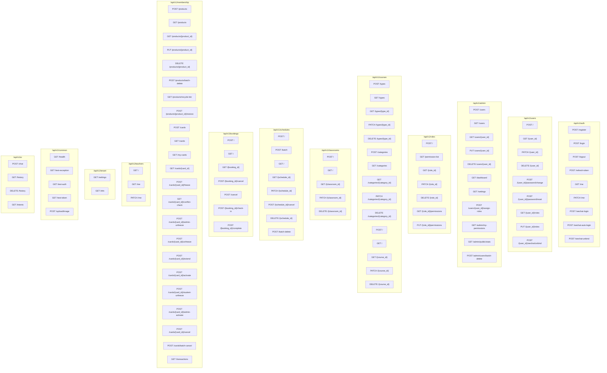

# API

## Purpose

本文档描述 class_booking_system 的 HTTP API 端点设计、认证方式、统一响应格式及各模块路由清单。所有端点来自 FastAPI router 定义（`apps/api/src/app/modules/*/router.py`）。

## Current Implementation

### 基础信息

| 项目 | 值 |
|------|------|
| Base URL | `http://host:port/api/v1` |
| 协议 | HTTP/JSON |
| API 版本前缀 | `/api/v1`（main.py API_V1_PREFIX） |
| 自动文档 | `/docs`（Swagger UI）、`/redoc`、`/openapi.json` |
| CORS | 配置为 `allow_origins`（Pydantic settings.cors_origins_list）、`allow_credentials=True` |
| Tenant Header | `x-tenant-id`（租户数字 ID）或 `x-tenant-slug`（租户 slug） |
| Auth Header | `Authorization: Bearer {access_token}` |

### 统一响应格式

apps/api/src/app/core/response.py：

```python
def success(data=None, msg="操作成功") -> dict:
    return {"code": 0, "msg": msg, "data": data}

# 错误时由 exception handler 返回:
# {"code": <int>, "msg": <str>, "detail": <any>}
# code: 401=Auth  403=Permission  404=NotFound  422=Validation  400=Business  500=Server
```

### 统一错误码

apps/api/src/app/core/exceptions.py：

| 异常类 | HTTP 状态码 | code | 触发条件 |
|--------|------------|------|----------|
| AuthException | 401 | 401 | Token 无效/过期/黑名单 |
| PermissionException | 403 | 403 | 无权限（RBAC 检查失败） |
| NotFoundException | 404 | 404 | 资源不存在 |
| ValidationException | 422 | 422 | 参数校验失败 |
| BusinessException | 400 | 400 | 业务规则冲突（如重复预约） |
| DatabaseException | 500 | 500 | 数据库异常 |

### 统一分页参数

多个 list 端点使用：
- `page`（默认 1）
- `page_size`（默认 20，max 500）

返回格式通常为：`{"items": [...], "total": int, "page": int, "page_size": int}`

### tenant_id 传递方式

所有业务路由（除 `/auth/register`、`/docs` 等白名单路径外）必须携带租户信息：
- `x-tenant-id: <int>`
- `x-tenant-slug: <string>`（二选一）

TenantASGIMiddleware 会：
1. 从 Header 提取 tenant_id 或 tenant_slug
2. 校验租户存在且 status=ACTIVE
3. 写入 ContextVar（`tenant_context.set_tenant_id`）
4. 失败返回 400

白名单路径（middleware 跳过检查）：
- `/docs`, `/redoc`, `/openapi.json`
- `/health`, `/api/v1/common/health`
- `/api/v1/auth/login`
- `/api/v1/auth/register`
- `/api/v1/auth/wechat-login`
- `/api/v1/auth/wechat-auto-login`
- `/uploads/*`

### 认证依赖注入

`deps/auth.py` 提供 `get_current_user`，使用方法：

```python
current_user: dict = Depends(get_current_user)
# current_user 包含: user_id, tenant_id, platform_role, role_codes
```

RBAC 装饰器：
- `@require_permissions("booking:manage")` - 需要特定权限码
- `@require_roles("admin", "super_admin")` - 需要特定角色

## Architecture

### 路由总览



## Important Rules

### 端点详细清单（按模块）

#### Auth（modules/auth/router.py）

| Method | Path | Auth | RBAC | 说明 |
|--------|------|------|------|------|
| POST | `/api/v1/auth/register` | 否 | - | 注册 |
| POST | `/api/v1/auth/login` | 否 | - | 账号密码登录 |
| POST | `/api/v1/auth/logout` | 是 | - | 登出（Token 加黑名单） |
| POST | `/api/v1/auth/refresh-token` | 否（需 refresh_token） | - | 刷新 Access Token |
| GET | `/api/v1/auth/me` | 是 | - | 获取当前用户信息 |
| PATCH | `/api/v1/auth/me` | 是 | - | 更新当前用户信息 |
| POST | `/api/v1/auth/wechat-login` | 否 | - | 微信扫码登录 |
| POST | `/api/v1/auth/wechat-auto-login` | 否 | - | 微信自动登录 |
| POST | `/api/v1/auth/wechat-unbind` | 是 | - | 解绑微信 |

#### User（modules/user/router.py）

| Method | Path | Auth | RBAC | 说明 |
|--------|------|------|------|------|
| POST | `/api/v1/users/` | 是 | - | 创建用户 |
| GET | `/api/v1/users/{user_id}` | 是 | - | 获取用户详情 |
| PATCH | `/api/v1/users/{user_id}` | 是 | - | 更新用户 |
| DELETE | `/api/v1/users/{user_id}` | 是 | - | 删除用户 |
| POST | `/api/v1/users/{user_id}/password/change` | 是 | - | 修改密码 |
| POST | `/api/v1/users/{user_id}/password/reset` | 是 | - | 重置密码 |
| GET | `/api/v1/users/{user_id}/roles` | 是 | - | 获取用户角色列表 |
| PUT | `/api/v1/users/{user_id}/roles` | 是 | - | 更新用户角色 |
| POST | `/api/v1/users/{user_id}/wechat/unbind` | 是 | - | 解绑微信 |

#### Admin（modules/admin/router.py）

| Method | Path | Auth | RBAC | 说明 |
|--------|------|------|------|------|
| POST | `/api/v1/admin/users` | 是 | - | 管理员创建用户 |
| GET | `/api/v1/admin/users` | 是 | - | 管理员用户列表 |
| GET | `/api/v1/admin/users/{user_id}` | 是 | - | 管理员用户详情 |
| PUT | `/api/v1/admin/users/{user_id}` | 是 | - | 管理员更新用户 |
| DELETE | `/api/v1/admin/users/{user_id}` | 是 | - | 管理员删除用户 |
| GET | `/api/v1/admin/dashboard` | 是 | - | 仪表盘数据 |
| GET | `/api/v1/admin/settings` | 是 | - | 管理配置 |
| POST | `/api/v1/admin/users/{user_id}/assign-roles` | 是 | - | 分配角色 |
| GET | `/api/v1/admin/my-permissions` | 是 | - | 当前用户权限列表 |
| GET | `/api/v1/admin/public/stats` | 否 | - | 公开统计（白名单） |
| POST | `/api/v1/admin/users/batch-delete` | 是 | - | 批量删除用户 |

#### Role（modules/role/router.py）

| Method | Path | Auth | RBAC | 说明 |
|--------|------|------|------|------|
| POST | `/api/v1/roles/` | 是 | - | 创建角色 |
| GET | `/api/v1/roles/permission-list` | 是 | - | 权限字典列表 |
| GET | `/api/v1/roles/{role_id}` | 是 | - | 角色详情 |
| PATCH | `/api/v1/roles/{role_id}` | 是 | - | 更新角色 |
| DELETE | `/api/v1/roles/{role_id}` | 是 | - | 删除角色 |
| GET | `/api/v1/roles/{role_id}/permissions` | 是 | - | 角色权限列表 |
| PUT | `/api/v1/roles/{role_id}/permissions` | 是 | - | 更新角色权限 |

#### Course Type（modules/course/router.py）

| Method | Path | Auth | RBAC | 说明 |
|--------|------|------|------|------|
| POST | `/api/v1/courses/types` | 是 | - | 创建课程类型 |
| GET | `/api/v1/courses/types` | 是 | - | 类型列表 |
| GET | `/api/v1/courses/types/{type_id}` | 是 | - | 类型详情 |
| PATCH | `/api/v1/courses/types/{type_id}` | 是 | - | 更新类型 |
| DELETE | `/api/v1/courses/types/{type_id}` | 是 | - | 删除类型 |

#### Course Category（modules/course/router.py）

| Method | Path | Auth | RBAC | 说明 |
|--------|------|------|------|------|
| POST | `/api/v1/courses/categories` | 是 | - | 创建分类 |
| GET | `/api/v1/courses/categories` | 是 | - | 分类列表 |
| GET | `/api/v1/courses/categories/{category_id}` | 是 | - | 分类详情 |
| PATCH | `/api/v1/courses/categories/{category_id}` | 是 | - | 更新分类 |
| DELETE | `/api/v1/courses/categories/{category_id}` | 是 | - | 删除分类 |

#### Course（modules/course/router.py）

| Method | Path | Auth | RBAC | 说明 |
|--------|------|------|------|------|
| POST | `/api/v1/courses/` | 是 | - | 创建课程 |
| GET | `/api/v1/courses/` | 是 | - | 课程列表 |
| GET | `/api/v1/courses/{course_id}` | 是 | - | 课程详情 |
| PATCH | `/api/v1/courses/{course_id}` | 是 | - | 更新课程 |
| DELETE | `/api/v1/courses/{course_id}` | 是 | - | 删除课程 |

#### Classroom（modules/classroom/router.py）

| Method | Path | Auth | RBAC | 说明 |
|--------|------|------|------|------|
| POST | `/api/v1/classrooms/` | 是 | - | 创建教室 |
| GET | `/api/v1/classrooms/` | 是 | - | 教室列表 |
| GET | `/api/v1/classrooms/{classroom_id}` | 是 | - | 教室详情 |
| PATCH | `/api/v1/classrooms/{classroom_id}` | 是 | - | 更新教室 |
| DELETE | `/api/v1/classrooms/{classroom_id}` | 是 | - | 删除教室 |

#### Schedule（modules/schedule/router.py）

| Method | Path | Auth | RBAC | 说明 |
|--------|------|------|------|------|
| POST | `/api/v1/schedules/` | 是 | - | 创建排期 |
| POST | `/api/v1/schedules/batch` | 是 | - | 批量创建排期 |
| GET | `/api/v1/schedules/` | 是 | - | 排期列表 |
| GET | `/api/v1/schedules/{schedule_id}` | 是 | - | 排期详情 |
| PATCH | `/api/v1/schedules/{schedule_id}` | 是 | - | 更新排期 |
| POST | `/api/v1/schedules/{schedule_id}/cancel` | 是 | - | 取消排期 |
| DELETE | `/api/v1/schedules/{schedule_id}` | 是 | - | 删除排期 |
| POST | `/api/v1/schedules/batch-delete` | 是 | - | 批量删除 |

#### Booking（modules/booking/router.py）

| Method | Path | Auth | RBAC | 说明 |
|--------|------|------|------|------|
| POST | `/api/v1/bookings/` | 是 | - | 创建预约 |
| GET | `/api/v1/bookings/` | 是 | - | 预约列表 |
| GET | `/api/v1/bookings/{booking_id}` | 是 | - | 预约详情 |
| POST | `/api/v1/bookings/{booking_id}/cancel` | 是 | - | 取消预约 |
| POST | `/api/v1/bookings/cancel` | 是 | - | 批量取消 |
| POST | `/api/v1/bookings/{booking_id}/check-in` | 是 | require_permissions("booking:manage") | 签到 |
| POST | `/api/v1/bookings/{booking_id}/complete` | 是 | require_permissions("booking:manage") | 标记完成 |

#### Membership Product（modules/membership/router.py）

| Method | Path | Auth | RBAC | 说明 |
|--------|------|------|------|------|
| POST | `/api/v1/membership/products` | 是 | - | 创建产品 |
| GET | `/api/v1/membership/products` | 是 | - | 产品列表 |
| GET | `/api/v1/membership/products/{product_id}` | 是 | - | 产品详情 |
| PUT | `/api/v1/membership/products/{product_id}` | 是 | - | 更新产品 |
| DELETE | `/api/v1/membership/products/{product_id}` | 是 | - | 删除产品（软删除） |
| POST | `/api/v1/membership/products/batch-delete` | 是 | - | 批量删除 |
| GET | `/api/v1/membership/products/recycle-bin` | 是 | - | 回收站 |
| POST | `/api/v1/membership/products/{product_id}/restore` | 是 | - | 恢复产品 |

#### Membership Card（modules/membership/router.py）

| Method | Path | Auth | RBAC | 说明 |
|--------|------|------|------|------|
| POST | `/api/v1/membership/cards` | 是 | - | 发放卡 |
| GET | `/api/v1/membership/cards` | 是 | - | 卡列表（管理端） |
| GET | `/api/v1/membership/my-cards` | 是 | - | 我的卡（学员端） |
| GET | `/api/v1/membership/cards/{card_id}` | 是 | - | 卡详情 |
| POST | `/api/v1/membership/cards/{card_id}/freeze` | 是 | - | 冻结卡 |
| GET | `/api/v1/membership/cards/{card_id}/conflict-check` | 是 | - | 冻结冲突检查 |
| POST | `/api/v1/membership/cards/{card_id}/admin-unfreeze` | 是 | - | 管理员解冻 |
| POST | `/api/v1/membership/cards/{card_id}/unfreeze` | 是 | - | 解冻 |
| POST | `/api/v1/membership/cards/{card_id}/extend` | 是 | - | 延长有效期 |
| POST | `/api/v1/membership/cards/{card_id}/activate` | 是 | - | 学员激活 |
| POST | `/api/v1/membership/cards/{card_id}/student-unfreeze` | 是 | - | 学员提前解冻 |
| POST | `/api/v1/membership/cards/{card_id}/admin-activate` | 是 | require_roles("admin","super_admin") | 管理员激活 |
| POST | `/api/v1/membership/cards/{card_id}/cancel` | 是 | require_roles("admin","super_admin") | 作废卡 |
| POST | `/api/v1/membership/cards/batch-cancel` | 是 | require_roles("admin","super_admin") | 批量作废 |
| GET | `/api/v1/membership/transactions` | 是 | - | 消费流水列表 |

#### Teacher（modules/teacher/router.py）

| Method | Path | Auth | RBAC | 说明 |
|--------|------|------|------|------|
| GET | `/api/v1/teachers/` | 是 | - | 教师列表 |
| GET | `/api/v1/teachers/me` | 是 | - | 当前教师信息 |
| PATCH | `/api/v1/teachers/me` | 是 | - | 更新当前教师信息 |

#### Tenant（modules/tenant/router.py）

| Method | Path | Auth | RBAC | 说明 |
|--------|------|------|------|------|
| GET | `/api/v1/tenant/settings` | 是 | - | 租户配置 |
| GET | `/api/v1/tenant/info` | 是 | - | 租户基本信息 |

#### Common（modules/common/router.py）

| Method | Path | Auth | RBAC | 说明 |
|--------|------|------|------|------|
| GET | `/api/v1/common/health` | 否 | - | 健康检查（白名单） |
| GET | `/api/v1/common/test-exception` | 否 | - | 测试异常处理 |
| GET | `/api/v1/common/test-auth` | 是 | - | 测试认证 |
| GET | `/api/v1/common/test-token` | 否 | - | 生成测试 Token |
| POST | `/api/v1/common/upload/image` | 是 | - | 上传图片（2MB） |

#### AI（modules/ai/router.py）

| Method | Path | Auth | RBAC | 说明 |
|--------|------|------|------|------|
| POST | `/api/v1/ai/chat` | 是 | - | AI 对话 |
| GET | `/api/v1/ai/history` | 是 | - | 对话历史 |
| DELETE | `/api/v1/ai/history` | 是 | - | 清空历史 |
| GET | `/api/v1/ai/intents` | 是 | - | 支持的意图列表 |

## Dependencies

### 中间件顺序（FastAPI 注册顺序）

```
1. CORSMiddleware            (app.add_middleware 第一个)
2. TenantASGIMiddleware      (app.add_middleware 第二个)
3. （RateLimiterMiddleware   未全局注册，lifespan 中动态添加——TODO 注释中提到但未实现）
4. 路由层                    (app.include_router)
5. ExceptionHandler          (app.add_exception_handler)
```

注意：FastAPI 的 `add_middleware` 是反向注册（后注册的先执行），所以实际执行顺序是：
```
TenantASGIMiddleware → CORSMiddleware → 路由
```

但 TenantASGIMiddleware 是纯 ASGI 中间件，不依赖 BaseHTTPMiddleware，避免了 asyncio 冲突。

### 依赖注入链

```python
get_session()           → SessionLocal()           → AsyncSession
get_redis_client()      → aioredis.from_url()      → Redis 连接池
get_current_user()      → get_redis_client() + JWT decode → dict
require_permissions()   → get_current_user() + RBAC check
require_roles()         → get_current_user() + RBAC role check
```

## Common Failure Points

1. **tenant_id 在非 HTTP 上下文中缺失**：APScheduler 定时任务没有 HTTP 请求，ContextVar 为空，`tenant_query.py` 事件会注入 `WHERE tenant_id = NULL`，导致查不到数据（定时任务内部通常手动传 tenant_id）
2. **Router include_router 的 prefix 与 Router 自身 prefix 叠加**：main.py 用 `include_router(ai_router)` 不带 prefix，因为 ai/router.py 自身 prefix 是 `/api/v1/ai`；其他 router 是 `include_router(xxx_router, prefix="/api/v1")`
3. **Response model 统一为 dict**：大部分 router 没指定 response_model，返回 `dict`（通过 `success()` 函数构造）。AI router 指定了 Pydantic response_model
4. **`@router.get("/", ...)` 和 `@router.get("")` 混用**：schedule/router.py 里是 `@router.get("")`，course/router.py 里有的是 `@router.get("/")`，FastAPI redirect_slashes=False 会导致 `GET /courses` vs `GET /courses/` 表现不同
5. **权限绕过开关**：PERMISSION_CHECK_BYPASS = True 硬编码，所有 require_permissions / require_roles 装饰器直接放行，RBAC 形同虚设
6. **router.py 里 RBAC 装饰器只在少数端点使用**：booking 的 check-in/complete，membership 的 admin 端点；大多数端点没有 RBAC，只靠 get_current_user 登录校验
7. **Schedule 的 batch router 使用 batch create**：但没有 list teachers、list courses 等通用查询的显式 router（可能在 schedule service 内部查询）

## TODO / Known Issues

- [ ] PERMISSION_CHECK_BYPASS 硬编码为 True，生产环境必须关闭
- [ ] RateLimiterMiddleware 未在 main.py 全局注册
- [ ] 统一列表端点的路径风格：`GET /courses` vs `GET /courses/`
- [ ] Admin router 和 User router 功能有重叠（都有用户 CRUD），职责边界不清晰
- [ ] 大多数 router 端点没有显式 RBAC 权限校验
- [ ] Response model 统一使用 dict，缺少 OpenAPI schema 文档
- [ ] `redirect_slashes=False` 配置下，GET /courses vs GET /courses/ 可能行为不一致
- [ ] 部分 Service 层函数名与 router 端点名不完全映射，中间经过多层封装
