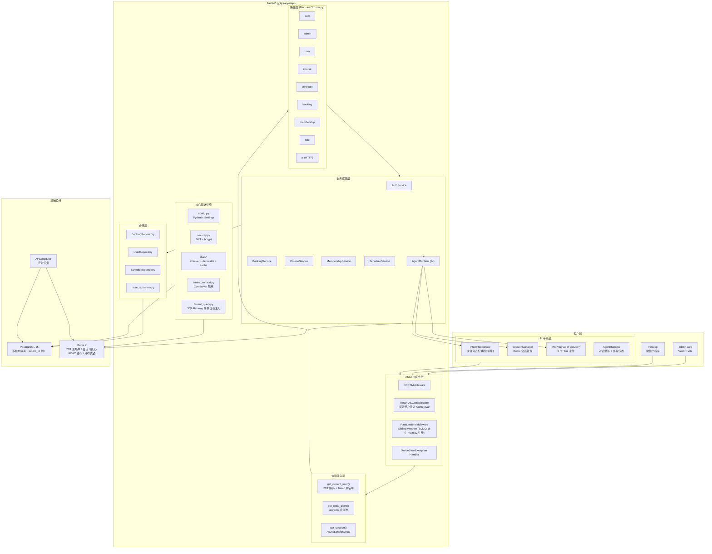
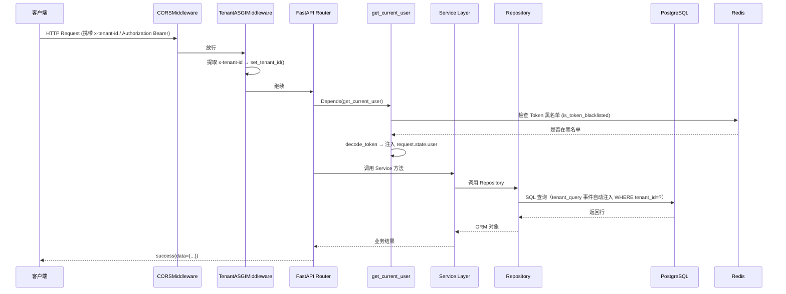
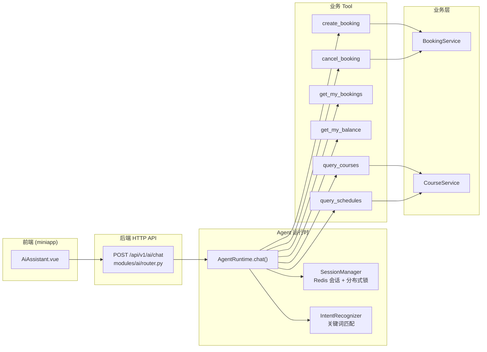

# Architecture

## Purpose

本文档描述 class_booking_system（舞蹈机构约课 SaaS）的整体技术架构，包括系统分层、模块划分、关键技术选型及各组件间的调用关系。

## Current Implementation

### 技术栈

| 层级 | 技术 | 版本/说明 |
|------|------|-----------|
| 语言 | Python | 3.12 |
| Web 框架 | FastAPI | latest（使用 async 依赖注入） |
| ORM | SQLAlchemy | >=2.0（async engine + do_orm_execute 事件） |
| 数据库 | PostgreSQL | 15-alpine |
| 缓存/队列 | Redis | 7-alpine |
| 定时任务 | APScheduler | AsyncIOScheduler |
| MCP 协议 | FastMCP | 用于 AI Tool 注册 |
| AI | 规则引擎（关键词匹配） | IntentRecognizer + AgentRuntime |
| 数据迁移 | Alembic | 28+ migration 文件 |
| 包管理 | uv | Python 依赖管理 |
| 前端（管理后台） | Vue 3 + Vite | apps/admin-web |
| 前端（小程序） | 微信小程序 | apps/miniapp |
| 容器化 | Docker Compose | dev/prod 两套配置 |
| CI | GitHub Actions | ci.yml + deploy.yml |
| 部署 | ECS + SSH + Docker Compose | 生产环境 |
| Web 服务器 | Nginx | 生产环境反向代理（infra/nginx/nginx.conf） |

### 项目目录结构

```
class_booking_system/
├── apps/
│   ├── api/                          # 后端 API 服务
│   │   ├── alembic/                  # Alembic 迁移
│   │   ├── docs/
│   │   ├── scripts/                  # seed、openapi 生成、test_api.sh
│   │   ├── src/app/
│   │   │   ├── ai/                   # AI 模块
│   │   │   │   ├── agent/            # Agent 运行时
│   │   │   │   ├── auth/             # AI 认证中间件（TODO）
│   │   │   │   ├── rag/              # RAG 检索（stub）
│   │   │   │   ├── tools/            # AI Tool 定义（未实际使用）
│   │   │   │   ├── context.py
│   │   │   │   └── mcp_server.py     # MCP Server（核心）
│   │   │   ├── core/                 # 核心基础设施
│   │   │   │   ├── oss/              # 对象存储服务
│   │   │   │   ├── rbac/             # RBAC 权限系统
│   │   │   │   ├── base_repository.py
│   │   │   │   ├── config.py
│   │   │   │   ├── database.py
│   │   │   │   ├── exceptions.py
│   │   │   │   ├── response.py
│   │   │   │   ├── security.py
│   │   │   │   ├── tenant_context.py
│   │   │   │   └── tenant_query.py
│   │   │   ├── deps/auth.py          # FastAPI 依赖注入
│   │   │   ├── middleware/           # ASGI 中间件
│   │   │   │   ├── error_handler.py
│   │   │   │   ├── rate_limiter.py
│   │   │   │   └── tenant_middleware.py
│   │   │   ├── modules/              # 业务模块（13 个）
│   │   │   │   ├── admin/
│   │   │   │   ├── ai/               # AI HTTP 路由
│   │   │   │   ├── auth/
│   │   │   │   ├── booking/
│   │   │   │   ├── classroom/
│   │   │   │   ├── common/
│   │   │   │   ├── course/
│   │   │   │   ├── membership/
│   │   │   │   ├── role/
│   │   │   │   ├── schedule/
│   │   │   │   ├── tenant/
│   │   │   │   ├── teacher/
│   │   │   │   └── user/
│   │   │   ├── shared/base_model.py  # Base / TenantMixin / TimestampMixin
│   │   │   ├── main.py               # FastAPI 入口
│   │   │   └── models.py             # 所有模型聚合入口（Alembic 依赖）
│   │   ├── tests/
│   │   ├── uploads/                 # 静态文件（头像等）
│   │   ├── Dockerfile
│   │   └── pyproject.toml
│   ├── admin-web/                    # 管理后台（Vue 3）
│   └── miniapp/                      # 学员端小程序
├── infra/
│   ├── docker/
│   │   ├── docker-compose.yml        # 开发环境
│   │   └── docker-compose.prod.yml   # 生产环境
│   └── nginx/
│       └── nginx.conf
├── .github/workflows/
│   ├── ci.yml
│   └── deploy.yml
└── docs/                             # 本目录
```

## Architecture

### 系统分层（Mermaid）



### 请求处理完整链路



### 多租户隔离策略

项目采用 **"列级隔离 + ContextVar + SQLAlchemy 事件"** 的三层多租户方案：

1. **数据模型层**：所有业务表包含 `tenant_id` 外键列（来自 `TenantMixin`）
2. **上下文层**：`TenantASGIMiddleware` 从 Header 提取 tenant 信息，写入 `ContextVar`（`tenant_context.py`）
3. **查询层**：`tenant_query.py` 通过 `SQLAlchemy 2.0 do_orm_execute` 事件，自动为所有包含 `tenant_id` 的实体注入 `WHERE tenant_id = :current` 条件

> Tenant 模型自身不继承 TenantMixin（租户之间不需要相互隔离）。

### AI 模块架构



AI 当前为 **规则引擎级别（L1.5）**，IntentRecognizer 使用关键词匹配，无 LLM 参与。MCP Server 通过 FastMCP 注册了 6 个 Tool，但当前 AgentRuntime 直接调用函数实现，未走 MCP 协议。

## Important Rules

1. **TenantASGIMiddleware 必须在 CORSMiddleware 之后注册**：否则 OPTIONS 预检请求无法携带 Header
2. **所有业务模型必须继承 TenantMixin**：`Tenant` 表自身除外
3. **tenant_query 事件在 lifespan 中初始化**：`setup_tenant_query_injection()` 必须在第一个请求到达前执行
4. **Token 黑名单前缀**：`blacklist:{token}`，TTL = JWT_REFRESH_TOKEN_EXPIRE_DAYS
5. **RBAC 权限缓存 Key**：`perms:{tenant_id}:{user_id}`，TTL = 300 秒（5 分钟）
6. **SessionManager Key 命名**：
   - 历史：`ai:session:{user_id | anon}:{session_id}`
   - 状态：`ai:state:{user_id | anon}:{session_id}`
   - 锁：`ai:lock:{user_id | anon}:{session_id}`
7. **RateLimiter 实现了但未在 main.py 全局注册**（代码写了注释说明在 lifespan 动态添加，但实际未添加）
8. **PERMISSION_CHECK_BYPASS = True**：RBAC 全局跳过开关（开发环境）

## Dependencies

### 运行时依赖（pyproject.toml）

- fastapi, uvicorn[standard]
- SQLAlchemy (async), asyncpg (PostgreSQL driver)
- pydantic-settings
- python-jose[cryptography] (JWT)
- passlib[bcrypt] (密码哈希)
- aioredis (Redis async client)
- apscheduler
- fastmcp (MCP Server)
- alembic
- python-multipart

### 基础设施依赖

- PostgreSQL 15-alpine（数据库）
- Redis 7-alpine（缓存/黑名单/会话/限流/锁/RBAC）

### APScheduler 定时任务

| Job ID | 频率 | 功能 |
|--------|------|------|
| auto_finish_expired_schedules | 5 分钟 | 标记过期排期为 FINISHED |
| auto_expire_membership_cards | 5 分钟 | 标记过期会员卡 |
| auto_activate_membership_cards | 5 分钟 | 激活生效期内的卡 |
| notify_expiring_membership_cards | 5 分钟 | 到期前通知 |
| auto_unfreeze_membership_cards | 5 分钟 | 到期自动解冻 |
| auto_cancel_underbooked_schedules | 5 分钟 | 人数不足取消排期 |

> 所有定时任务当前设为 5 分钟（开发环境），main.py 注释标明生产环境应改为 60/30/15 分钟。

## Common Failure Points

1. **tenant_id 未正确设置时 ORM 查询无租户过滤**：ContextVar 必须在请求生命周期内保持有效，异步任务/定时任务中无 HTTP 上下文时会导致全表查询
2. **SessionLocal 未正确关闭导致 DB 连接泄漏**：每个 `async with SessionLocal() as db` 必须在 finally 中关闭
3. **apscheduler 在 lifespan yield 前启动，异常会阻止应用启动**：Redis 不可用时会 raise RuntimeError
4. **MCP Tool 和 AgentRuntime 共用函数但存在两套注册**：mcp_server.py 用 `@mcp.tool()`，AgentRuntime 直接 import 函数调用，未通过 MCP 协议
5. **RateLimiter 中间件注册问题**：BaseHTTPMiddleware 在 Starlette 中有已知的异步冲突；代码写了 TenantASGIMiddleware 改用纯 ASGI 实现，但 RateLimiterMiddleware 仍用 BaseHTTPMiddleware
6. **定时任务 timezone**：APScheduler 用 UTC，但业务时间判断用 `datetime.now(UTC)`，应一致
7. **AI 模块 tools/ 目录的函数未被使用**：实际 Tool 实现在 mcp_server.py 中，tools/ 目录可能是早期残留

## TODO / Known Issues

- [ ] PERMISSION_CHECK_BYPASS 硬编码为 True，生产环境需改为 False
- [ ] RateLimiterMiddleware 未在 main.py 全局注册（注释称 lifespan 动态添加，实际未实现）
- [ ] RateLimiterMiddleware 仍使用 BaseHTTPMiddleware，存在 asyncio 冲突风险（TenantASGIMiddleware 已改用纯 ASGI 实现）
- [ ] AI ai/auth/ 目录下的 middleware.py 为空（未实现）
- [ ] AI rag/embedder.py 和 rag/retriever.py 目前是 stub（retriever 返回硬编码数据）
- [ ] AI tools/ 目录下有多个文件（create_booking.py, cancel_booking.py 等），但 AgentRuntime 实际从 mcp_server.py 调用，tools/ 目录可能是未使用
- [ ] 定时任务频率均为 5 分钟（开发环境），生产环境需要调整
- [ ] Scheduler 的 auto_finish_expired_schedules 的 grace 时间配置与实际业务逻辑可能存在偏差
- [ ] 前端 admin-web / miniapp / teacher-web 三个前端，teacher-web 在 apps/ 目录下不存在（只有 admin-web 和 miniapp）
- [ ] packages/ 目录（monorepo 共享包）不存在
- [ ] 部署中使用 `--no-frozen-lockfile` 可能导致部署版本不一致
- [ ] alembic env.py 中的 session_factory 绑定方式需确认是否支持 async
