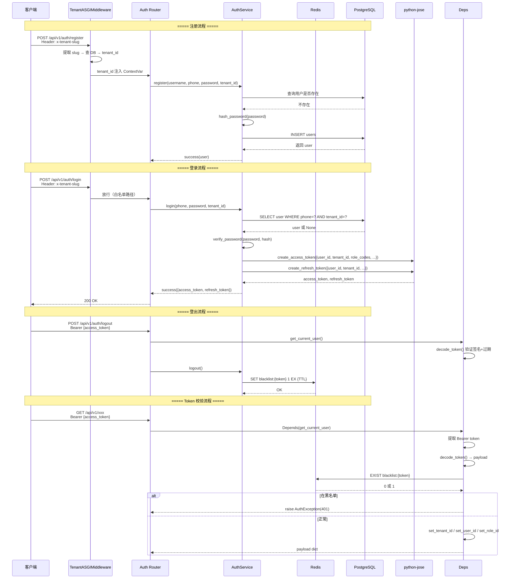
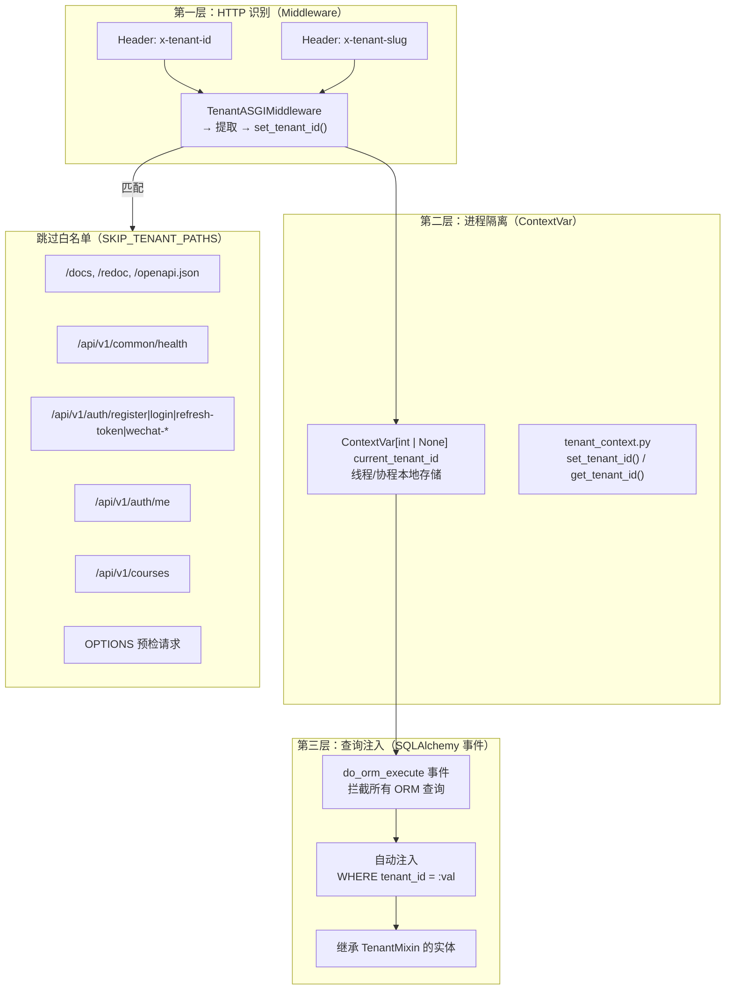
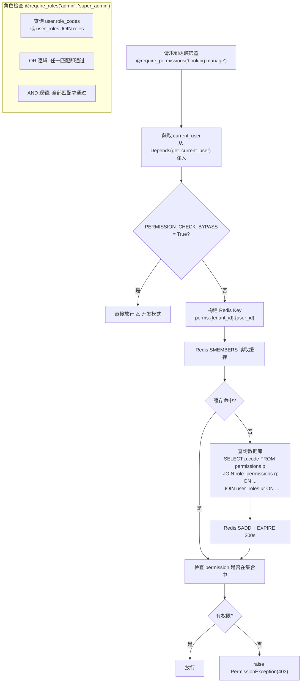

# Authentication & Multi-Tenant & RBAC

## Purpose

本文档描述 class_booking_system 的三大安全子系统：

1. **Authentication**（认证）：用户身份验证、Token 签发与校验、登出
2. **Multi-Tenant**（多租户）：租户识别、ContextVar 隔离、SQL 查询自动注入
3. **RBAC**（角色权限控制）：角色定义、权限检查、Redis 缓存、装饰器

## Current Implementation

### 认证系统

| 项目 | 值 | 位置 |
|------|------|------|
| 密码哈希 | `passlib[bcrypt]` | `app/core/security.py` `pwd_context.hash()` |
| 哈希验证 | `passlib[bcrypt]` | `app/core/security.py` `pwd_context.verify()` |
| JWT 签发 | `python-jose` HS256 | `app/core/security.py` `jwt.encode()` |
| JWT 解码 | `python-jose` HS256 | `app/core/security.py` `jwt.decode()` leeway=10s |
| Access Token 有效期 | `JWT_ACCESS_TOKEN_EXPIRE_MINUTES`（配置）| config.py |
| Refresh Token 有效期 | `JWT_REFRESH_TOKEN_EXPIRE_DAYS`（配置）| config.py |
| Token 黑名单 | Redis `blacklist:{token}` TTL=JWT_REFRESH_TOKEN_EXPIRE_DAYS | security.py |
| Token 黑名单开关 | `ENABLE_TOKEN_BLACKLIST` | config.py |
| JWT Secret | `JWT_SECRET`（环境变量） | config.py |

### 认证端点

| Method | Path | 白名单 | 说明 |
|--------|------|--------|------|
| POST | `/api/v1/auth/register` | ✅ | 手机号+密码+租户 slug 注册 |
| POST | `/api/v1/auth/login` | ✅ | 手机号+密码 登录，返回 access + refresh token |
| POST | `/api/v1/auth/logout` | 否 | 将 access token 加入黑名单 |
| POST | `/api/v1/auth/refresh-token` | ✅ | refresh token 换新 access token |
| GET | `/api/v1/auth/me` | ✅（被 SKIP_TENANT_PATHS 包含）| 获取当前用户信息 |
| PATCH | `/api/v1/auth/me` | 否 | 更新当前用户信息 |
| POST | `/api/v1/auth/wechat-auto-login` | ✅ | code → openid → 查询绑定 |
| POST | `/api/v1/auth/wechat-login` | ✅ | bind_token + phone → 完成绑定登录 |
| POST | `/api/v1/auth/wechat-unbind` | 否 | 解绑微信 |

### 多租户系统

| 项目 | 值 | 位置 |
|------|------|------|
| 中间件 | `TenantASGIMiddleware`（纯 ASGI 实现）| `app/middleware/tenant_middleware.py` |
| Header 识别 | `x-tenant-id`（数字）或 `x-tenant-slug`（字符串） | middleware |
| 上下文存储 | `ContextVar[int | None]` | `app/core/tenant_context.py` `current_tenant_id` |
| 查询注入 | SQLAlchemy 2.0 `do_orm_execute` 事件 | `app/core/tenant_query.py` |
| 全局跳过开关 | `PERMISSION_CHECK_BYPASS = True`（当前硬编码 True） | rbac checker |
| RBAC 缓存 Key | `perms:{tenant_id}:{user_id}` | `app/core/rbac/cache.py` |
| RBAC 缓存 TTL | 300 秒（5 分钟） | cache.py |

### RBAC 系统

| 项目 | 值 | 位置 |
|------|------|------|
| 角色存储 | `roles` 表（tenant_id nullable，支持全局角色） | auth/models.py |
| 权限存储 | `permissions` 表 | auth/models.py |
| 关联表 | `user_roles` + `role_permissions` | auth/models.py |
| 检查入口 | `check_permission` / `check_permissions` / `check_role` / `check_roles` | rbac/checker.py |
| HTTP 装饰器 | `@require_permissions(...)` / `@require_roles(...)` | rbac/decorator.py |
| 缓存 | Redis Set，TTL 5 分钟 | rbac/cache.py |
| DB 查询降级 | Redis 不可用时直接查数据库 | checker.py |

## Architecture

### 认证流程图



### 多租户隔离三层架构



### RBAC 权限检查流程



### JWT Token Payload 结构

create_access_token 写入的数据（来自 login 成功后的返回）：

```json
{
  "user_id": 1001,
  "tenant_id": 10,
  "platform_role": "student",
  "role_codes": ["student"],
  "iat": 1789973090,
  "jti": "uuid",
  "exp": 1789973090 + ACCESS_TOKEN_EXPIRE_MINUTES
}
```

Refresh Token payload 类似，额外加 `"type": "refresh"`。

## Important Rules

### 关键规则

1. **TenantASGIMiddleware 是纯 ASGI 中间件**：不继承 Starlette 的 `BaseHTTPMiddleware`，避免 asyncio 事件循环冲突
2. **Middleware OPTIONS 预检直接放行**：CORS 预检请求不携带业务 Header
3. **Middleware 通过 DB slug 查询租户时会先校验 status**：DISABLED 租户返回 None → 400 错误
4. **tenant_query.py 在 lifespan 中 setup**：必须在第一个请求到达前执行 `setup_tenant_query_injection()`
5. **tenant_query.py 只处理 SQLAlchemy ORM 构造的查询**：原生 SQL（`session.execute(text("..."))`）不会被自动注入 tenant_id
6. **get_current_user 内部不做 Token 黑名单检查**：黑名单检查需要业务层手动调用 `is_token_blacklisted`（auth/router.py 的 logout 端点有调用，但 get_current_user 依赖注入里没做）
7. **PERMISSION_CHECK_BYPASS = True**：所有 RBAC 装饰器直接放行，生产环境必须关闭
8. **Role 表的 tenant_id nullable**：全局角色（如 super_admin）tenant_id 为 NULL，查询全局角色需 OR 条件
9. **clear_role_permissions_cache 未实现**：rbac/cache.py 里有 TODO 占位，批量清除角色权限缓存需要查 DB 获取所有用户
10. **Refresh Token 黑名单 TTL = JWT_REFRESH_TOKEN_EXPIRE_DAYS**：与 refresh token 有效期一致

### Tenant ContextVar 生命周期

```python
# 请求到达前（Middleware）
set_tenant_id(tenant_id)   # ContextVar 被设置

# 请求处理中（Service / Repository）
get_tenant_id()            # 获取租户 ID，tenant_query 事件自动注入 WHERE

# 请求结束后（Middleware finally 块）
set_tenant_id(None)        # 清理
```

⚠️ **定时任务/后台线程中 ContextVar 为空**：APScheduler 运行在独立线程，没有 HTTP 请求上下文，`get_tenant_id()` 返回 None，会导致查询注入 `WHERE tenant_id IS NULL`。当前定时任务内部通常循环查询所有 tenant_id 再手动注入。

## Dependencies

### 认证相关依赖

| 库 | 用途 |
|----|------|
| python-jose[cryptography] | JWT 签发/解码（HS256） |
| passlib[bcrypt] | 密码哈希 |
| aioredis | Token 黑名单 |

### 配置项（config.py / .env）

| 配置 | 默认值 | 说明 |
|------|--------|------|
| JWT_SECRET | -（必填） | HS256 密钥 |
| JWT_ACCESS_TOKEN_EXPIRE_MINUTES | - | Access Token 有效期 |
| JWT_REFRESH_TOKEN_EXPIRE_DAYS | - | Refresh Token 有效期 |
| ENABLE_TOKEN_BLACKLIST | - | 是否启用 Token 黑名单 |
| REDIS_TOKEN_BLACKLIST_PREFIX | `blacklist:` | 黑名单 Key 前缀 |
| PERMISSION_CHECK_BYPASS | `True` | 开发环境跳过 RBAC |
| REDIS_URL | -（必填） | Redis 连接 |

### RBAC 相关

| 文件 | 作用 |
|------|------|
| `rbac/checker.py` | 权限核心检查逻辑 |
| `rbac/decorator.py` | FastAPI 路由装饰器 |
| `rbac/cache.py` | Redis Set 缓存管理 |
| `deps/auth.py` | `get_current_user` / `get_optional_user` |

### 微信登录相关

| 表 | 作用 |
|----|------|
| wechat_accounts | 存储 open_id, unionid, app_id, phone, nickname |
| users | platform_role, status |

WechatLogin 流程：`code → openid → 查 wechat_accounts → 绑定 user_id → 返回 Token`

## Common Failure Points

1. **get_current_user 不检查 Token 黑名单**：auth/logout 把 token 加黑名单后，已登出用户的 token 在过期前仍能使用。黑名单检查逻辑存在但未集成到 `decode_token` 或 `get_current_user` 中
2. **Token 黑名单前缀问题**：登出的是 access_token，但 add_token_to_blacklist 是完整 token 作为 key；刷新 token 换出的新 access_token 不受影响（正确），但需要确认 refresh-token 端点是否有检查黑名单
3. **tenant_query 在 Session 之外失效**：只有在 `async with SessionLocal() as db` 内执行的 ORM Query 才会被注入
4. **定时任务中的 tenant_id 问题**：APScheduler 内 ContextVar 为空，必须手动 set_tenant_id(tenant_id) 循环处理每个租户
5. **TenantASGIMiddleware 的 slug 查询**：`_get_tenant_by_slug` 用的是 `session_factory` 直接创建 Session，不走 `get_session` 依赖注入，没有依赖 Scope
6. **TenantASGIMiddleware 的 SKIP_TENANT_PATHS 包含 `/api/v1/courses`**：这个通配跳过比较奇怪，导致 courses 所有子路径都不要求租户信息
7. **RBAC 装饰器注入方式**：decorator 从 kwargs 取 `db`, `current_user`, `redis_client`，需要函数签名里有这些参数；遗漏一个会导致 RBAC 检查时 KeyError
8. **JWT decode 的 leeway=10**：可能掩盖时钟偏移问题，建议只在开发环境使用
9. **wechat_auto_login 返回 need_bind 状态**：前端需要根据 need_bind 决定走 login 流程还是 bind 流程

## TODO / Known Issues

- [ ] PERMISSION_CHECK_BYPASS 硬编码 True，生产环境必须改为环境变量
- [ ] get_current_user 未集成 Token 黑名单检查
- [ ] SKIP_TENANT_PATHS 包含 `/api/v1/courses`，可能是调试时加的，应移除或缩小范围
- [ ] TenantASGIMiddleware 的 slug 查询是在 middleware 内直接开 Session，没走依赖注入，事务独立
- [ ] clear_role_permissions_cache 未实现（rbac/cache.py TODO）
- [ ] Role.tenant_id nullable 设计下，全局角色的查询 OR 条件容易遗漏
- [ ] RateLimiterMiddleware 存在但未全局注册，限流功能未启用
- [ ] 微信登录流程中的 code 换取 openid 需要调微信 API，AuthService 内部调用方式需确认
- [ ] jti（JWT ID）虽然加入了 payload 但未在黑名单里利用它（可以只把 jti 加入黑名单而不是完整 token）
