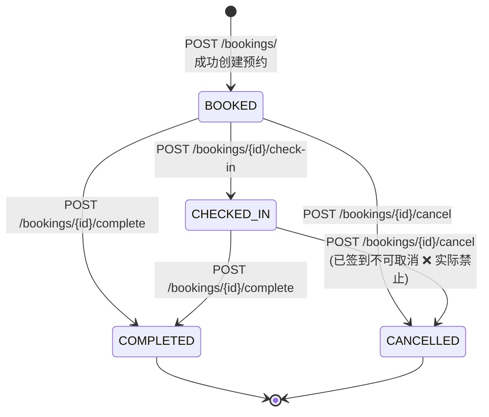
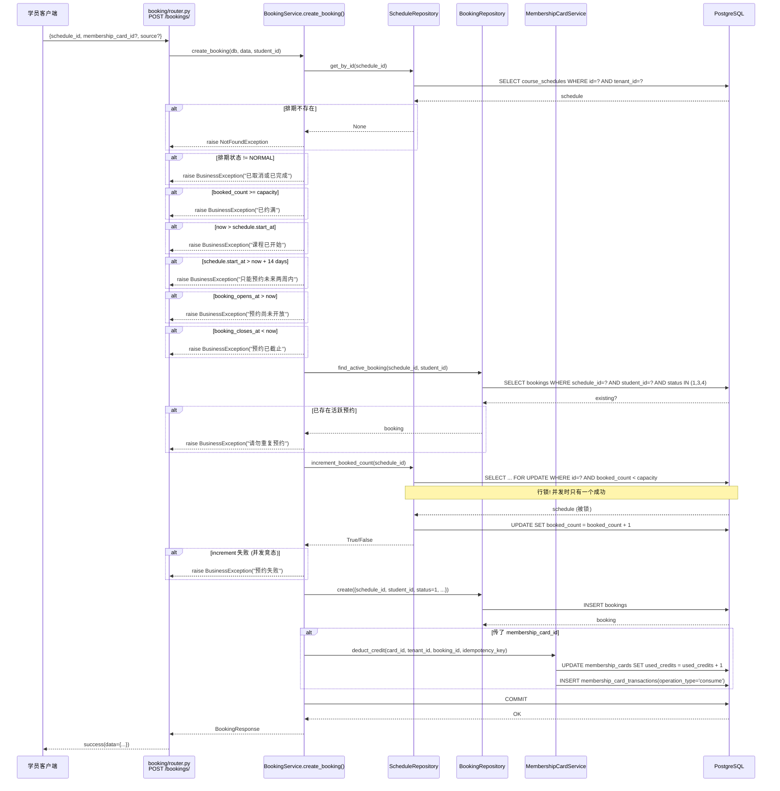
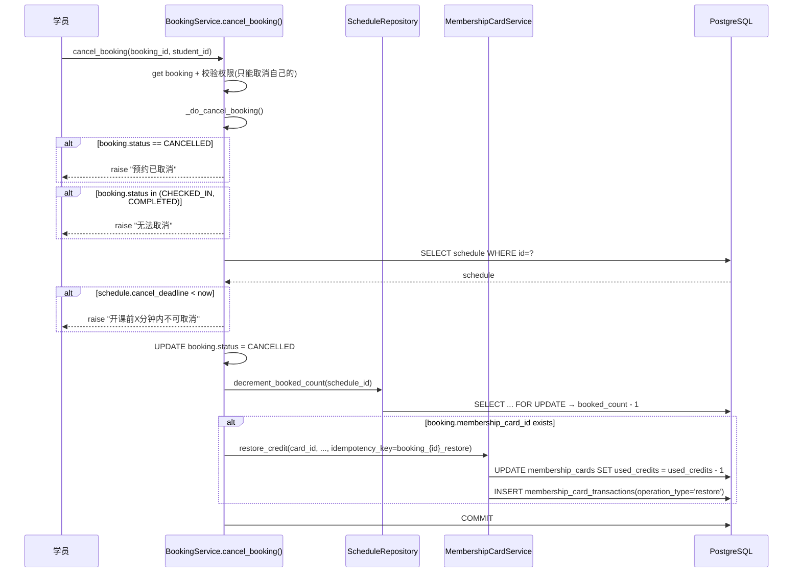

# Booking

## Purpose

本文档描述预约（Booking）业务的完整生命周期：创建、取消、签到、完成，以及与会员卡扣/退费、排期容量并发控制的交互。

## Current Implementation

### 相关模块位置

| 组件 | 路径 |
|------|------|
| 路由 | `modules/booking/router.py` |
| 服务 | `modules/booking/service.py` BookingService |
| 仓储 | `modules/booking/repository.py` BookingRepository |
| 模型 | `modules/booking/models.py` Booking |
| Schema | `modules/booking/schemas.py` |
| 排期仓储 | `modules/schedule/repository.py`（booked_count 原子增减） |
| 会员卡服务 | `modules/membership/service.py`（deduct_credit / restore_credit） |

### Booking 状态机



状态值定义：

| 枚举值 | DB 值 | 含义 |
|--------|-------|------|
| BOOKED | 1 | 已预约 |
| CANCELLED | 2 | 已取消 |
| CHECKED_IN | 3 | 已签到 |
| COMPLETED | 4 | 已完成 |
| NO_SHOW | 5 | 未到场 |

### Booking Source

| 值 | 含义 |
|----|------|
| self | 学员自己预约 |
| admin | 管理员代约 |
| teacher | 教师代约 |

## Architecture

### 创建预约完整流程图



### 取消预约流程



### 并发控制关键实现

```python
# ScheduleRepository.increment_booked_count()
# 核心: SELECT ... FOR UPDATE WHERE booked_count < capacity
# 并发下，只有第一个事务能拿到行锁，后续事务要么等要么返回空

stmt = (
    select(CourseSchedule)
    .where(
        CourseSchedule.id == schedule_id,
        CourseSchedule.status == ScheduleStatus.NORMAL.value,
        CourseSchedule.booked_count < CourseSchedule.capacity,
    )
    .with_for_update()   # ← 行级排他锁
)
```

关键约束表（数据库层兜底）：

```sql
-- course_schedules 表
CHECK Constraint: booked_count <= capacity AND booked_count >= 0
-- 即使应用层 increment 没正确工作，DB 层也会拒绝超量

-- bookings 表（PostgreSQL 部分唯一索引）
CREATE UNIQUE INDEX uq_bookings_schedule_student_active 
  ON bookings(schedule_id, student_id) 
  WHERE status IN (1, 3, 4);  -- BOOKED / CHECKED_IN / COMPLETED
-- 数据库层兜底: 同一排期同一学员不能有两个活跃预约
```

### 显示状态（display_status）计算

Booking 表里存的是 `status`（业务状态），响应里计算 `display_status`（面向学员的展示）：

| status | 时间条件 | display_status | 含义 |
|--------|----------|----------------|------|
| CANCELLED (2) | - | 2 | 已取消 |
| CHECKED_IN (3) | - | 3 | 上课中 |
| COMPLETED / NO_SHOW | - | 4 | 已完成 |
| BOOKED (1) | start_at > now | 1 | 待上课 |
| BOOKED (1) | start_at ≤ now ≤ end_at | 3 | 上课中 |
| BOOKED (1) | end_at < now | 4 | 已完成（排期已结束但未签到/完成）|

## Important Rules

### 业务校验清单

| 校验项 | 位置 | 错误信息 |
|--------|------|----------|
| 排期必须存在 | service.create_booking | NotFoundException("排期不存在") |
| 排期状态必须 NORMAL | service | BusinessException("已取消或已完成") |
| booked_count < capacity | service + repository | "已约满" |
| 排期未开始（`start_at > now`）| service | "课程已开始" |
| 只能预约未来 14 天内 | service | "只能预约未来两周内" |
| 预约开放时间（booking_opens_at）| service | "预约尚未开放" |
| 预约截止时间（booking_closes_at）| service | "预约已截止" |
| 无重复活跃预约 | service | "请勿重复预约" |
| 取消权限（只能自己取消自己的）| service.cancel_booking | PermissionException |
| 已签到/已完成不可取消 | service._do_cancel_booking | "无法取消" |
| cancel_deadline 之前可取消 | service | "开课前X分钟内不可取消" |

### 原子操作保障

| 操作 | 方法 | 机制 |
|------|------|------|
| booked_count +1 | ScheduleRepository.increment_booked_count | `SELECT ... FOR UPDATE` + `UPDATE booked_count = booked_count + 1` |
| booked_count -1 | ScheduleRepository.decrement_booked_count | 同上 |
| 无重复预约 | BookingRepository.find_active_booking + DB 唯一索引 | 应用层先查 + DB 层兜底 |
| 会员卡扣次 | MembershipCardService.deduct_credit | 应用层 UPDATE + DB CHECK Constraint |
| 会员卡退费 | MembershipCardService.restore_credit | 同上 |
| 幂等性 | `idempotency_key = f"booking_{id}_deduct"` | membership_card_transactions.idempotency_key UNIQUE |

### 权限控制（RBAC）

| 端点 | 权限要求 |
|------|----------|
| POST /bookings/ | 登录即可 |
| GET /bookings/ | 登录即可 |
| GET /bookings/{id} | 登录即可 |
| POST /bookings/{id}/cancel | 登录（取消自己的） |
| POST /bookings/cancel | 登录（批量取消，未在代码中看到批量逻辑） |
| POST /bookings/{id}/check-in | `@require_permissions("booking:manage")` |
| POST /bookings/{id}/complete | `@require_permissions("booking:manage")` |

> ⚠️ 注意：PERMISSION_CHECK_BYPASS = True（全局开启），所有 require_permissions 装饰器当前直接放行。

### 定时任务对 Booking 的影响

| 任务 | 频率 | 对 Booking 的影响 |
|------|------|-------------------|
| auto_finish_expired_schedules | 5 min | 将过期排期标记 FINISHED，关联的 BOOKED 预约变成孤立状态（排期 FINISHED，预约还 BOOKED） |
| auto_cancel_underbooked_schedules | 5 min | 人数不足取消排期 → 需要级联处理已有的 BOOKED 预约（代码中可能只改排期状态，预约需要手动取消） |

## Dependencies

### 外部依赖

| 依赖 | 用途 |
|------|------|
| PostgreSQL | 存储 bookings 表 + course_schedules 表 |
| Redis | AI 模块会话锁等（BookingService 自身不直接用 Redis） |
| MembershipCardService | 会员卡扣次/退费 |
| ScheduleRepository | booked_count 原子操作 |

### Service 内部依赖注入

```python
class BookingService:
    def __init__(self):
        self.repo = BookingRepository()          # 自动实例化
        self.schedule_repo = ScheduleRepository() # 自动实例化
    # membership_card_service 从 modules.membership.service 直接 import
```

> BookingService 内部直接实例化 Repository，不通过依赖注入。membership_card_service 是单例 import。

## Common Failure Points

1. **booked_count 与实际 bookings 行数不一致**：auto_finish_expired_schedules 把排期改成 FINISHED 时如果没有处理 booked_count 或关联预约，会导致数据不同步
2. **事务边界**：increment_booked_count 和 INSERT booking 是同一个 db session，但 deduct_credit 如果抛异常，booking INSERT 已经成功，需要外层 service 确保事务回滚（用同一个 db session + 最后统一 commit）
3. **membership_card_id 无外键约束**：如果被取消的卡仍被 booking 引用，退费会失败；目前 try/except 吞了异常但 booking 已经取消成功，会导致卡的 used_credits 与 transactions 不一致
4. **auto_finish_expired_schedules 后的预约状态**：排期 FINISHED 后，关联的 BOOKED 预约不会自动变成 COMPLETED，可能留在 BOOKED 状态（需要运营手动处理或另一个定时任务）
5. **increment_booked_count 的 `with_for_update()`**：PostgreSQL 行锁会阻塞其他事务，高并发下可能成为瓶颈；当前没有 `SKIP LOCKED`，是典型的数据库排队模型
6. **find_active_booking 的 tenant_id 双重检查**：TenantMixin 自动注入 tenant_id 查询，BookingRepository 又手动加了 tenant_id 条件，可能重复

## TODO / Known Issues

- [ ] Booking 的 NO_SHOW 状态（5）创建预约时不会被设置，只有外部（定时任务或管理后台）能设置，当前 service 没看到设置入口
- [ ] 批量取消端点 `POST /bookings/cancel` 在 router.py 有定义但 service 层实现未知（cancel_booking_by_schedule 可能支持批量？）
- [ ] booking/router.py 中取消端点有两个：`POST /bookings/{booking_id}/cancel` 和 `POST /bookings/cancel`，职责需明确
- [ ] auto_finish_expired_schedules 将排期标记 FINISHED 时，未自动处理关联的 BOOKED/CHECKED_IN 预约（状态流转缺失）
- [ ] auto_cancel_underbooked_schedules 取消排期时，需级联取消所有已预约用户并退会员卡
- [ ] BookingService 直接实例化 Repository，单元测试时难以 mock；建议改为依赖注入
- [ ] increment_booked_count 没有 `SKIP LOCKED` 选项，高并发下事务排队等待可能成为瓶颈
- [ ] 预约 create 时 commit 在 deduct_credit 之后，如果 commit 失败但卡已扣次，需要补偿机制（当前有 idempotency_key 但没有补偿任务）
