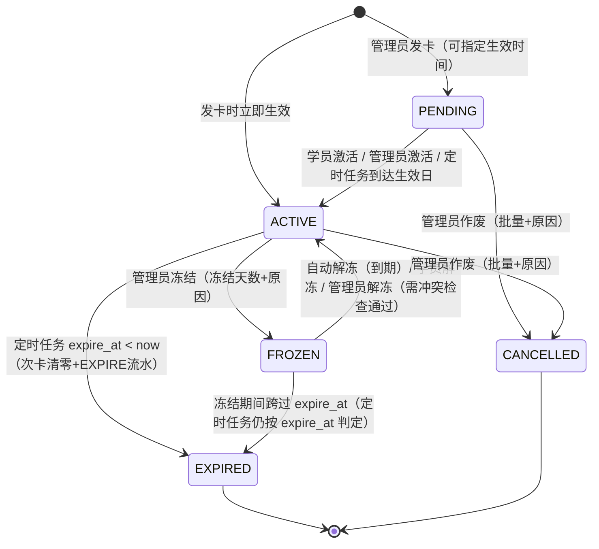
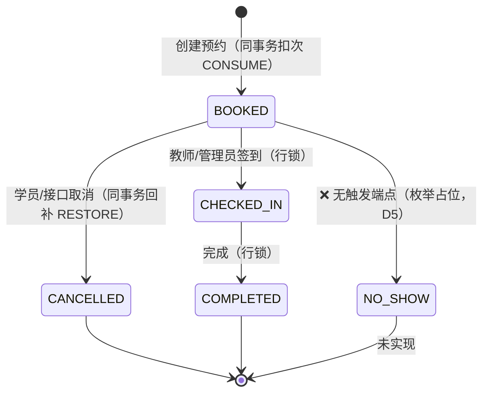

# F6.0 跨端业务模型与实体状态机（Entity State Model）

> 日期：2026-10-09
> 性质：只读审计产物。实体/字段/枚举全部来自真实模型代码，标注 file:line

## 一、实体清单与关联关系

```mermaid
erDiagram
    MEMBERSHIP_CARD_PRODUCT ||--o{ MEMBERSHIP_CARD : "product_id 发卡实例化"
    MEMBERSHIP_CARD ||--o{ MEMBERSHIP_CARD_TRANSACTION : "card_id 变动流水"
    BOOKING }o--o| MEMBERSHIP_CARD : "membership_card_id (FK SET NULL)"
    BOOKING }o|| COURSE_SCHEDULE : "schedule_id (FK RESTRICT)"
    COURSE_SCHEDULE }o|| COURSE : "course_id"
    BOOKING }o|| USER : "student_id"
    MEMBERSHIP_CARD }o|| USER : "student_id"
    ORDER o|o--o| MEMBERSHIP_CARD : "membership_card_id (FK, 模块空壳)"
```

| 实体 | 模型位置 | 角色 | 现状 |
|------|---------|------|------|
| MembershipCardProduct 卡产品/套餐 | `membership/models.py:83-145` | 商品模板：计费类型、价格、总次数、有效天数、适用课程、每周上限、上下架 | ✅ |
| MembershipCard 卡实例 | `membership/models.py:146-255` | 学员持有的具体卡：卡号、余额（total/used_credits + remaining_credits 属性）、valid_from/expire_at、状态、冻结与作废留痕 | ✅ |
| MembershipCardTransaction 卡流水 | `membership/models.py:257-300` | 变动台账（ISSUE/CONSUME/RESTORE/RECHARGE/REFUND/ADJUST/EXPIRE），含 booking_id、idempotency_key、operator_id | ✅ **兼任核销记录**（无独立核销表） |
| CourseSchedule 排期 | `schedule/models.py` | 可预约的课时单元（课程×时间×教室×容量） | ✅（F4.5 并发安全） |
| Booking 预约 | `booking/models.py:25-80` | 预约记录：schedule_id、student_id、membership_card_id、status、source、cancelled/checked_in 留痕 | ✅ |
| Order 订单 / Payment 支付 | `order/models.py`、`payment/` | 购卡支付凭证 | ❌ 空壳（F4.2 已补 orders.membership_card_id 外键与索引） |
| Notification 通知 | `notification/models.py` | 到期提醒/预约通知 | ❌ 空壳（F6.2） |

### 概念澄清（任务书要求的七概念对照）

| 任务书概念 | 系统对应物 | 说明 |
|-----------|-----------|------|
| 会员卡产品/套餐 | MembershipCardProduct | — |
| 学员持有的具体课卡 | MembershipCard | — |
| 课程预约 | Booking（status=BOOKED） | — |
| **计划使用的课卡** | Booking.membership_card_id | **非独立实体**，仅是指向卡实例的引用；卡作废后引用仍在但卡不可用 |
| 实际考勤 | Booking.status → CHECKED_IN / COMPLETED | 考勤=预约状态推进，**无独立考勤表** |
| 实际核销记录 | MembershipCardTransaction(type=CONSUME) | **核销发生在预约创建时**（预扣模式），非签到时 |
| 支付/退款记录 | Order / TransactionType.REFUND | 支付未实现；退款仅枚举占位 |

> ⚠️ **预约成功 ≠ 签到成功 ≠ 核销成功**：当前系统中"核销"动作与"预约创建"是同一事务的两面；签到只是出勤确认。原型与后续开发都不得把三者混为一谈。

## 二、卡实例状态机（MembershipCard.status）



触发条件与证据：

| 迁移 | 触发者 | 实现 |
|------|--------|------|
| PENDING→ACTIVE | 学员 | `POST /membership/cards/{id}/activate`（require_roles student） |
| PENDING→ACTIVE | 管理员 | `POST /membership/cards/{id}/admin-activate` |
| PENDING→ACTIVE | 定时任务 | `membership/scheduler.py:106-244` auto_activate |
| ACTIVE→FROZEN | 管理员 | freeze（frozen_until/frozen_reason），F4.3 批量锁排序 |
| FROZEN→ACTIVE | 定时/学员/管理员 | 自动解冻、student-unfreeze、admin-unfreeze（conflict-check + action） |
| ACTIVE→EXPIRED | 定时任务 | `scheduler.py:51-103`：过期 + 次卡剩余清零 + EXPIRE 流水 |
| *→CANCELLED | 管理员 | cancel / batch-cancel（必填原因） |

**状态机缺口**（与任务书六态对照）：
- 无 EXHAUSTED（用尽）态 → D2
- 无"首次核销激活"迁移（首次签到不触发任何卡状态变化）→ D1
- PENDING 卡在激活前能否预约 → D4 边界之一

## 三、预约状态机（Booking.status）



要点：
- 进入 BOOKED 的同时发生 CONSUME 流水；CANCELLED 的同时发生 RESTORE 流水（同事务，booking/service.py:130-155, 199-269）
- CHECKED_IN / COMPLETED **不产生任何卡变动**
- NO_SHOW 仅存在于枚举与 Check 约束，无产品化路径 → D5
- 有效预约唯一性：`(schedule_id, student_id) WHERE status IN (1,3,4)` 部分唯一索引（booking/models.py:71-77）

### 预约-时间冲突校验（D10，原型演示态 / 真实后端缺口）

| 项 | 内容 |
|----|------|
| 冲突口径 | 同一学员已有「进行中」预约（status ∈ BOOKED / CHECKED_IN，不含 CANCELLED / COMPLETED）所在排期时间段，与目标排期时间段的标准区间重叠：`a.start < b.end && b.start < a.end` |
| 时间粒度 | 排期 = `CourseSchedule.start_at` / `end_at`（`schedule/models.py:42-43`，带时区）；原型以 `date`(YYYY-MM-DD) + `time`(HH:MM-HH:MM) 拼接为 `YYYY-MM-DDTHH:MM` 字符串比较（字典序即时间序） |
| 拦截阶段 | 预约确认（P-M4 点击「确认预约」、进入写操作前）；命中即不生成预约、不改动任何既有预约状态 |
| 与卡冲突关系 | 「跨排期时间段重叠」与「会员卡有效期重叠（D9，`cardConflict`）」是**两个独立校验**，互不覆盖、互不替代；命中卡冲突时优先提示卡冲突 |
| 现状 | 真实后端 `apps/api/src/app/modules/booking/service.py::create_booking`（L51-93）**仅有**同排期重复预约（L87-89 `find_active_booking`）、容量、时间窗口校验，**无跨排期时间段重叠校验**；原型已补演示态，正式开发需按 D10 落地 |

## 四、计划课卡生命周期与预约的耦合（当前真实行为）

| 时点 | 系统行为 | 缺口 |
|------|---------|------|
| 预约创建 | 校验卡可用性+余额 → 扣次 → BOOKED 持有 card_id 引用 | PENDING/边界校验范围待确认（D4） |
| 预约后卡被冻结 | **无任何处理**：预约仍 BOOKED，签到不校验卡状态 | D3 |
| 预约后卡被作废 | 引用保留（status=CANCELLED），预约不受影响 | D3 |
| 预约后卡过期 | 定时任务仅改卡状态；预约不受影响 | D3 |
| 预约后卡被删除 | FK SET NULL，预约脱钩保留 | 已固化（F4.1） |
| 取消预约 | 回补到**原卡**（restore_credit 按 booking.membership_card_id 定位） | 卡已作废时回补去向 → 归入 D3/D8 处理 |
| 签到/完成 | 仅状态推进 | 无二次核销（设计如此，见 D1） |

## 五、跨端状态同步模型（现状）

- 无服务端推送（F6.2 未做）：小程序各页进入时拉取最新数据（onShow 刷新）
- 扣次/回补的即时性依赖同事务返回值：预约成功响应即携带扣次后状态
- 管理端改卡状态后，学员端无提醒；冻结冲突处理依赖管理员主动检查
- 原型需表达"刷新感知"交互（下拉刷新/返回刷新），不得画实时推送
