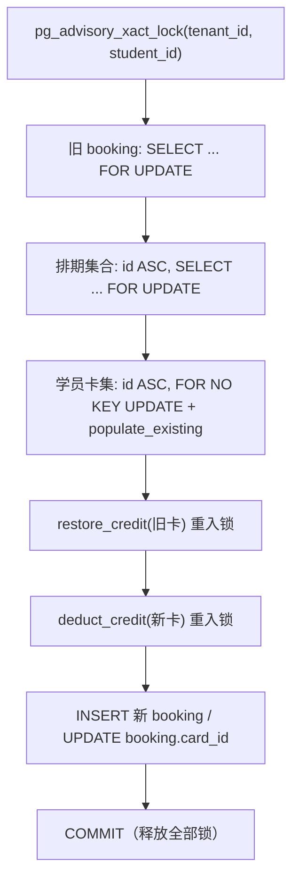

# F6.5 实施计划：原子改期 / 原子改派

> 设计对象：当前工作区真实代码（2026-10-22，含 F6.3/F6.4 已落地改动）。
> 本文件是**设计交付物**，不包含业务代码改动、不执行迁移、不运行测试。
> 关键决策见 `requirement.md` §11（D-1 ~ D-11）；未拍板前不进入 DEVELOPMENT。

## 1. 设计结论摘要

1. **改期** = 旧约 `CANCELLED` + 新约 `BOOKED`，同一事务；旧排期名额 `-1`、新排期 `+1`。
2. **纯改派**（同排期换卡）= 原地更新同一 booking 的 `membership_card_id`，状态仍 `BOOKED`，名额不变。
3. 行锁顺序固定：`advisory(tenant,student)` → 旧 booking → 排期（id ASC）→ 学员卡集（id ASC）→ 回补/扣次。
4. 次卡同卡改期也执行「回补再扣」；期卡/无限卡回补 no-op；期卡不因改期改写有效期。
5. 幂等以「旧 booking 状态 + `booking_reschedules` 审计记录」为主，`Idempotency-Key` 为可选增强；不建通用 HTTP 幂等表。
6. 新增审计表 `booking_reschedules`；**不建 booking FK**，避免阻断既有排期硬删除（`schedule/service.py:406-438`）。
7. 目标排期重叠校验复用 F6.4，但必须新增 `exclude_booking_id` 排除自身。

## 2. 任务拆分（T6.5.x）

| 任务 | 内容 | 文件（真实路径） | Agent |
|------|------|------------------|-------|
| T6.5.1 | 新增 `BookingReschedule` 模型与迁移草案 | `apps/api/src/app/modules/booking/models.py`；`apps/api/alembic/versions/<rev>_add_booking_reschedules.py`（新增） | database-engineer |
| T6.5.2 | 扩展 booking repository：排除自身、审计/幂等 Repository | `apps/api/src/app/modules/booking/repository.py` | backend-engineer |
| T6.5.3 | 排期批量加锁入口 | `apps/api/src/app/modules/schedule/repository.py`、`schedule/service.py` | backend-engineer |
| T6.5.4 | 卡集统一加锁入口 | `apps/api/src/app/modules/membership/service.py` | backend-engineer |
| T6.5.5 | `BookingService.reschedule_booking` 复合事务 + 取消窗口复用 | `apps/api/src/app/modules/booking/service.py` | backend-engineer |
| T6.5.6 | DTO 与路由 | `apps/api/src/app/modules/booking/schemas.py`、`booking/router.py` | backend-engineer |
| T6.5.7 | OpenAPI 生成与 `pnpm gen:types` | `packages/api-types/openapi.json`、`packages/api-types/schema.d.ts`（生成物） | backend-engineer + architect |
| T6.5.8 | 集成/并发/幂等测试 | `apps/api/tests/integration/test_booking_reschedule.py`、`test_booking_reschedule_concurrency.py`（新增） | backend-engineer |
| T6.5.9 | 前端契约交接（不实现 UI） | `docs/ai/implementation/F6.5-frontend-handoff.md`（可选产物）；`packages/api-client/src/bookings.ts` 由 F6.10/F6.11 实施 | frontend-engineer |
| T6.5.10 | 静态/运行时验证与 Review | `static-verification.md`、`review.md` | architect |
| T6.5.11 | 排期取消锁硬化 | `apps/api/src/app/modules/schedule/service.py`（`cancel_schedule`） | backend-engineer |

> T6.5.11 **已实施**（2026-10-22，用户要求 D-6 先修复再关闭）：取消排期改为 booking(id ASC) → schedule 加锁，持锁后重收集 BOOKED 预约，新增 2 条 D-6 并发用例。

## 3. 调用链与事务边界

```
POST /api/v1/bookings/{booking_id}/reschedule
  → Router（认证、@require_roles("student")、Pydantic、Header）
  → BookingService.reschedule_booking（唯一事务边界）
      → BookingRepository（booking / reschedule 审计）
      → ScheduleService / ScheduleRepository（排期锁与容量）
      → MembershipCardService（卡校验、回补、扣次）
  → success(data=BookingRescheduleResponse)
```

事务约束（对照 `.trae/rules/database/transaction.md:8-13`）：

- 全程共享 Router 注入的同一个 `AsyncSession`；**只在 `reschedule_booking` 末尾 `commit()` 一次**。
- 所有写入（旧约状态、新 booking、`booked_count`、卡 `used_credits`、流水、审计）共享同一事务。
- `BookingRepository.create(..., auto_commit=False)`（`base_repository.py:164-197`），插入后 `flush()` 取主键。
- 下游异常必须上抛触发回滚；禁止吞异常后继续 `commit()`。
- 捕获 `HTTPException`（membership Service 使用）并转 `BusinessException(code=e.status_code)`，与 `create_booking` 的处理一致（`booking/service.py:217-230`）。
- `IntegrityError` 统一映射：唯一索引/CHECK 约束 → 友好 400；未知 → 500。

## 4. 锁顺序与并发策略

### 4.1 固定锁顺序



说明：

- **advisory lock 必须最先**：与 `create_booking` 的 `lock_student_booking_scope`（`booking/repository.py:153-174`）互斥，串行化同一学员的「创建 / 改期」，避免改期与新建交叉产生重叠预约。
- **booking 行第二**：与取消/签到/完成使用的 `get_by_id_for_update`（`booking/repository.py:267-289`）一致；拿到锁后重检状态，防重复改期/取消。
- **排期按 id ASC**：两个排期必须一次性排序加锁；禁止先锁目标再锁旧排期（反向改期会形成环）。
- **卡集按 id ASC**：复用 `get_cards_for_update_by_student` 的排序与 `FOR NO KEY UPDATE`（`membership/repository.py:229-273`），避免与 booking 插入的 FK `KEY SHARE` 冲突，并消除两卡互锁。
- **改期不使用 `SKIP LOCKED`**：`increment_booked_count`（`schedule/repository.py:182-208`）的 skip-locked 语义只适合「抢名额快速失败」；改期应在已按序锁定的行上直接调整，排队而不是跳过。
- 事务隔离级别沿用默认 READ COMMITTED；不提升 SERIALIZABLE（SERIALIZABLE 仅用于排期创建，见 `schedule/service.py:117-182`）。

### 4.2 为什么不会与 create/cancel 形成死锁

| 对端 | 对端锁顺序 | 改期锁顺序 | 结论 |
|------|------------|------------|------|
| create_booking | advisory → schedule → 插入 booking（无既有行）→ card | advisory → booking → schedule → card | 同一学员由 advisory 串行；不同学员共享排期时都遵循 schedule→card，无反转 |
| cancel_booking | booking → schedule → card | booking → schedule → card | 同序 |
| finalize_schedule_bookings | booking(id ASC) → schedule → card | booking → schedule → card | 同序 |
| schedule cancel | booking(id ASC) → schedule（T6.5.11 已硬化） | booking → schedule | 同序；取消后排期不再残留进行中预约 |

### 4.3 容量调整

在排期行已按 id ASC 锁定的前提下：

- 校验目标排期 `status=NORMAL`、`booked_count < capacity`、时间窗口合法。
- 旧排期 `booked_count -= 1`（仅当 >0；正常 BOOKED 应 >0）。
- 目标排期 `booked_count += 1`。
- 依赖 DB CHECK `chk_schedule_capacity`（`schedule/models.py:71-74`）兜底。
- 不调用 `increment_booked_count` 的 `SKIP LOCKED` 路径；直接修改已锁定 ORM 实体，由同一事务 flush。

## 5. BookingService.reschedule_booking 详细流程（设计级伪代码）

> 以下为设计骨架，变量/方法名为建议命名；实际实现由 backend-engineer 按真实代码落位。

```python
async def reschedule_booking(
    self,
    db: AsyncSession,
    *,
    booking_id: int,
    data: BookingRescheduleRequest,
    current_user: dict,
    idempotency_key: str | None = None,
) -> BookingRescheduleResponse:
    user_id = current_user["user_id"]
    tenant_id = current_user["tenant_id"]

    # 1. 同一学员串行化（与 create_booking 共用）
    await self.repo.lock_student_booking_scope(db, tenant_id=tenant_id, student_id=user_id)

    # 2. 锁旧 booking，拿到锁后重检
    booking = await self.repo.get_by_id_for_update(db, booking_id)
    if not booking:
        raise NotFoundException("预约不存在")
    if booking.student_id != user_id:
        raise PermissionException("只能改期自己的预约")

    # 3. 幂等重放判定（见 §7）
    replay = await self._find_reschedule_replay(db, booking, data, idempotency_key)
    if replay is not None:
        return await self._build_reschedule_response(db, replay, booking)

    # 4. 状态 / 旧排期 / 取消窗口
    if booking.status != BookingStatus.BOOKED.value:
        raise BusinessException("当前预约状态无法改期", code=400)
    old_schedule = await self.schedule_repo.get_by_id(db, booking.schedule_id)
    if not old_schedule:
        raise NotFoundException("原排期不存在")
    if old_schedule.start_at <= datetime.now(UTC):
        raise BusinessException("课程已开始，无法改期", code=400)

    same_schedule = data.new_schedule_id == booking.schedule_id
    target_card_id = (
        data.new_membership_card_id
        if data.new_membership_card_id is not None
        else booking.membership_card_id
    )

    # 纯改派：同排期 + 同卡 → 无变化
    if same_schedule and target_card_id == booking.membership_card_id:
        raise BusinessException("未发生改期或改派", code=400)

    # D-5：原预约无卡时本版不允许附加卡
    if booking.membership_card_id is None and target_card_id is not None:
        raise BusinessException("原预约未使用会员卡，暂不支持改派", code=400)

    # 5. 改期才受取消窗口限制；纯改派不释放名额
    if not same_schedule:
        self._assert_cancel_window(db, old_schedule)

    # 6. 目标排期存在 + 锁定（id ASC）
    target_schedule = await self.schedule_repo.get_by_id(db, data.new_schedule_id)
    if not target_schedule:
        raise NotFoundException("目标排期不存在")
    locked = await self.schedule_service.get_schedules_for_update(
        db, sorted({old_schedule.id, target_schedule.id})
    )
    old_schedule, target_schedule = locked[old_schedule.id], locked[target_schedule.id]

    if not same_schedule:
        self._validate_target_schedule(target_schedule)  # NORMAL/容量/时间窗口
        # 7. 同排期重复 + 时间段重叠（排除自身）
        duplicate = await self.repo.find_active_booking(
            db, target_schedule.id, user_id, exclude_booking_id=booking.id
        )
        if duplicate:
            raise BusinessException("您已预约该排期，请勿重复预约", code=400)
        conflict = await self.repo.find_overlapping_active_booking(
            db, student_id=user_id,
            start_at=target_schedule.start_at,
            end_at=target_schedule.end_at,
            exclude_booking_id=booking.id,
        )
        if conflict:
            info = (await self._get_schedule_info_map(db, [conflict.schedule_id])).get(
                conflict.schedule_id, {}
            )
            raise BusinessException(self._format_time_conflict_message(info), code=400)

    # 8. 目标卡快路径校验（无锁；后续扣次会加锁重检）
    card_validation = await self._validate_target_card(
        db, target_card_id, user_id, tenant_id, target_schedule
    )  # 返回 None / {"card_type", "deduct", "status", ...}

    # 9. 锁定学员卡集（id ASC，覆盖 ACTIVE/PENDING/EXPIRED/FROZEN/CANCELLED）
    locked_cards = await membership_card_service.lock_student_cards_for_booking_change(
        db, student_id=user_id, tenant_id=tenant_id
    )

    # 10. 插入审计/幂等记录（flush 取 rid）
    reschedule = await self.reschedule_repo.create(db, {
        "old_booking_id": booking.id,
        "new_booking_id": booking.id,          # 改期在插入新 booking 后回填
        "old_schedule_id": booking.schedule_id,
        "new_schedule_id": target_schedule.id,
        "old_membership_card_id": booking.membership_card_id,
        "new_membership_card_id": target_card_id,
        "operation_type": "card_swap" if same_schedule else "reschedule",
        "request_key": idempotency_key,
        "operator_id": user_id,
        "remark": data.reason,
    }, auto_commit=False)
    await db.flush()
    rid = reschedule.id

    try:
        if same_schedule:
            # 模式 B：原地改派
            booking.membership_card_id = target_card_id
            await db.flush()
            # 期卡 PENDING：锚点包含当前 booking
            await self._validate_period_anchor_if_needed(
                db, card_validation, target_card_id, user_id, tenant_id, booking, target_schedule
            )
            await self._restore_old_card(db, booking, old_card_id, rid)
            await self._deduct_target_card(
                db, card_validation, target_card_id, tenant_id,
                booking_id=booking.id, idempotency_key=f"reschedule_{rid}_deduct",
                schedule=target_schedule,
            )
        else:
            # 模式 A：改期
            booking.status = BookingStatus.CANCELLED.value
            booking.cancelled_at = datetime.now(UTC)
            booking.cancelled_reason = f"改期至排期 {target_schedule.id}"[:255]
            old_schedule.booked_count -= 1
            target_schedule.booked_count += 1
            await db.flush()  # 释放 uq_bookings_schedule_student_active

            new_booking = await self.repo.create(db, {
                "schedule_id": target_schedule.id,
                "student_id": user_id,
                "status": BookingStatus.BOOKED.value,
                "source": BookingSource.SELF.value,
                "membership_card_id": target_card_id,
            }, auto_commit=False)
            await db.flush()
            reschedule.new_booking_id = new_booking.id
            await db.flush()

            await self._validate_period_anchor_if_needed(
                db, card_validation, target_card_id, user_id, tenant_id, new_booking, target_schedule
            )
            await self._restore_old_card(db, booking, old_membership_card_id, rid)
            await self._deduct_target_card(
                db, card_validation, target_card_id, tenant_id,
                booking_id=new_booking.id,
                idempotency_key=f"booking_{new_booking.id}_deduct",
                schedule=target_schedule,
            )

        await db.commit()
    except HTTPException as e:
        await db.rollback()
        raise BusinessException(str(e.detail), code=e.status_code)
    except BusinessException:
        await db.rollback()
        raise
    except IntegrityError as e:
        await db.rollback()
        raise self._map_integrity_error(e)
    except Exception as e:
        await db.rollback()
        logger.exception(f"[BookingService] 改期失败: booking_id={booking_id}, err={e}")
        raise BusinessException("改期失败，请稍后重试", code=500)

    new_or_current = (
        new_booking if not same_schedule else booking
    )
    return await self._build_reschedule_response(db, reschedule, new_or_current)
```

### 5.1 关键实现点

| # | 点 | 说明 |
|---|----|------|
| 1 | `_assert_cancel_window(db, schedule)` | 从 `_do_cancel_booking` 的 `booking/service.py:301-318` 抽出，取消与改期共用；纯改派不调用 |
| 2 | `_validate_target_schedule(schedule)` | 对齐 `create_booking` 的 `booking/service.py:73-95`：状态、容量、已开始、14 天、开放/截止 |
| 3 | `_validate_target_card(...)` | 复用 `membership_card_service.validate_card_for_booking`（`membership/service.py:594-656`）；原预约无卡且目标无卡返回 None |
| 4 | `_validate_period_anchor_if_needed(...)` | 仅 `card_type=period` 且 `status=PENDING` 且 `valid_from is None` 时调用；锚点用 `repo.get_earliest_card_booking_start(db, card_id, tenant_id)`（旧约已 flush 为 CANCELLED / 新约已插入），再调 `validate_period_card_booking`（`membership/service.py:659-736`） |
| 5 | `_restore_old_card(...)` | 旧卡为 `None` 则跳过；`restore_credit` key `reschedule_{rid}_restore`；失败上抛（fail-closed） |
| 6 | `_deduct_target_card(...)` | `deduct_credit(check_at=target_schedule.start_at)`；改期 key `booking_{new_id}_deduct`；改派 key `reschedule_{rid}_deduct`；期卡/无限卡由 Service no-op |
| 7 | 容量 | 直接改已锁 ORM 实体；不调用 skip-locked 版本 |
| 8 | 审计 `new_booking_id` | 改期插入新 booking 后回填；改派等于旧 booking id |
| 9 | 响应 | 改期返回新 booking；改派返回同一 booking；`previous_booking_id` / `previous_status` 始终为旧值 |

### 5.2 期卡锚点细节

- **改期同卡 PENDING**：先把旧约置 `CANCELLED` 并 `flush`，再插入新 booking 并 `flush`；`get_earliest_card_booking_start` 默认排除 `CANCELLED`（`booking/repository.py:368-396`），因此锚点 = 剩余预约 + 新预约的最早排期日。
- **改派到另一张 PENDING 期卡**：先把 `booking.membership_card_id` 更新为目标卡并 `flush`，再查目标卡最早预约；该 booking 会被计入锚点。
- **ACTIVE 期卡**：不调用锚点校验；`validate_card_for_booking` 已按目标排期日校验 `expire_at`。
- **旧 PENDING 期卡**：旧约取消后可能失去唯一锚点，卡保持 PENDING；后续由 90 天未激活任务处理（F6.3 既有逻辑）。这是产品可接受后果，记录在 U5。

## 6. Repository / Service 新增方法签名

### 6.1 `BookingRepository`（`booking/repository.py`）

```python
async def find_active_booking(
    self, db, schedule_id: int, student_id: int,
    *, exclude_booking_id: int | None = None,
) -> Booking | None: ...

async def find_overlapping_active_booking(
    self, db, *, student_id: int, start_at: datetime, end_at: datetime,
    exclude_booking_id: int | None = None,
) -> Booking | None: ...
```

- 仅在传入时追加 `Booking.id != :exclude_booking_id`；不改变原有语义。
- JOIN 场景继续显式叠加 `Booking.tenant_id == get_tenant_id()`（与现实现一致，`booking/repository.py:201-205`）。

### 6.2 `BookingRescheduleRepository`（同文件新增类）

```python
class BookingRescheduleRepository(TenantAwareRepository[BookingReschedule]):
    model_class = BookingReschedule

    async def get_by_request_key(self, db, request_key: str) -> BookingReschedule | None
    async def get_reschedule_by_old_booking(self, db, old_booking_id: int) -> BookingReschedule | None
    async def get_latest_by_old_booking(self, db, old_booking_id: int) -> BookingReschedule | None
    async def get_by_new_booking(self, db, new_booking_id: int) -> BookingReschedule | None
```

- 全部走自动租户注入；JOIN 不涉及。
- `get_reschedule_by_old_booking` 固定 `operation_type='reschedule'`，用于「旧约已取消」的幂等重放。
- `get_latest_by_old_booking` 用于纯改派重放（同一 booking 可多次改派）。

### 6.3 `ScheduleRepository` / `ScheduleService`

```python
# schedule/repository.py
async def get_by_ids_for_update(self, db, schedule_ids: list[int]) -> list[CourseSchedule]:
    # WHERE id IN (...) AND tenant_id = current
    # ORDER BY id ASC
    # WITH FOR UPDATE（不使用 SKIP LOCKED）
```

```python
# schedule/service.py
async def get_schedules_for_update(
    self, db, schedule_ids: list[int]
) -> dict[int, CourseSchedule]:
    # 去重、排序、调用 repo；缺失则 NotFoundException("排期不存在")
```

- 与既有 `get_schedule_for_update`（`schedule/service.py:529-550`）同构，供跨模块使用，避免 BookingService 直接操作 ScheduleRepository 加锁。

### 6.4 `MembershipCardService`

```python
async def lock_student_cards_for_booking_change(
    self, db, *, student_id: int, tenant_id: int
) -> list[MembershipCard]:
    return await self.card_repo.get_cards_for_update_by_student(
        db, student_id, tenant_id,
        statuses=(
            CardStatus.PENDING.value,
            CardStatus.ACTIVE.value,
            CardStatus.EXPIRED.value,
            CardStatus.FROZEN.value,
            CardStatus.CANCELLED.value,
        ),
    )
```

- 覆盖旧卡可能已过期/冻结/作废的情况；`FOR NO KEY UPDATE` + `populate_existing`（`membership/repository.py:254-270`）。
- 后续 `restore_credit` / `deduct_credit` 再次取锁为同事务重入，不构成新的锁序。

## 7. 幂等设计

### 7.1 三层幂等

| 层 | 机制 | 作用 |
|----|------|------|
| L1 行锁 | advisory + booking `FOR UPDATE` | 同一学员/同一 booking 的并发请求串行化 |
| L2 状态 + 审计 | 旧 booking 状态 + `booking_reschedules` 唯一约束 | 事务提交后重试可重放；防止同一旧约产生两次改期 |
| L3 请求键 | 可选 `Idempotency-Key`，存 `request_key` | 客户端显式重试去重；同键不同参数返回 409 |

### 7.2 `booking_reschedules` 唯一约束

- `UNIQUE (tenant_id, old_booking_id) WHERE operation_type = 'reschedule'`：同一旧 booking 至多一次「改期」（防并发/重试双开）。
- `UNIQUE (tenant_id, request_key) WHERE request_key IS NOT NULL`：请求键全局去重。
- 不限制 `card_swap` 的 old_booking_id：同一 booking 可因卡失效多次改派。

### 7.3 流水幂等键

| 操作 | 幂等键 | 理由 |
|------|--------|------|
| 回补旧卡（两种模式） | `reschedule_{rid}_restore` | 每次改期/改派独立；不与取消的 `booking_{id}_restore` 冲突 |
| 改期扣新卡 | `booking_{new_booking_id}_deduct` | 保持「每笔次卡 booking 都有 `booking_{id}_deduct`」的既有不变量；后续取消用 `booking_{new_id}_restore` 对称 |
| 改派扣目标卡 | `reschedule_{rid}_deduct` | 同一 booking 原有 `booking_{id}_deduct` 已被旧卡占用，必须用新键，否则幂等检查会跳过扣次 |
| 期卡激活（后续完成） | `booking_{new_booking_id}_period_activate` | 现有 F6.3 键（`membership/service.py:756`）不变 |
| 取消新约（后续） | `booking_{new_booking_id}_restore` | 现有取消键（`booking/service.py:330`）不变 |

### 7.4 重放判定

```
1) request_key 命中：
   - old/new schedule、old/new card 与本次一致 → 返回既有结果
   - 不一致 → 409“幂等键已被其他请求使用”
2) request_key 未命中/未提供：
   - booking.status == CANCELLED 且存在 operation_type=reschedule 记录：
       - 目标参数一致 → 返回记录对应的 new_booking
       - 不一致 → 409“预约已改期，请基于最新预约操作”
   - booking.status == BOOKED 且 operation_type=card_swap 的最新记录目标卡 == 本次目标卡：
       → 返回当前 booking（重放）
3) 其余 → 正常执行
```

### 7.5 幂等键格式

- `Idempotency-Key`：`Header(None, alias="Idempotency-Key", max_length=64)`；建议字符集 `[A-Za-z0-9._-]`，由 Router 做长度校验，Service 不再信任其他语义。
- 不把 `Idempotency-Key` 当身份；租户/用户仍取自已认证上下文。
- 不自动清理审计行；保留期由数据治理决定（U8）。

## 8. 契约（DTO / 路由）

### 8.1 Schema（`booking/schemas.py`）

```python
class BookingRescheduleRequest(BaseModel):
    new_schedule_id: int = Field(..., ge=1, description="目标排期ID")
    new_membership_card_id: int | None = Field(None, ge=1, description="目标会员卡ID；不传=沿用原卡")
    reason: str | None = Field(None, max_length=200, description="改期原因")

class BookingRescheduleResponse(BaseModel):
    mode: str = Field(..., description="reschedule=改期 / card_swap=同排期改派")
    previous_booking_id: int
    previous_status: int
    booking: BookingResponse
```

### 8.2 路由（`booking/router.py`）

```python
@router.post(
    "/{booking_id}/reschedule",
    response_model=dict,
    summary="原子改期 / 原子改派",
)
@require_roles("student")
async def reschedule_booking(
    booking_id: int = Path(..., description="预约ID"),
    data: BookingRescheduleRequest = Body(...),
    idempotency_key: str | None = Header(None, alias="Idempotency-Key", max_length=64),
    db: AsyncSession = Depends(get_session),
    current_user: dict = Depends(get_current_user),
):
    result = await booking_service.reschedule_booking(
        db, booking_id=booking_id, data=data,
        current_user=current_user, idempotency_key=idempotency_key,
    )
    return success(data=result, msg="改期成功" if result.mode == "reschedule" else "改派成功")
```

- 路径无尾斜杠（`redirect_slashes=False`）。
- Router 不做业务判断；`msg` 仅根据 `mode` 做展示选择。
- 返回统一信封 `{code,msg,data}`；HTTP 200。
- 错误：401/403/404/400/409/500，均通过统一异常体系。

### 8.3 `data` 示例

```json
{
  "mode": "reschedule",
  "previous_booking_id": 1001,
  "previous_status": 2,
  "booking": {
    "id": 1002,
    "public_id": "……",
    "tenant_id": 1,
    "schedule_id": 88,
    "student_id": 7,
    "status": 1,
    "display_status": 1,
    "source": "self",
    "membership_card_id": 456,
    "booked_at": "2026-10-22T08:00:00Z",
    "cancelled_at": null,
    "cancelled_reason": null,
    "checked_in_at": null,
    "created_at": "……",
    "updated_at": "……",
    "course_name": "拉丁舞基础",
    "start_at": "2026-10-25T11:00:00Z",
    "end_at": "2026-10-25T12:30:00Z",
    "classroom_name": "A201",
    "teacher_name": "王老师"
  }
}
```

## 9. 迁移草案（不执行）

### 9.1 模型（`booking/models.py` 末尾新增）

```python
class BookingReschedule(Base, TenantMixin, TimestampMixin):
    __tablename__ = "booking_reschedules"

    id: Mapped[int] = mapped_column(BigInteger, primary_key=True)
    public_id: Mapped[str] = mapped_column(PG_UUID(as_uuid=True), unique=True, nullable=False, default=uuid4)
    old_booking_id: Mapped[int] = mapped_column(BigInteger, nullable=False)
    new_booking_id: Mapped[int] = mapped_column(BigInteger, nullable=False)
    old_schedule_id: Mapped[int] = mapped_column(BigInteger, nullable=False)
    new_schedule_id: Mapped[int] = mapped_column(BigInteger, nullable=False)
    old_membership_card_id: Mapped[int | None] = mapped_column(BigInteger, nullable=True)
    new_membership_card_id: Mapped[int | None] = mapped_column(BigInteger, nullable=True)
    operation_type: Mapped[str] = mapped_column(String(20), nullable=False)
    request_key: Mapped[str | None] = mapped_column(String(64), nullable=True)
    operator_id: Mapped[int | None] = mapped_column(BigInteger, nullable=True)
    remark: Mapped[str | None] = mapped_column(String(255), nullable=True)

    __table_args__ = (
        CheckConstraint("operation_type IN ('reschedule','card_swap')", name="ck_booking_reschedules_type"),
        Index(
            "uq_booking_reschedules_old_reschedule",
            "tenant_id", "old_booking_id",
            unique=True,
            postgresql_where=text("operation_type = 'reschedule'"),
        ),
        Index(
            "uq_booking_reschedules_request_key",
            "tenant_id", "request_key",
            unique=True,
            postgresql_where=text("request_key IS NOT NULL"),
        ),
        Index("idx_booking_reschedules_tenant_created", "tenant_id", text("created_at DESC")),
        Index("idx_booking_reschedules_new_booking", "tenant_id", "new_booking_id"),
    )
```

**不建 FK 的原因**：`schedule/service.py:406-438` 与 `booking/repository.py:250-265` 会硬删除排期下的 booking；若审计表 FK `RESTRICT` 会阻断删除，`CASCADE` 又会丢审计。裸 BIGINT 快照是当前项目最兼容的选择（D-10）。

### 9.2 Alembic 草案

```python
# apps/api/alembic/versions/<rev>_add_booking_reschedules.py
# down_revision 以实施时 alembic heads 为准，不在设计阶段虚构

def upgrade() -> None:
    op.create_table(
        "booking_reschedules",
        sa.Column("id", sa.BigInteger(), primary_key=True),
        sa.Column("public_id", postgresql.UUID(as_uuid=True), nullable=False, unique=True),
        sa.Column("tenant_id", sa.BigInteger(), nullable=False),
        sa.Column("old_booking_id", sa.BigInteger(), nullable=False),
        sa.Column("new_booking_id", sa.BigInteger(), nullable=False),
        sa.Column("old_schedule_id", sa.BigInteger(), nullable=False),
        sa.Column("new_schedule_id", sa.BigInteger(), nullable=False),
        sa.Column("old_membership_card_id", sa.BigInteger(), nullable=True),
        sa.Column("new_membership_card_id", sa.BigInteger(), nullable=True),
        sa.Column("operation_type", sa.String(20), nullable=False),
        sa.Column("request_key", sa.String(64), nullable=True),
        sa.Column("operator_id", sa.BigInteger(), nullable=True),
        sa.Column("remark", sa.String(255), nullable=True),
        sa.Column("created_at", sa.DateTime(timezone=True), server_default=sa.text("now()"), nullable=False),
        sa.Column("updated_at", sa.DateTime(timezone=True), server_default=sa.text("now()"), nullable=False),
        sa.CheckConstraint(
            "operation_type IN ('reschedule','card_swap')",
            name="ck_booking_reschedules_type",
        ),
    )
    op.create_index(
        "uq_booking_reschedules_old_reschedule",
        "booking_reschedules", ["tenant_id", "old_booking_id"],
        unique=True,
        postgresql_where=sa.text("operation_type = 'reschedule'"),
    )
    op.create_index(
        "uq_booking_reschedules_request_key",
        "booking_reschedules", ["tenant_id", "request_key"],
        unique=True,
        postgresql_where=sa.text("request_key IS NOT NULL"),
    )
    op.create_index(
        "idx_booking_reschedules_tenant_created",
        "booking_reschedules", ["tenant_id", sa.text("created_at DESC")],
    )
    op.create_index(
        "idx_booking_reschedules_new_booking",
        "booking_reschedules", ["tenant_id", "new_booking_id"],
    )

def downgrade() -> None:
    op.drop_table("booking_reschedules")
```

### 9.3 迁移风险

| 风险 | 说明 | 缓解 |
|------|------|------|
| 大表锁 | 新表为空，创建/索引快 | 低风险 |
| 回滚丢审计 | `downgrade` 删表 | 生产回滚前先导出审计；业务数据不会自动还原（见 §13） |
| 唯一索引并发 | 部分唯一索引由 DB 兜底 | Service 捕获 `IntegrityError` 映射 409/400 |

## 10. 4 端影响与 OpenAPI

| 端/包 | 影响 | 结论 |
|-------|------|------|
| `apps/admin-web` | 无 | 不新增 UI；管理员调用 403（本版不做代改） |
| `apps/student-web` | 契约消费（F6.10） | 新增改期/改派入口；错误四态；由 frontend-engineer 实现 |
| `apps/teacher-web` | 无 | 不涉及 |
| `apps/miniapp` | 契约消费（F6.11） | 学员端预约详情/列表入口；复用 `apps/miniapp/src/api/index.ts:509-537` 的 `bookingApi` 风格新增方法 |
| `packages/api-client` | 新增方法 | 建议 `bookingApi.reschedule(id, data)`；路径 `/bookings/${id}/reschedule`；类型来自 `api-types`，禁止拍脑袋定义 |
| `packages/api-types` | 变更 | `pnpm gen:types` 重新生成；**禁止手改** `schema.d.ts` |
| MCP / AI | 无 | 本版不新增 Tool；`/ai/chat` 不能改期（见 §14） |
| Scheduler | 无 | 不改期卡激活/过期任务 |

契约冻结要求（v3 R5）：

1. 后端先合并 OpenAPI（`response_model=dict` 仍是项目现状，响应 `data` 结构以本文 §8.3 为准）。
2. 执行 `pnpm gen:types`。
3. 前端确认 4 端矩阵（admin/teacher 明确“不适用”）。
4. 前端新增 API 方法前逐字段核对真实路由；禁止调用不存在的端点。

## 11. 测试计划

### 11.1 新增测试文件

| 文件 | 覆盖 |
|------|------|
| `apps/api/tests/integration/test_booking_reschedule.py` | B-1 ~ B-20 的功能、权限、租户、幂等重放、回滚 |
| `apps/api/tests/integration/test_booking_reschedule_concurrency.py` | D-1 ~ D-10 的并发/锁序/死锁/双重回补 |
| `apps/api/tests/unit/test_booking_reschedule_policy.py`（可选） | 纯函数：模式判定、幂等重放参数比对、错误映射 |

### 11.2 用例映射

| Acceptance | 测试要点 |
|------------|----------|
| B-1/B-2 | 次卡同卡/异卡；断言旧卡 `used_credits`、新卡 `used_credits`、两笔流水、`booked_count` |
| B-3/B-4/B-5 | 期卡 ACTIVE/PENDING；断言 `valid_from/expire_at` 未变、无 CONSUME/RESTORE 流水、PENDING 不激活 |
| B-6 | 纯改派；断言 booking id 不变、`booked_at` 不变、排期 count 不变、无新 booking |
| B-7 ~ B-17 | 失败/边界矩阵；每个失败用例断言「旧约仍 BOOKED、无新 booking、卡余额不变、目标 count 不变」 |
| B-18 | 在 restore 后注入异常（monkeypatch `deduct_credit` 抛错），断言全回滚 |
| B-19/B-20 | 同键重放、同键不同参数 409；断言只有 1 条审计、1 条新 booking |
| C-1 ~ C-9 | 复用 `tests/membership_support.py` 登录夹具；跨租户/越权/伪造字段 |
| D-1 ~ D-10 | `asyncio.gather` 并发；断言 `booked_count`、审计行数、流水数、无死锁（超时即 FAIL） |
| E-1 ~ E-6 | 既有测试定向回归 + `pnpm gen:types` |

### 11.3 测试数据注意

- 排期必须 `NORMAL` 且 `start_at` 在未来；不同课程类型用于卡适用性用例。
- 次卡 `total_credits` 至少 2，便于同卡回补再扣；再准备一张余额 0 的卡验证扣次失败。
- 期卡 `validity_days` 明确；PENDING 卡 `valid_from/expire_at` 为 NULL。
- 租户隔离用例需要第二个租户/学员；若环境无法构造，C-5/C-7 记 `NOT VERIFIED`。
- 并发用例要注意 `asyncio` 与 asyncpg 事件循环约束，复用现有集成测试基础设施（真实 Uvicorn 8765）。

## 12. 验证命令

```bash
# 0. 基础设施
pnpm db:up

# 1. 迁移（测试库）
cd apps/api
uv run alembic upgrade head

# 2. 语法 / Lint
python3 -m py_compile \
  src/app/modules/booking/models.py \
  src/app/modules/booking/schemas.py \
  src/app/modules/booking/repository.py \
  src/app/modules/booking/service.py \
  src/app/modules/booking/router.py \
  src/app/modules/schedule/repository.py \
  src/app/modules/schedule/service.py \
  src/app/modules/membership/service.py
.venv/bin/ruff check \
  src/app/modules/booking \
  src/app/modules/schedule \
  src/app/modules/membership \
  tests/integration/test_booking_reschedule.py \
  tests/integration/test_booking_reschedule_concurrency.py

# 3. 定向运行时
PYTHONPATH=src .venv/bin/python -m pytest \
  tests/integration/test_booking_reschedule.py -q
PYTHONPATH=src .venv/bin/python -m pytest \
  tests/integration/test_booking_reschedule_concurrency.py -q

# 4. 回归定向集
PYTHONPATH=src .venv/bin/python -m pytest \
  tests/integration/test_booking_time_overlap.py \
  tests/integration/test_membership_card_deduct_lifecycle.py \
  tests/integration/test_membership_period_card_lifecycle.py \
  tests/integration/test_period_card_activation_concurrency.py \
  tests/integration/test_booking_card_authorization.py \
  tests/integration/test_checkin_complete_lock.py \
  tests/integration/test_cancel_schedule_rollback.py \
  tests/integration/test_tenant_isolation.py -q

# 5. OpenAPI / 类型
cd ../..
PYTHONPATH=apps/api/src uv run --project apps/api python apps/api/scripts/generate_openapi.py
pnpm gen:types
# 前端（F6.10/F6.11 实施后）
# pnpm --filter student-web exec vue-tsc -b
# pnpm --filter miniapp run build:mp-weixin
```

## 13. 回滚方案

| 层级 | 动作 | 说明 |
|------|------|------|
| 代码 | 回滚 `booking/models.py`、`repository.py`、`service.py`、`router.py`、`schemas.py`、`schedule/*`、`membership/service.py` | 新端点是纯新增，回滚后旧接口不受影响 |
| 迁移 | `uv run alembic downgrade -1`（删除 `booking_reschedules`） | 仅在确认无需保留审计时执行；生产先导出表数据 |
| 业务数据 | **不自动回滚** | 已完成的改期会留下「旧约 CANCELLED + 新约 BOOKED」。如需人工恢复，先用 `booking_reschedules` 定位 old/new，再由管理员按业务补偿；禁止写脚本批量反向改期 |
| 配置 | 无新增配置项 | 无 feature flag；如需紧急关闭，可回滚路由或返回 404 |
| 前端 | 移除 `bookingApi.reschedule` 调用入口 | 后端回滚后前端不得继续调用；契约二次交接 |

## 14. UNKNOWN / Handoff

### 14.1 UNKNOWN

| # | 项 | 处理 |
|---|----|------|
| U1 | 改期是否受取消窗口限制 | 推荐受限（D-3），待产品确认 |
| U2 | 管理员/教师代改 | 本版不做（D-6） |
| U3 | 无卡预约附加卡 | 本版拒绝（D-5） |
| U4 | 同排期同卡请求 | 无幂等记录时 400；有记录重放（D-11） |
| U5 | 期卡 PENDING 锚点漂移 | 接受；审计记录新旧排期 |
| U6 | 过期次卡余额回补 | 沿用 F6.3；产品确认过期卡余额策略 |
| U7 | 排期取消 vs 改期重复回补 | T6.5.11 已实施并实测（D-6 两条用例 PASS） |
| U8 | 审计保留期 / 幂等键清理 | 数据治理另行决定 |
| U9 | 统计口径 | 用 `booking_reschedules` 区分改期取消 |
| U10 | MCP/AI 改期 | 本版无 Tool；未来若做，必须 Tool → Service + 用户确认 |
| U11 | 前端入口位置/确认文案 | F6.10/F6.11 产品设计 |
| U12 | 时区 | 沿用 `Asia/Shanghai` 展示（`booking/service.py:47-49`） |

### 14.2 Handoff（给 backend-engineer）

- 先执行 minimal-change-guard 的“修改前”检查：`git status`、识别预存改动、冻结 expected files 白名单。
- 严格按 §2 任务顺序：模型/迁移 → Repository → Schedule/Membership 锁入口 → Service → Router/Schema → 测试。
- 每改完一个 Python 文件立即 `python3 -m py_compile`。
- 不得修改 `packages/api-types` 生成物；只运行 `pnpm gen:types`。
- 取消流程改动仅限已批准的 T6.5.11（已完成）；不得再顺手扩围。
- 完成后按 v3 协议返回：Analysis / Decision / Changed Files / Dependencies / Risks / UNKNOWN / Handoff。

### 14.3 Handoff（给 frontend-engineer）

- 契约：§8 的请求/响应；错误码 400/403/404/409/500。
- 受影响 App：`student-web`（F6.10）、`miniapp`（F6.11）；admin/teacher 不适用。
- 写操作必须有二次确认；失败展示 `msg`；401 交给既有 API 层刷新重放。
- 类型来自 `api-types` / `api-client` 导出；禁止本地重复定义后端 DTO。
- 小程序与 Web 的 API 层差异（`uni.request` vs axios）分别处理，不复制粘贴。
