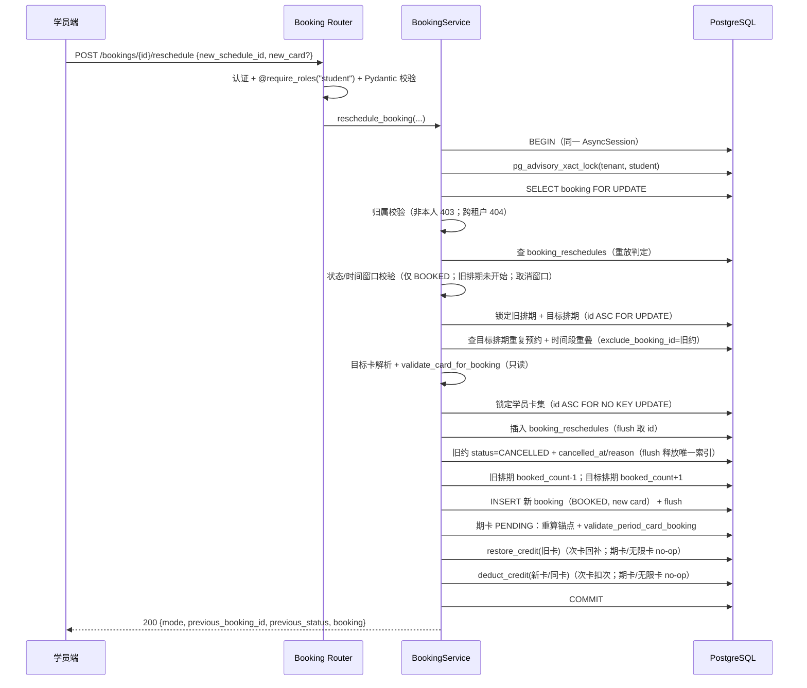
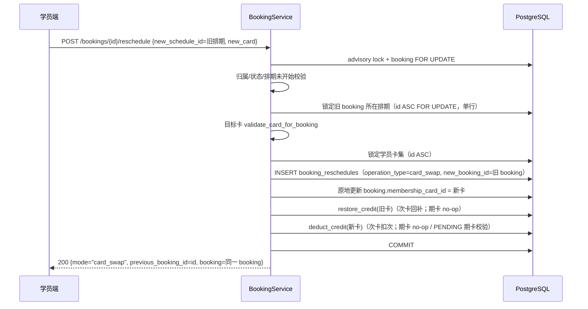
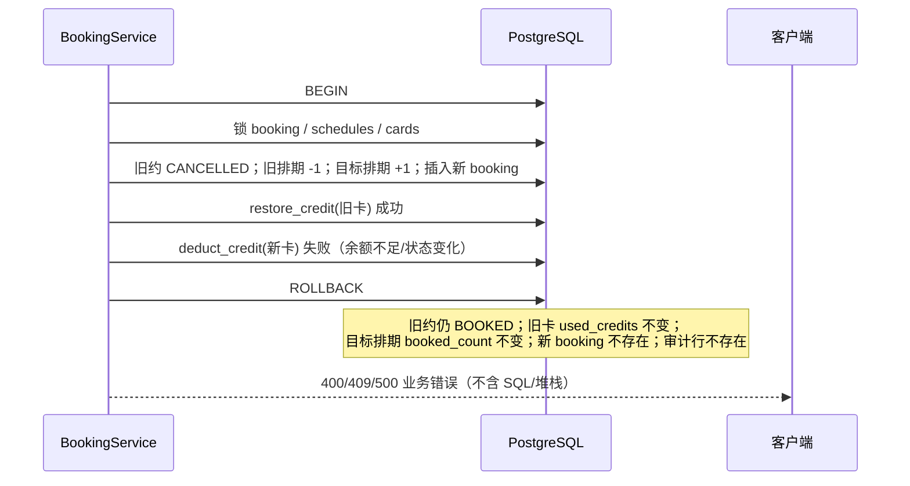

# F6.5 用户流程：原子改期 / 原子改派

> 角色：学员本人（`@require_roles("student")`）。管理员/教师代改不在本版范围（D-6）。
> 所有步骤在**同一个 `AsyncSession`、同一个事务**内完成，最后一次 `commit()`；任一步异常整体回滚。

## 1. 入口与参数

```
POST /api/v1/bookings/{booking_id}/reschedule
Authorization: Bearer <access_token>
x-tenant-slug: <tenant>
Idempotency-Key: <optional, <=64 chars>

{
  "new_schedule_id": 123,
  "new_membership_card_id": 456,   // 可选；不传 = 沿用原卡
  "reason": "改到周末班"            // 可选，<=200
}
```

分支判定：

```
new_schedule_id != old.schedule_id
  ├─ 是 → 模式 A：改期（reschedule）
  └─ 否 → 目标卡是否变化？
           ├─ 否 → 400「未发生改期或改派」（若命中幂等记录则重放）
           └─ 是 → 模式 B：改派（card_swap，同排期换卡）
```

## 2. 模式 A：改期（同卡 / 换卡）



### 2.1 校验顺序（无副作用优先）

| 序 | 校验 | 失败 |
|---|------|------|
| 1 | 认证 / 角色 | 401 / 403 |
| 2 | 预约存在且同租户 | 404（跨租户也 404） |
| 3 | 预约属于当前学员 | 403 |
| 4 | 幂等重放判定 | 命中 → 200 重放；键冲突 → 409 |
| 5 | 旧约状态 = `BOOKED` | 400「当前预约状态无法改期」 |
| 6 | 旧排期未开始 | 400 |
| 7 | 取消窗口（`cancel_deadline` / 租户分钟数） | 400 |
| 8 | 目标排期存在且同租户 | 404 |
| 9 | 目标排期 `NORMAL`、未开始、两周内、开放/截止窗口 | 400 |
| 10 | 目标排期未满 | 400「该排期已约满」 |
| 11 | 同排期重复预约（排除旧约） | 400「您已预约该排期」 |
| 12 | 时间段重叠（排除旧约） | 400（复用 F6.4 文案） |
| 13 | 目标卡归属/状态/有效期/课程适用 | 403 / 404 / 400 |
| 14 | 目标卡次数充足（仅异卡次卡） | 400「会员卡次数已用完」 |
| 15 | 期卡 PENDING 预期窗口/区间冲突 | 400 / 409 |
| 16 | 回补原卡（次卡） | 失败 → 整体回滚（400/500） |

> 卡校验在容量落库之前（与 `create_booking` 一致），保持「卡冲突优先提示」。

## 3. 模式 B：纯改派（同排期换卡）



- 不改变 `status`、`booked_at`、`schedule_id`、排期 `booked_count`。
- 不受取消窗口限制；只要求预约 `BOOKED` 且排期未开始。
- 目标卡不可用（冻结/过期/非本人/课程不适配）时直接拒绝，旧卡不变。

## 4. 换卡改期的卡处理矩阵

| 旧卡类型 | 新卡类型 | 旧卡动作 | 新卡动作 | 结果 |
|----------|----------|----------|----------|------|
| 次卡 | 次卡（同卡） | `restore_credit` +1 | `deduct_credit` -1 | 净额不变；两笔流水 |
| 次卡 | 次卡（异卡） | +1 | -1 | 旧卡余额恢复，新卡扣 1 |
| 次卡 | 期卡/无限卡 | +1 | no-op | 旧卡恢复，新卡不扣次 |
| 期卡/无限卡 | 次卡 | no-op | -1 | 新卡扣 1 |
| 期卡 | 期卡（同卡） | no-op | no-op | 卡有效期不变 |
| 期卡 | 期卡（异卡，PENDING/ACTIVE） | no-op | 校验目标卡可预约 | 旧卡 PENDING 锚点可能后移 |
| 无限卡 | 任意 | no-op | 按目标卡规则 | — |
| 无卡 | 无卡 | — | — | 允许改期；改派无变化则拒绝 |
| 无卡 | 有卡 | — | — | **拒绝**（D-5） |

> 期卡 PENDING 的预期有效期锚点 = 「取消旧约后，该卡剩余非取消预约 + 新预约」中最早的排期日（`booking/repository.py:368-396` 口径）。改期不写入 `valid_from/expire_at`；首次 `COMPLETED` 仍由 `activate_period_card_on_completion` 激活（`membership/service.py:738-864`）。

## 5. 失败回滚时序



必须覆盖的失败点：

| 失败点 | 回滚后状态 |
|--------|------------|
| 目标排期满 | 旧约 BOOKED；无任何写入 |
| 时间段重叠 | 旧约 BOOKED；无任何写入 |
| 目标卡校验失败 | 旧约 BOOKED；原卡不变 |
| 目标卡扣次失败（余额不足） | 旧约 BOOKED；原卡回补已回滚；目标名额未占 |
| 期卡区间冲突（409） | 旧约 BOOKED；卡状态不变 |
| 新 booking INSERT 触发唯一索引 | 旧约 BOOKED；名额回滚 |
| 任意未预期 DB 异常 | 全部回滚；返回统一 500 信封 |

## 6. 并发时序

### 6.1 同一预约重复提交

```
T1: advisory → booking FOR UPDATE → 校验通过 → 改期 → COMMIT
T2: advisory（等待）→ booking FOR UPDATE（等待）
    → 拿到锁后 booking 已 CANCELLED
    → 查 booking_reschedules 命中同一请求
    → 200 重放（返回 T1 的新 booking），不重复扣次
```

若 T2 的 `new_schedule_id/new_card` 与记录不一致 → `409 预约已改期，请刷新后重试`。

### 6.2 同一学员并发两个改期

`pg_advisory_xact_lock(tenant, student)` 串行化；后到者在锁释放后基于最新数据重新校验，避免两个改期同时占名额或产生交叉重叠。

### 6.3 反向改期（A→B 与 B→A）

两个事务分别锁定 `min(schedule_id)` 再锁 `max(schedule_id)`，卡集按 `id ASC` 锁定；不会形成 A 等 B、B 等 A 的环。目标容量不足时后到者 400。

### 6.4 改期 vs 取消 / 完成

同一 booking 行 `FOR UPDATE` 串行化：

- 取消先成功 → 改期拿到锁后状态为 `CANCELLED` → 400。
- 改期先成功 → 取消请求针对旧 booking 已 `CANCELLED` → 400「预约已取消」；用户应取消/改期新 booking。

### 6.5 改期 vs 排期取消（已知风险）

排期取消当前未对 booking 行加锁（`schedule/service.py:341-379`）。若与改期并发，可能出现重复回补（见 `requirement.md` RK-5 / U7）。本版以并发用例实测；若复现，登记技术债，另行硬化，不在 F6.5 顺手修改排期取消语义。

## 7. 幂等重放时序

```
请求进入
  ├─ 有 Idempotency-Key？
  │    ├─ booking_reschedules 命中 (tenant, key)
  │    │    ├─ 旧/新 schedule、旧/新 card 与本次一致 → 200 重放
  │    │    └─ 不一致 → 409 幂等键冲突
  │    └─ 未命中 → 继续
  ├─ 无 Key / 未命中：
  │    ├─ 旧 booking 已 CANCELLED 且有 operation_type=reschedule 记录
  │    │    ├─ 目标参数一致 → 200 重放
  │    │    └─ 不一致 → 409「预约已改期，请基于最新预约操作」
  │    └─ 旧 booking 仍 BOOKED → 正常执行
```

- `Idempotency-Key` 只做请求去重，**不作为身份来源**；租户/用户仍来自认证上下文。
- 键长度 ≤64，超长由 Pydantic/Header 校验拒绝；不记录敏感信息。
- 纯改派的重放判定：`booking.membership_card_id` 已等于请求目标卡 → 200 返回当前 booking。

## 8. 权限与租户

| 场景 | 结果 | 说明 |
|------|------|------|
| 未登录 | 401 | `get_current_user` 依赖 |
| 非 student 角色（admin/teacher） | 403 | `@require_roles("student")`（`booking/router.py:29` 同款） |
| 预约不存在 | 404 | `NotFoundException` |
| 预约属于其他学员 | 403 | `PermissionException`，与取消一致（`booking/service.py:248-255`） |
| 预约属于其他租户 | 404 | `TenantAwareRepository.get_by_id` 返回 None（`base_repository.py:420-425`） |
| 目标卡不存在/跨租户 | 404 | `validate_card_for_booking`（`membership/service.py:610-612`） |
| 目标卡属于其他学员 | 403 | `validate_card_for_booking`（`membership/service.py:613-614`） |
| 请求体伪造 `student_id/tenant_id` | 忽略 | DTO 不包含这些字段 |

## 9. 客户端表现（4 端）

| 端 | 本版影响 | 表现 |
|----|----------|------|
| student-web | 契约消费（F6.10） | 预约详情/列表「改期」入口 → 选目标排期/卡 → 二次确认 → 调 `reschedule`；成功刷新列表，失败展示 `msg` |
| miniapp（学员） | 契约消费（F6.11） | 同上；复用 `apps/miniapp/src/api/index.ts` 错误处理 |
| admin-web | 无 | 不新增入口；管理员调用会被 403（本版不支持代改） |
| teacher-web | 无 | 不涉及 |

前端四态要求（由 F6.10/F6.11 落实）：

- Loading：按钮禁用 + 提交中。
- Empty：目标排期为空/无可选卡。
- Error：400/403/404/409/500 均展示后端 `msg`；401 由 API 层刷新重放。
- Success：展示新排期时间/课程/卡；旧约不再出现在「待上课」。

## 10. 非功能流程

- 审计：每次成功改期/改派写一条 `booking_reschedules`，含操作人、模式、旧/新排期、旧/新卡、请求键。
- 日志：Service 记录 booking_id、old/new schedule、card 变化；**不记录 token、完整手机号、SQL、堆栈**。
- 观测：失败按错误码分类；409 期卡冲突与 400 容量/重叠分开统计。
