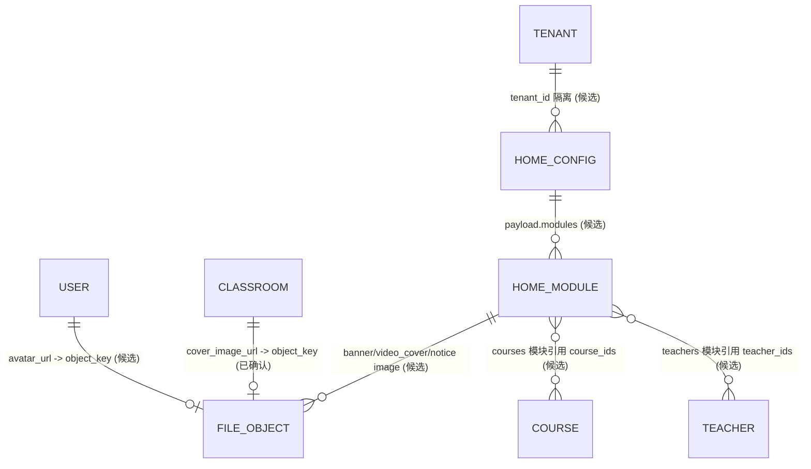
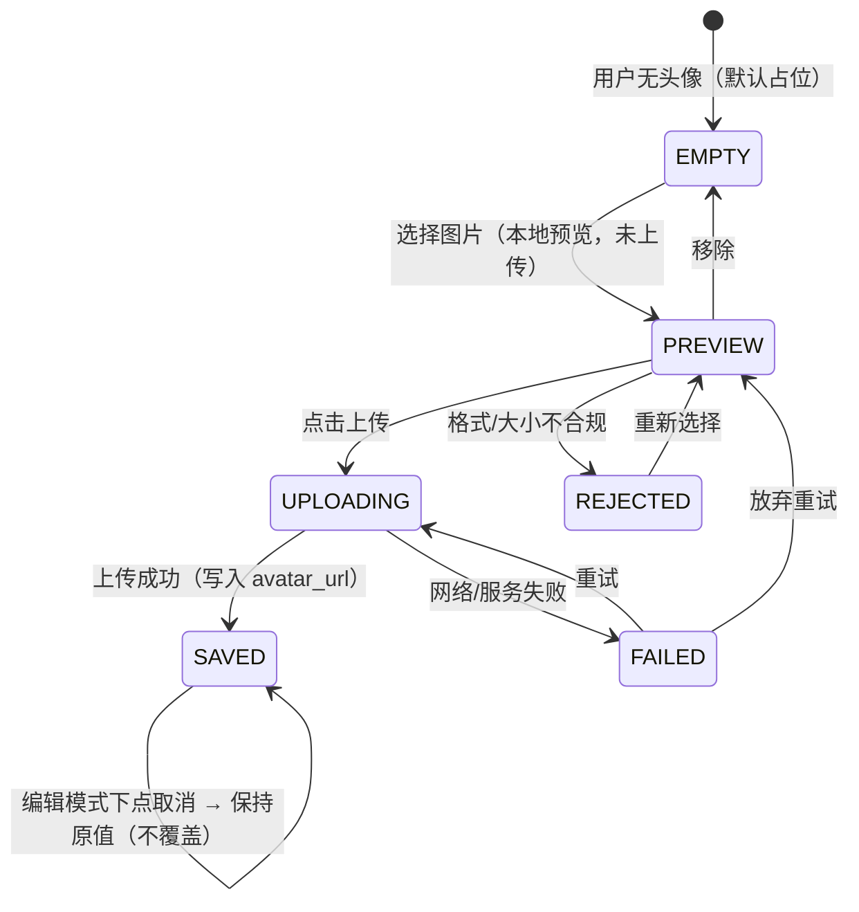
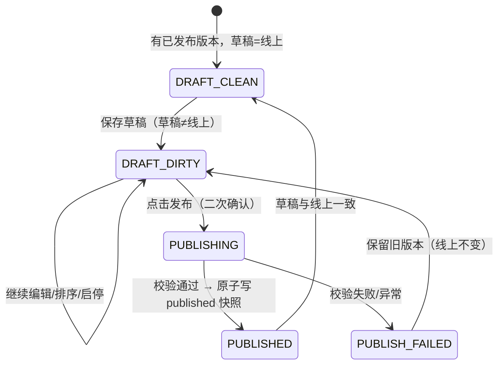

# F7.0 实体与状态模型（Entity State Model）

> 日期：2026-10-19
> 性质：原型级模型。**标注「已有」**的实体字段来自真实代码（带证据）；**标注「候选/待评审」**的为本次新增设计，尚未落地。

## 一、实体清单

| 实体 | 现状 | 说明 |
|------|------|------|
| User | **已有** `avatar_url String(500)` | `modules/user/models.py:39`；DTO/api-client 均已含 |
| Classroom | **已有** `name/equipment`；**已确认新增** `code`（租户内唯一）/`location`/`cover_image_url`；**已删除** `capacity`、`status` | `course/models.py:18-30`（原 `status` 在 F7.0 教室 UI 中不再使用） |
| FileObject | **候选新增** | 上传文件记录（key/mime/size/biz_type/uploader） |
| HomeConfig | **候选新增** | 草稿 + 发布快照（scope/version/payload JSONB） |
| HomeModule | **候选**（payload 内数组元素） | type/enabled/sort/配置项 |

## 二、用户头像状态机（P-F7-01/02）

要点：`PREVIEW` 是**本地预览**，只有 `UPLOADING→SAVED` 才产生服务器文件；**取消不覆盖原有头像**（`D-F7-A5`）。

## 三、首页配置（草稿 / 发布）状态机（P-F7-08/15）

要点：
- 小程序**只读** `published`；`DRAFT_DIRTY` 期间线上不受影响（`D-F7-E1`）。
- 发布**失败保留旧版本**：`published` 快照不被覆盖（`D-F7-E2`）。
- `published` 每次发布生成 **version** 自增快照。

## 四、首页模块（HomeModule）状态

| 字段 | 取值 | 说明 |
|------|------|------|
| `type` | `banner`/`teachers`/`courses`/`video`/`notice` | 第一版固定 5 类（`D-F7-D3`） |
| `enabled` | true/false | 停用 → 小程序静默隐藏（`D-F7-E4`） |
| `sort` | int（1..n 连续） | 模块排序值，1 最靠前；由**拖动排序**调整，放下后整体重写为 1..n（`D-F7-D2`） |
| 内容来源 | banner/video/notice=配置数据；teachers/courses=引用真实 id | 见 solution-design.md 1.2 |

模块渲染决策表（P-F7-14）：

| 情况 | 小程序表现 |
|------|------------|
| `enabled=false` | 不渲染 |
| `enabled=true` 但内容为空 | 不渲染（空壳隐藏） |
| `enabled=true` 有内容 | 按 `sort` 顺序渲染 |
| 图片 URL 失效 | 显示统一占位图 |
| 首页接口失败 | 分级降级：师资/课程回落真实 API；纯配置模块用缓存，无缓存则隐藏 |

## 五、教室实体字段（P-F7-05）

> 教室**不再有「状态」概念**：`status` 字段与「维护 / 启用」操作按钮、状态列/标签一并移除（`D-F7-C1`）。

| 字段 | 现状/已确认 | 取值 / 说明 |
|------|-----------|-------------|
| `code`（教室编码） | **已确认新增**（`D-F7-C3`） | 字符串，**必填、租户内唯一**；重复保存报「教室编码已存在」；展示于表格列 / 卡片 tag / 弹窗输入项 |
| `cover_image_url` | **已确认新增** | 有图 / **未设置（显示「暂无图片」占位）** / 加载失败（占位） |
| `location` | **候选·待评审** | 字符串，可空（空 → 显示「--」） |
| `name` / `equipment` | 已有 | 名称（必填）/ 设备多选 |
| ~~`capacity`~~ | **已删除** | 容纳人数不再引入 |
| ~~`status`~~ | **已删除（F7.0 不再使用）** | 原 `1 正常 / 0 维护中` 及「维护」按钮已移除 |

## 六、跨端状态同步（现状约束）

- 小程序首页在各页 `onMounted/onShow` 拉取数据（无服务端推送）。
- 后台**发布**后，小程序下次进入首页才可见新配置 → 原型预览体现"发布后生效"，不表现实时推送。
- 预览（P-F7-14）读的是**草稿**，故与小程序实际线上所见可能不同，已在预览页显式标注。

## 七、决策依赖标注

| 实体/状态 | 依赖决策 |
|-----------|----------|
| 头像上传约束 | D-F7-A4 |
| 教室新增字段（含编码） | D-F7-C1 / D-F7-C3 |
| 首页模块增减/排序 | D-F7-D2/D3 |
| 内容选择方式 | D-F7-D4/D5 |
| 草稿/发布机制 | D-F7-E1/E2 |
| 降级与占位 | D-F7-E3/E7 |
