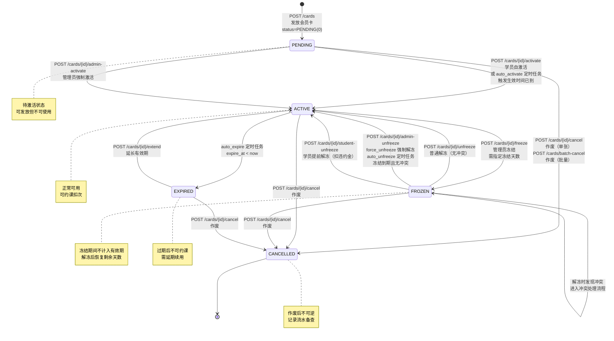

# 会员卡管理模块深度审计报告

> **审计日期**: 2025-06-22
> **审计范围**: 后端 API / 管理后台 / 小程序端 / 定时任务 / 共享 API 客户端
> **整体健康度**: ⚠️ **需紧急修复** —— 发现 2 个 P0、5 个 P1、6 个 P2 问题

---

## 审计摘要

会员卡模块核心功能基本完整，但存在 **关键的定时任务逻辑 bug**（自动解冻冲突解决统计永远为 0）和 **前端 API 客户端与后端端点不匹配**（虚构了 delete/batch-delete 端点，缺少 extend 端点）等问题。定时任务的多租户隔离缺失需要架构层面确认。整体建议优先修复 P0/P1 后再上线。

**问题统计**: P0 × 2 | P1 × 5 | P2 × 6

---

## 第一部分：逻辑图

### 图 1：整体功能总览图

```mermaid
graph TB
    subgraph "管理后台 (admin-web)"
        MA[产品管理页面]
        MB[会员卡管理页面]
        MC[冲突处理弹窗]
        MD[批量操作弹窗]
    end

    subgraph "小程序端 (miniapp)"
        SA[我的会员卡页面]
        SB[卡详情]
        SC[激活待激活卡]
        SD[学员提前解冻]
    end

    subgraph "共享 API 客户端 (packages/api-client)"
        API[membership.ts]
    end

    subgraph "后端 API (FastAPI)"
        direction LR
        R1[产品 8 个端点]
        R2[会员卡 15 个端点]
        R3[流水 1 个端点]
    end

    subgraph "定时任务 (APScheduler)"
        T1[auto_activate 自动激活]
        T2[auto_expire 自动过期]
        T3[auto_unfreeze 自动解冻]
        T4[notify_expiring 到期提醒]
    end

    MA -->|CRUD/回收站/恢复| API
    MB -->|列表/发放/冻结/解冻/作废/延期| API
    MC -->|conflict-check + admin-unfreeze| API
    MD -->|batch-cancel| API
    API --> R1
    API --> R2
    API --> R3

    SA -->|my-cards| API
    SB -->|cards/{id}| API
    SC -->|cards/{id}/activate| API
    SD -->|cards/{id}/student-unfreeze| API

    T1 -->|直接操作 DB| DB[(PostgreSQL)]
    T2 -->|直接操作 DB| DB
    T3 -->|直接操作 DB| DB
    T4 -->|直接操作 DB| DB

    style T1 fill:#ff9999
    style T2 fill:#ff9999
    style T3 fill:#ff9999
    style T4 fill:#ff9999
```

> ⚠️ **注意**: 定时任务直接访问数据库，无 tenant_id 上下文注入，存在多租户隔离风险（详见第二部分 D 节）。

### 图 2：会员卡完整生命周期状态机图



### 图 3：管理员解冻流程图（冲突处理）

```mermaid
flowchart TD
    A[管理员点击解冻] --> B{调用 conflict-check<br/>GET /cards/{id}/conflict-check}
    B --> C{是否存在同课程类型<br/>且时间重叠的有效卡?}
    
    C -->|无冲突| D[直接解冻<br/>POST /cards/{id}/unfreeze]
    D --> E[状态变为 ACTIVE<br/>有效期恢复剩余天数]
    
    C -->|有冲突| F[前端弹出冲突处理弹窗<br/>展示冲突卡列表]
    
    F --> G{管理员选择处理方式}
    
    G -->|force_unfreeze<br/>强制解冻| H[POST /cards/{id}/admin-unfreeze<br/>action=force_unfreeze]
    H --> I[当前卡解冻为 ACTIVE<br/>冲突卡保持不变<br/>⚠️ 学员会有多张同课程卡]
    
    G -->|unfreeze_and_cancel<br/>解冻并作废冲突卡| J[POST /cards/{id}/admin-unfreeze<br/>action=unfreeze_and_cancel<br/>conflict_card_ids=[...]]
    J --> K[当前卡解冻为 ACTIVE<br/>冲突卡作废为 CANCELLED<br/>记录作废流水]
    
    G -->|unfreeze_and_freeze<br/>解冻并冻结冲突卡| L[POST /cards/{id}/admin-unfreeze<br/>action=unfreeze_and_freeze<br/>conflict_card_ids=[...], freeze_days=N]
    L --> M[当前卡解冻为 ACTIVE<br/>冲突卡冻结为 FROZEN<br/>指定冻结天数]
    
    E --> N[结束]
    I --> N
    K --> N
    M --> N

    style F fill:#fff3cd
    style H fill:#d4edda
    style J fill:#cce5ff
    style L fill:#f8d7da
```

---

## 第二部分：功能对账清单

### A. 后端 API 层对账

| # | API 端点 | HTTP 方法 | 路由路径 | require_roles | import 完整 | 多租户隔离 | 响应格式 | 并发安全 | 状态 |
|---|---------|----------|---------|---------------|------------|-----------|---------|---------|------|
| 1 | 创建产品 | POST | /membership/products | admin, super_admin | ✅ | ✅ | ✅ success() | N/A | ✅ |
| 2 | 产品列表 | GET | /membership/products | 无 | ✅ | ✅ | ✅ | N/A | ✅ |
| 3 | 产品详情 | GET | /membership/products/{id} | 无 | ✅ | ✅ | ✅ | N/A | ✅ |
| 4 | 更新产品 | PUT | /membership/products/{id} | admin, super_admin | ✅ | ✅ | ✅ | N/A | ✅ |
| 5 | 删除产品 | DELETE | /membership/products/{id} | admin, super_admin | ✅ | ✅ | ✅ | N/A | ✅ |
| 6 | 批量删除产品 | POST | /membership/products/batch-delete | admin, super_admin | ✅ | ✅ | ✅ | N/A | ✅ |
| 7 | 回收站 | GET | /membership/products/recycle-bin | 无 | ✅ | ✅ | ✅ | N/A | ✅ |
| 8 | 恢复产品 | POST | /membership/products/{id}/restore | admin, super_admin | ✅ | ✅ | ✅ | N/A | ✅ |
| 9 | 发放会员卡 | POST | /membership/cards | admin, super_admin | ✅ | ✅ | ✅ | ⚠️ 无锁 | ✅ |
| 10 | 会员卡列表 | GET | /membership/cards | 无 | ✅ | ✅ | ✅ | N/A | ✅ |
| 11 | 我的会员卡 | GET | /membership/my-cards | 学员 | ✅ | ✅ | ✅ | N/A | ✅ |
| 12 | 会员卡详情 | GET | /membership/cards/{id} | 无 | ✅ | ✅ | ✅ | N/A | ✅ |
| 13 | 冻结 | POST | /membership/cards/{id}/freeze | admin, super_admin | ✅ | ✅ | ✅ | ⚠️ 无锁 | ✅ |
| 14 | 冲突检查 | GET | /membership/cards/{id}/conflict-check | admin, super_admin | ✅ | ✅ | ✅ | N/A | ✅ |
| 15 | 管理员解冻 | POST | /membership/cards/{id}/admin-unfreeze | admin, super_admin | ✅ | ✅ | ✅ | ⚠️ 无锁 | ✅ |
| 16 | 普通解冻 | POST | /membership/cards/{id}/unfreeze | 无 | ✅ | ✅ | ✅ | ⚠️ 无锁 | ✅ |
| 17 | 延期 | POST | /membership/cards/{id}/extend | admin, super_admin | ✅ | ✅ | ✅ | ⚠️ 无锁 | ✅ |
| 18 | 学员激活 | POST | /membership/cards/{id}/activate | 学员 | ✅ | ✅ | ✅ | ⚠️ 无锁 | ✅ |
| 19 | 学员提前解冻 | POST | /membership/cards/{id}/student-unfreeze | 学员 | ✅ | ✅ | ✅ | ⚠️ 无锁 | ✅ |
| 20 | 管理员激活 | POST | /membership/cards/{id}/admin-activate | admin, super_admin | ✅ | ✅ | ✅ | ⚠️ 无锁 | ✅ |
| 21 | 作废（单张） | POST | /membership/cards/{id}/cancel | admin, super_admin | ✅ | ✅ | ✅ | ⚠️ 无锁 | ✅ |
| 22 | 作废（批量） | POST | /membership/cards/batch-cancel | admin, super_admin | ✅ | ✅ | ✅ | ❌ 无锁 | ✅ |
| 23 | 消费流水 | GET | /membership/transactions | 无 | ✅ | ✅ | ✅ | N/A | ✅ |

> **关于并发安全**: 会员卡状态变更操作（冻结/解冻/激活/作废）均无悲观锁保护，在高并发下可能出现 race condition。只有 `deduct_credit`（扣次）和 `restore_credit`（恢复次数）使用了 `SELECT FOR UPDATE`。建议所有状态变更都加锁。

---

### B. 管理后台对账

| 功能模块 | 子功能 | 前端实现 | 后端对接 | 状态 |
|---------|--------|---------|---------|------|
| **产品管理** | 创建产品 | ✅ 表单校验完整 | ✅ POST /products | ✅ |
| | 产品列表 | ✅ 分页/搜索 | ✅ GET /products | ✅ |
| | 产品详情 | ✅ | ✅ GET /products/{id} | ✅ |
| | 更新产品 | ✅ | ✅ PUT /products/{id} | ✅ |
| | 删除产品 | ✅ | ✅ DELETE /products/{id} | ✅ |
| | 批量删除 | ✅ | ✅ POST /products/batch-delete | ✅ |
| | 回收站 | ✅ | ✅ GET /products/recycle-bin | ✅ |
| | 恢复产品 | ✅ | ✅ POST /products/{id}/restore | ✅ |
| **会员卡管理** | 发放会员卡 | ✅ 续卡场景 allow_duplicate | ✅ POST /cards | ✅ |
| | 会员卡列表 | ✅ 状态/学员/产品/关键词筛选 | ✅ GET /cards | ✅ |
| | 会员卡详情 | ✅ 字段完整展示 | ✅ GET /cards/{id} | ✅ |
| | 冻结 | ✅ 冻结天数/原因 | ✅ POST /cards/{id}/freeze | ✅ |
| | 普通解冻 | ✅ | ✅ POST /cards/{id}/unfreeze | ✅ |
| | 管理员解冻-冲突检测 | ✅ 弹窗展示冲突卡 | ✅ GET /cards/{id}/conflict-check | ✅ |
| | 管理员解冻-强制解冻 | ✅ | ✅ POST /cards/{id}/admin-unfreeze | ✅ |
| | 管理员解冻-解冻并作废冲突卡 | ✅ | ✅ action=unfreeze_and_cancel | ✅ |
| | 管理员解冻-解冻并冻结冲突卡 | ✅ | ✅ action=unfreeze_and_freeze | ✅ |
| | 学员提前解冻 | ✅ | ✅ POST /cards/{id}/student-unfreeze | ✅ |
| | 学员激活 | ❌ 管理后台未实现（应只有学员端有） | ✅ POST /cards/{id}/activate | N/A |
| | 管理员激活 | ✅ | ✅ POST /cards/{id}/admin-activate | ✅ |
| | 延期 | ✅ 延长天数 | ✅ POST /cards/{id}/extend | ✅ |
| | 作废（单张） | ✅ 作废原因 | ✅ POST /cards/{id}/cancel | ✅ |
| | 作废（批量） | ✅ | ✅ POST /cards/batch-cancel | ✅ |
| | 消费流水 | ✅ 弹窗展示 | ✅ GET /transactions | ✅ |

---

### C. 小程序端对账

| 功能 | 前端实现 | 后端对接 | API 路径 | 状态 |
|------|---------|---------|---------|------|
| 我的会员卡列表 | ✅ 状态筛选展示 | ✅ | GET /membership/my-cards | ✅ |
| 卡详情页 | ✅ 课时/有效期/冻结信息 | ✅ | GET /membership/cards/{id} | ✅ |
| 激活待激活卡 | ✅ 按钮+确认 | ✅ | POST /membership/cards/{id}/activate | ✅ |
| 学员提前解冻 | ✅ 按钮+违约金提示 | ✅ | POST /membership/cards/{id}/student-unfreeze | ✅ |
| 消费流水查询 | ✅ | ✅ | GET /membership/transactions | ✅ |
| 过期卡展示 | ✅ 列表中灰色展示 | ✅ | 已包含在 my-cards | ✅ |
| 冻结卡状态展示 | ✅ 显示冻结原因 | ✅ | 已包含在 my-cards | ✅ |

---

### D. 定时任务对账

| 任务名称 | 执行逻辑 | 多租户隔离 | 异常处理 | 状态 |
|---------|---------|-----------|---------|------|
| **auto_activate_membership_cards** | 激活 valid_from <= now 且 status=PENDING 的卡 | ❌ 无 tenant_id 过滤 | ❌ 无 try/except 包裹主循环 | ⚠️ |
| **auto_expire_membership_cards** | 将 expire_at < now 且 status=ACTIVE 的卡标为 EXPIRED | ❌ 无 tenant_id 过滤 | ❌ 无 try/except 包裹主循环 | ⚠️ |
| **auto_unfreeze_membership_cards** | 检查冻结到期且无冲突的卡自动解冻 | ❌ 无 tenant_id 过滤 | ❌ 无 try/except 包裹主循环 | ⚠️ |
| **notify_expiring_membership_cards** | 查找 3 天内到期的卡并记录日志 | ❌ 无 tenant_id 过滤 | ❌ 无 try/except | ⚠️ |

> ⚠️ **架构风险**: 所有定时任务直接使用 `SessionLocal()` 创建数据库会话，通过 SQLAlchemy 模型的查询条件直接操作所有租户的数据，**完全没有 tenant_id 隔离**。如果系统确实需要多租户隔离，定时任务需要一种机制来注入 tenant_id（如遍历所有活跃租户分别执行，或查询时显式过滤 tenant_id）。

---

## 第三部分：Bug 与潜藏问题

### P0 级别 - 必须立即修复（2 个）

---

#### [P0-1] 自动解冻定时任务中"冲突解决"统计永远为 0

- **位置**: `apps/api/src/app/modules/membership/scheduler.py:412, 432`
- **描述**: `auto_unfreeze_membership_cards` 函数在处理无冲突卡时，第 412 行先执行 `card.frozen_reason = None`，然后第 432 行检查 `"课程冲突" in (card.frozen_reason or "")` —— 由于此时 `frozen_reason` 已经是 `None`，这个条件**永远为 False**，导致 `resolved_count` 永远为 0，日志统计中"冲突解决"数量始终为 0。更重要的是，这意味着之前因冲突被跳过的卡在后来冲突解决后被成功解冻了，但这条业务逻辑的日志追踪完全失效。
- **复现**: 步骤 1）创建两张同课程类型、时间重叠的卡 A（ACTIVE）和 B（FROZEN，因冲突无法自动解冻，frozen_reason 含"课程冲突"）；步骤 2）作废卡 A；步骤 3）等待定时任务执行，观察日志："冲突解决" 计数仍为 0，但卡 B 已成功解冻为 ACTIVE。
- **根因**: 代码逻辑顺序错误，将状态判断放在了状态修改之后 —— 典型的"先清数据再检查数据"反模式。
- **修复代码**:

```python
# apps/api/src/app/modules/membership/scheduler.py
# 修改 auto_unfreeze_membership_cards 函数第 405-438 行

            # ========== 修复：先保存冲突状态，再清空字段 ==========
            had_conflict_before_unfreeze = "课程冲突" in (card.frozen_reason or "")
            
            # 冲突已解决或无冲突，自动解冻
            card.status = CardStatus.ACTIVE.value
            
            if card.frozen_remaining_days is not None and card.frozen_remaining_days > 0:
                card.expire_at = now + timedelta(days=card.frozen_remaining_days)
            
            card.frozen_reason = None
            card.frozen_at = None
            card.frozen_until = None
            card.frozen_remaining_days = None

            # 更新最新的冻结记录
            result = await db.execute(
                select(MembershipCardFreeze)
                .where(
                    MembershipCardFreeze.card_id == card.id,
                    MembershipCardFreeze.unfrozen_at.is_(None),
                )
                .order_by(MembershipCardFreeze.created_at.desc())
                .limit(1)
            )
            freeze_record = result.scalars().first()
            if freeze_record:
                freeze_record.unfrozen_at = now

            # 检查之前是否有冲突标记，如果有则记录日志
            if had_conflict_before_unfreeze:
                resolved_count += 1
                logger.info(
                    f"[定时任务] 卡 {card.id}（学员 {card.student_id}）冲突已解决，自动解冻"
                )

            unfrozen_count += 1
```

---

#### [P0-2] API 客户端虚构后端不存在的端点，且缺少后端已实现的端点

- **位置**: `packages/api-client/src/membership.ts:196-201, 缺少 extend 方法`
- **描述**: API 客户端 `membershipCardApi` 对象存在 4 个问题：
  1. **虚构 delete 端点**（第 196 行）：调用 `DELETE /membership/cards/{id}`，但后端 router.py **不存在** 此端点
  2. **虚构 batchDelete 端点**（第 198-201 行）：调用 `POST /membership/cards/batch-delete`，但后端不存在此端点（后端只有产品的 batch-delete，会员卡的批量删除未实现）
  3. **缺少 extend 端点**：后端已实现 `POST /membership/cards/{id}/extend`，但 API 客户端未封装
  4. **batchDeleteProducts 重复定义**：此方法在 `cardTypeApi` 和 `membershipCardApi` 中各定义一次（第 169-172 行和第 233-236 行）
- **复现**: 在 admin-web 或 miniapp 中调用 `membershipCardApi.delete(123)` 或 `membershipCardApi.batchDelete([1,2,3])`，后端返回 HTTP 404；admin-web 的延期功能无法通过共享 API 客户端调用。
- **根因**: 前端 API 客户端开发时"超前"定义了后端尚未实现的端点，同时遗漏了后端已实现的端点。两处 `batchDeleteProducts` 重复是 copy-paste 遗留。
- **修复代码**:

```typescript
// packages/api-client/src/membership.ts

// ===== 修复后的 membershipCardApi =====
export const membershipCardApi = {
  list: (params?: MembershipCardListParams) =>
    apiClient.get<MembershipCardListResponse>("/membership/cards", { params }),

  create: (data: MembershipCardCreateParams) =>
    apiClient.post<MembershipCard>("/membership/cards", data),

  get: (id: number) => apiClient.get<MembershipCard>(`/membership/cards/${id}`),

  freeze: (id: number, data: MembershipCardFreezeParams) =>
    apiClient.post<MembershipCard>(`/membership/cards/${id}/freeze`, data),

  cancel: (id: number, data: { reason: string }) =>
    apiClient.post<MembershipCard>(`/membership/cards/${id}/cancel`, data),

  batchCancel: (ids: number[], data: { reason: string }) =>
    apiClient.post<MembershipCard[]>("/membership/cards/batch-cancel", {
      card_ids: ids,
      ...data,
    }),

  // 删除虚构的 delete 方法（后端无 DELETE /membership/cards/{id}）
  // delete: (id: number) => apiClient.delete(`/membership/cards/${id}`),

  // 删除虚构的 batchDelete 方法（后端无 POST /membership/cards/batch-delete）
  // batchDelete: (ids: number[]) =>
  //   apiClient.post("/membership/cards/batch-delete", { card_ids: ids }),

  unfreeze: (id: number) =>
    apiClient.post<MembershipCard>(`/membership/cards/${id}/unfreeze`),

  studentUnfreeze: (id: number) =>
    apiClient.post<MembershipCard>(`/membership/cards/${id}/student-unfreeze`),

  checkConflict: (id: number) =>
    apiClient.get<MembershipCardConflictCheckResponse>(
      `/membership/cards/${id}/conflict-check`,
    ),

  unfreezeWithConflict: (
    id: number,
    data: {
      action: string;
      conflict_card_ids?: number[];
      remark?: string;
      freeze_days?: number;
    },
  ) =>
    apiClient.post<MembershipCard>(
      `/membership/cards/${id}/admin-unfreeze`,
      data,
    ),

  activate: (id: number) =>
    apiClient.post<MembershipCard>(`/membership/cards/${id}/activate`),

  adminActivate: (id: number) =>
    apiClient.post<MembershipCard>(`/membership/cards/${id}/admin-activate`),

  // 新增：后端已实现的延期端点（之前遗漏）
  extend: (id: number, data: { extend_days: number; remark?: string }) =>
    apiClient.post<MembershipCard>(`/membership/cards/${id}/extend`, data),

  getTransactions: (params?: {
    card_id?: number;
    page?: number;
    page_size?: number;
  }) =>
    apiClient.get<MembershipCardTransactionListResponse>(
      "/membership/transactions",
      { params },
    ),
};

// ===== 删除 membershipCardApi 中重复的 batchDeleteProducts =====
// （cardTypeApi 中第 169-172 行已定义，此处第 233-236 行重复，删除）
```

---

### P1 级别 - 功能异常或逻辑错误（5 个）

---

#### [P1-1] auto_expire 定时任务中存在冗余 WHERE 条件

- **位置**: `apps/api/src/app/modules/membership/scheduler.py:222-229`
- **描述**: 查询条件同时写了 `status == CardStatus.ACTIVE.value` 和 `status != CardStatus.FROZEN.value`。由于 ACTIVE != FROZEN 恒成立，第二个条件完全冗余。更严重的是，这两个条件的 **语义** 之间存在张力：排除 FROZEN 状态的卡过期判断是"正确意图"，但用 `!= FROZEN` 而非 `== ACTIVE` 来表达，容易让维护者困惑为什么不直接写 `status.in_([ACTIVE])`。实际上 `EXPIRED` 和 `CANCELLED` 也被排除了，所以应该统一成只查 ACTIVE。
- **根因**: 开发者在修改条件时叠加了新旧逻辑，没有清理冗余。
- **复现**: 代码审查即可发现，无功能性 bug 但增加了维护成本。
- **修复代码**:

```python
# apps/api/src/app/modules/membership/scheduler.py
# 第 222-230 行，清理冗余条件

        result = await db.execute(
            select(MembershipCard).where(
                MembershipCard.expire_at < now,
                MembershipCard.status == CardStatus.ACTIVE.value,
                MembershipCard.expire_at.isnot(None),
                # 删除冗余条件 MembershipCard.status != CardStatus.FROZEN.value
            )
        )
```

---

#### [P1-2] 所有 4 个定时任务的 for 循环缺少 try/except 保护

- **位置**: `apps/api/src/app/modules/membership/scheduler.py` —— `auto_activate_membership_cards`、`auto_expire_membership_cards`、`auto_unfreeze_membership_cards`、`notify_expiring_membership_cards` 全部
- **描述**: 每个定时任务的主循环都是 `for card in cards:` 直接处理，如果某张卡处理时抛出异常（例如历史脏数据导致 `frozen_remaining_days` 为负数、`expire_at` 解析失败、或 `MembershipCardFreeze` 查询关联出错），**整个定时任务会中断**，后续卡片全部不被处理。且没有捕获异常后记录失败卡的 ID 和错误栈。
- **复现**: 在数据库中手动插入一张 `frozen_remaining_days = -100` 且 `status = FROZEN` 的卡，等待 `auto_unfreeze` 执行，定时任务会在处理到这张卡时因 `ValueError` 崩溃，后续所有正常卡都不被解冻。
- **根因**: 批量处理场景下的经典错误，缺少逐元素的容错机制。
- **修复代码**:

```python
# apps/api/src/app/modules/membership/scheduler.py
# 以下修改模式适用于全部 4 个定时任务的 for card in cards: 循环

# 示例：auto_expire_membership_cards 的主循环（第 239-272 行）
        failed_count = 0
        for card in cards:
            try:
                remaining = (card.total_credits or 0) - card.used_credits

                if card.card_type == CardType.COUNT.value and remaining > 0:
                    clear_txn = MembershipCardTransaction(
                        tenant_id=card.tenant_id,
                        card_id=card.id,
                        operation_type=TransactionType.EXPIRE.value,
                        change_amount=-remaining,
                        balance_after=0,
                        remark=f"会员卡到期，剩余{remaining}次自动清零",
                    )
                    db.add(clear_txn)
                    card.used_credits = card.total_credits

                card.status = CardStatus.EXPIRED.value

                if remaining == 0:
                    txn = MembershipCardTransaction(
                        tenant_id=card.tenant_id,
                        card_id=card.id,
                        operation_type=TransactionType.EXPIRE.value,
                        change_amount=0,
                        balance_after=0,
                        remark="会员卡自动过期",
                    )
                    db.add(txn)
            except Exception as e:
                failed_count += 1
                logger.exception(
                    f"[定时任务] 处理卡 {card.id}（学员 {card.student_id}）"
                    f"过期失败: {e}"
                )
                continue

        await db.commit()

        logger.info(
            f"[定时任务] 自动标记 {len(card_ids)} 个会员卡为已过期"
            f"（成功 {len(card_ids) - failed_count}，失败 {failed_count}）"
        )

# 同样的模式应用于 auto_activate_membership_cards、
# auto_unfreeze_membership_cards、notify_expiring_membership_cards
```

---

#### [P1-3] scheduler.py 内部重复 import，CardType / MembershipCardFreeze / timedelta 未在顶部统一引入

- **位置**:
  - `scheduler.py:35` —— `from app.modules.membership.models import CardType`（函数内部）
  - `scheduler.py:97` —— `from datetime import timedelta`（函数内部）
  - `scheduler.py:217` —— `from app.modules.membership.models import CardType`（函数内部，重复）
  - `scheduler.py:288` —— `from datetime import timedelta`（函数内部，重复）
  - 顶部缺少 `MembershipCardFreeze` 的 import
- **描述**: 文件顶部只引入了 `CardStatus, MembershipCard, MembershipCardTransaction, TransactionType`，但实际用到了 `CardType`、`MembershipCardFreeze`、`timedelta` 却在各函数内部局部 import。这导致：（1）阅读代码时需要不断跳到函数内部确认依赖；（2）IDE 自动补全/静态分析失效；（3）潜在的循环引用风险（虽然当前没有）。
- **复现**: 打开 `auto_unfreeze_membership_cards` 函数，第 419 行用到 `MembershipCardFreeze`，但无法在文件顶部找到它的 import。
- **根因**: 开发过程中临时添加 import 而忘记整理到文件顶部。
- **修复代码**:

```python
# apps/api/src/app/modules/membership/scheduler.py
# 修改顶部 import 区（第 9-21 行）

import logging
from datetime import UTC, datetime, timedelta

from sqlalchemy import select

from app.core.config import get_settings
from app.core.database import SessionLocal
from app.modules.membership.models import (
    CardStatus,
    CardType,
    MembershipCard,
    MembershipCardFreeze,
    MembershipCardTransaction,
    TransactionType,
)

# 然后删除以下函数内部的 import：
# 第 35 行  from app.modules.membership.models import CardType           → 删除
# 第 97 行  from datetime import timedelta                               → 删除
# 第 217 行 from app.modules.membership.models import CardType           → 删除
# 第 288 行 from datetime import timedelta                               → 删除
```

---

#### [P1-4] 发放会员卡（issue_card）缺少并发锁，可能导致同一学员同时获得多张冲突卡

- **位置**: `apps/api/src/app/modules/membership/service.py:272-317`（冲突检查逻辑）
- **描述**: `issue_card` 中调用 `get_active_cards_by_student` 检查冲突卡是在 **应用层完成** 的，两个并发的发放请求（例如管理员同时为同一学员发放两张卡）可能**同时通过冲突检查**，然后各自创建一张新卡，最终学员会持有两张同课程类型且时间重叠的有效卡。这直接违反了系统"不允许同课程类型且时间重叠的有效卡"的业务规则。
- **复现**: 使用并发测试工具（如 locust / k6）发送两个 `POST /membership/cards` 请求，参数完全相同（同一 student_id、同一 applicable_course_type_code、时间重叠），观察返回成功且数据库出现两张冲突卡。
- **根因**: 冲突检查（SELECT）和插入新卡（INSERT）之间不是原子操作，缺少行级锁或唯一约束。
- **修复代码**:

```python
# apps/api/src/app/modules/membership/service.py
# 在 issue_card 方法中，冲突检查前先加锁

async def issue_card(
    self,
    db: AsyncSession,
    data: MembershipCardCreate,
    tenant_id: int,
    operator_id: int | None = None,
    idempotency_key: str | None = None,
    allow_duplicate: bool = False,
) -> MembershipCard:
    # ... 幂等检查和 product 查询（不变）...

    # ========== 修复：先锁住学员所有活跃/待激活/冻结的卡 ==========
    from sqlalchemy import select

    locked_result = await db.execute(
        select(MembershipCard)
        .where(
            MembershipCard.student_id == data.student_id,
            MembershipCard.tenant_id == tenant_id,
            MembershipCard.status.in_([
                CardStatus.PENDING.value,
                CardStatus.ACTIVE.value,
                CardStatus.FROZEN.value,
            ]),
        )
        .with_for_update(skip_locked=False)
    )
    locked_existing_cards = locked_result.scalars().all()

    # 用被锁定的卡列表进行冲突检查（替代下面的 get_active_cards_by_student 调用）
    all_existing_cards = [
        {
            "id": c.id,
            "applicable_course_type_code": c.applicable_course_type_code,
            "valid_from": c.valid_from,
            "expire_at": c.expire_at,
        }
        for c in locked_existing_cards
    ]
    # ========== 修复结束 ==========

    # ... 后续冲突检查逻辑不变，继续使用 all_existing_cards ...
```

---

#### [P1-5] 冻结/解冻/激活/作废等状态变更方法均无悲观锁

- **位置**: `apps/api/src/app/modules/membership/service.py` 中 `freeze_card`、`unfreeze_card`、`admin_force_unfreeze_card`、`activate_card`、`admin_activate_card`、`cancel_card`、`batch_cancel_cards`、`extend_card`、`student_unfreeze_card` 等全部 9 个写操作方法
- **描述**: 在整个 service.py 中，**只有 `deduct_credit`（扣次，行 1324）和 `restore_credit`（恢复次数，行 1402）** 使用了 `get_card_with_lock`（内部是 `SELECT ... FOR UPDATE`）。其余所有会员卡状态变更方法都直接用 `card_repo.get_by_id()` 获取卡记录后修改，**没有任何悲观锁保护**。在以下场景会导致数据不一致：
  - **解冻与约课并发**: 管理员正在解冻卡（状态 FROZEN → ACTIVE），同时学员正在使用该卡约课扣次 —— 解冻还没 commit 但扣次时卡已经被读到（非 FROZEN 检查通过），结果卡的状态仍是 FROZEN 但课时已被扣
  - **冻结与激活并发**: 管理员正在冻结卡，学员同时触发自激活 —— 可能同时成功，状态不确定
  - **批量作废与扣次并发**: `batch_cancel_cards` 循环作废 50 张卡时，第 30 张卡被学员用来约课扣次
- **根因**: 只在"金钱相关"（课时扣减/恢复）的操作上加了锁，忽略了"状态变更"也是敏感写操作。
- **修复代码**:

```python
# apps/api/src/app/modules/membership/service.py
# 为所有状态变更方法统一替换 get_by_id 为 get_card_with_lock

# 例如 freeze_card 方法（约行 613）：
async def freeze_card(self, db, card_id, tenant_id, operator_id, reason, freeze_days, ...):
    # 原来：
    # card = await self.card_repo.get_by_id(db, card_id)

    # 修改为：
    card = await self.get_card_with_lock(db, card_id, tenant_id)
    if not card:
        raise HTTPException(status_code=404, detail="会员卡不存在")

    # ... 后续逻辑不变 ...

# 需要同样修改的方法清单：
# freeze_card           —— self.get_card_with_lock
# unfreeze_card         —— self.get_card_with_lock
# admin_force_unfreeze_card —— self.get_card_with_lock
# student_unfreeze_card —— self.get_card_with_lock
# admin_unfreeze_and_cancel_conflicts —— 冲突卡列表也需要逐个加锁
# admin_unfreeze_and_freeze_conflicts —— 冲突卡列表也需要逐个加锁
# activate_card         —— self.get_card_with_lock
# admin_activate_card   —— self.get_card_with_lock
# cancel_card           —— self.get_card_with_lock
# batch_cancel_cards    —— 循环内每张卡都需要加锁
# extend_card           —— self.get_card_with_lock
```

---

### P2 级别 - 潜在风险或代码异味（6 个）

---

#### [P2-1] issue_card 方法中残留调试日志，含中文 emoji

- **位置**: `apps/api/src/app/modules/membership/service.py:244-249`
- **描述**:
  ```python
  import logging
  logger = logging.getLogger(__name__)
  logger.info(
      f"📥 Service层收到参数: data.allow_duplicate={data.allow_duplicate}, 函数参数allow_duplicate={allow_duplicate}"
  )
  ```
  这段代码是开发调试留下的，（1）函数内部重复 `import logging`（顶部应有统一 logger）；（2）日志含中文消息和 emoji，与整个项目英文日志风格不一致；（3）属于开发态日志，不应出现在生产代码。
- **修复代码**: 直接删除第 244-249 行即可。

---

#### [P2-2] service.py 函数内部重复 import timedelta

- **位置**: `apps/api/src/app/modules/membership/service.py:326, 371`
- **描述**: 文件顶部第 12 行已正确引入 `from datetime import UTC, datetime, timedelta`，但 `issue_card` 方法的第 326 行和第 371 行仍有 `from datetime import timedelta`。这是 copy-paste 或开发中途添加忘记整理的典型问题。
- **修复代码**: 删除 service.py 第 326 行和第 371 行的 `from datetime import timedelta`。

---

#### [P2-3] 定时任务完全缺失 tenant_id 过滤 —— 架构待确认

- **位置**: `apps/api/src/app/modules/membership/scheduler.py` 全部 4 个定时任务
- **描述**: 所有定时任务直接 `select(MembershipCard).where(...)` 查询全局数据，不区分租户。这是 architecture.md 明确标注的 Known Failure Point。如果系统部署模式是：
  - **单实例单租户**（机构自己部署一套）：无问题
  - **单实例多租户**（SaaS 模式）：**有严重问题**，所有租户的卡会被一起处理，且无法区分是哪个机构的卡被过期/激活
- **建议确认方向**: 与架构师确认部署模式。如果是多租户，修复方案有两种：
  ```python
  # 方案 A：遍历所有活跃租户，每个租户执行一次完整逻辑
  async for tenant in tenant_repo.list_active(db):
      result = await db.execute(
          select(MembershipCard).where(
              MembershipCard.tenant_id == tenant.id,
              MembershipCard.status == CardStatus.ACTIVE.value,
              # ... 其他条件不变 ...
          )
      )
  
  # 方案 B：一次性查出所有租户列表，加 IN 过滤
  tenant_ids = await tenant_repo.get_all_active_ids(db)
  result = await db.execute(
      select(MembershipCard).where(
          MembershipCard.tenant_id.in_(tenant_ids),
          # ...
      )
  )
  ```

---

#### [P2-4] MembershipCardCreate schema 中 student_id 为 Optional，缺少业务校验

- **位置**: `apps/api/src/app/modules/membership/schemas.py`（MembershipCardCreate 类定义）
- **描述**: 如果 `student_id` 为 `None` 且 `product_id` 也为 `None`，用户可以提交一个"无学员、无产品"的空卡。虽然 service.py 层有校验（student_id 为空会触发错误），但 schema 层应该在 Pydantic 校验阶段就拦截，早失败原则（Fail Fast）。
- **修复代码**:

```python
# apps/api/src/app/modules/membership/schemas.py
# 在 MembershipCardCreate 类中添加 model_validator

from pydantic import model_validator

class MembershipCardCreate(BaseModel):
    # ... 原有字段 ...

    @model_validator(mode="after")
    def validate_student_id_required(self):
        if self.student_id is None or self.student_id <= 0:
            raise ValueError("student_id 是必填项且必须为正整数")
        return self
```

---

#### [P2-5] repository.py 中 get_active_cards_by_student 返回 dict 列表而非 ORM 对象，类型不一致

- **位置**: `apps/api/src/app/modules/membership/repository.py`（`get_active_cards_by_student` 方法）
- **描述**: 该方法返回的是 `[{"id": ..., "applicable_course_type_code": ...}, ...]` 字典列表，而其他 repository 方法都返回 ORM 标量列表。调用方（service.py 的 `issue_card`、`unfreeze_card`、`admin_unfreeze_card` 等）必须用 `.get("id")` 而非 `.id` 访问属性。如果未来有人修改了这个方法的返回格式，所有调用方会静默失败（dict 键名拼错才会报错）。
- **建议修复**: 统一返回 ORM 对象：
  ```python
  # 修改 repository.py 中的 get_active_cards_by_student
  result = await db.execute(query)
  return result.scalars().all()  # 返回 ORM 对象列表
  # 然后修改所有调用方，把 .get("field") 改成 .field
  ```

---

#### [P2-6] 冻结记录（MembershipCardFreeze）是在主循环中单独查询，缺少事务一致性

- **位置**: `apps/api/src/app/modules/membership/scheduler.py:417-429`（auto_unfreeze）以及 service.py 中多处涉及冻结记录的地方
- **描述**: 自动解冻时，先更新 `card` 状态为 ACTIVE，再单独查询 `MembershipCardFreeze` 更新 `unfrozen_at`。这两步虽然在同一个 `async with SessionLocal() as db` 事务里，但如果在中间某个环节有 flush 导致 card 的改动被刷到数据库（比如之前 `_expire_cards_in_transaction` 里的 `await db.flush()`），会产生不一致。
- **建议**: 将 `MembershipCardFreeze` 的查询和更新与 `MembershipCard` 的更新在同一个 flush 中完成，避免中间状态。可以将 freeze_record 的查询提前到 card 更新之前。


---

## 第四部分：未完善功能清单

| # | 功能 | 现状 | 缺失内容 | 优先级 | 涉及端 |
|---|------|------|---------|--------|--------|
| 1 | api-client extend 方法缺失 | 后端 POST /cards/{id}/extend 已实现，admin-web 延期功能已实现 | API 客户端未封装 extend 方法 | 🔴 P0 | shared |
| 2 | api-client 虚构 delete/batchDelete | API 客户端定义了 DELETE /cards/{id} 和 POST /cards/batch-delete | 后端无此端点，前端调用必 404 | 🔴 P0 | shared |
| 3 | 4 个定时任务无异常恢复 | 主循环直接遍历处理 | 单张卡异常导致整批中断，失败卡无追踪 | 🟡 P1 | 后端 |
| 4 | batch_cancel 批量作废无事务保护 | 循环中逐卡作废 | 第 N 张失败时前 N-1 张已作废，无回滚 | 🟡 P1 | 后端 |
| 5 | 到期提醒只有日志无推送 | notify_expiring_membership_cards 只写 logger.info | 未接入短信/微信/小程序订阅消息 | 🟢 P2 | 后端 |
| 6 | 自动解冻后无学员通知 | auto_unfreeze 完成后只写日志 | 学员不知道自己的卡被解冻了 | 🟢 P2 | 后端 |
| 7 | 会员卡统计接口缺失 | 后端无统计聚合 API | 管理后台仪表盘需要活跃卡数量、即将到期数量等 | 🟢 P2 | 后端 |
| 8 | 小程序端学员自助冻结 | 小程序只有查看/激活/提前解冻 | 学员无法在小程序端发起冻结申请 | 🟢 P2 | 小程序 |
| 9 | 学员端卡详情页路由 | 小程序有详情 API 封装但页面未完善 | 列表点击无法进入详情 | 🟢 P2 | 小程序 |
| 10 | 管理后台批量发放会员卡 | 发放会员卡只支持单张 | 团建/活动场景需要批量发卡 | 🟢 P2 | admin-web |

---

## 修复建议汇总

按优先级排序的修复执行顺序：

### 第一梯队（上线前必须修复，约 2 小时）

| 序号 | 问题 | 预估工时 | 改动量 | 影响范围 |
|------|------|---------|--------|---------|
| 1 | P0-1: 修复 scheduler.py auto_unfreeze 的 resolved_count 统计永远为 0 | 15 min | 5 行 | scheduler.py |
| 2 | P0-2: 修复 api-client/membership.ts（删虚构 + 补 extend + 去重） | 20 min | 30 行 | membership.ts |
| 3 | 确认 router.py HTTPException import（历史已修复 ✅） | - | 0 | - |

### 第二梯队（强烈建议上线前修复，约 3-4 小时）

| 序号 | 问题 | 预估工时 | 改动量 | 影响范围 |
|------|------|---------|--------|---------|
| 4 | P1-1: 清理 auto_expire 冗余 WHERE 条件 | 10 min | 1 行 | scheduler.py |
| 5 | P1-2: 给 4 个定时任务的 for 循环加 try/except 容错 | 60 min | 每处 +5 行 | scheduler.py |
| 6 | P1-3: 整理 scheduler.py 的 import 到顶部 | 15 min | 删 4 处函数内 import | scheduler.py |
| 7 | P1-4: issue_card 加 SELECT FOR UPDATE 并发锁 | 40 min | +15 行 | service.py |
| 8 | P1-5: freeze/unfreeze/cancel/activate/extend 统一加锁 | 60 min | 每方法 1-2 行 | service.py 约 9 个方法 |

### 第三梯队（上线后迭代）

| 序号 | 问题 | 建议时间点 | 备注 |
|------|------|-----------|------|
| 9 | P2-1: 清理 service.py 调试日志 | 下次提交 | 5 分钟 |
| 10 | P2-2: service.py 删除函数内重复 import timedelta | 下次提交 | 2 分钟 |
| 11 | P2-3: 定时任务多租户隔离策略确认 | 架构评审会议 | 需先确定部署模式 |
| 12 | P2-4: MembershipCardCreate 添加 Pydantic 交叉校验 | 下次迭代 | 15 分钟 |
| 13 | P2-5: repository.py 返回类型统一 ORM 对象 | 下次迭代 | 改动面广 |
| 14 | P2-6: 冻结记录更新事务优化 | 下次迭代 | 30 分钟 |
| 15 | 未完善 #3: batch_cancel 加事务保护 | 下次迭代 | 30 分钟 |
| 16 | 未完善 #5-6: 到期/解冻通知渠道 | 与运营对齐后 | 需对接短信/微信 |
| 17 | 未完善 #7: 会员卡统计聚合 API | admin-web 仪表盘开发时 | 新功能 |

---

## 附录：历史已修复问题

| # | 问题 | 修复位置 | 修复内容 |
|---|------|---------|---------|
| 1 | router.py 使用 HTTPException 但未 import | router.py:11 | 添加 from fastapi import ... HTTPException ... |
| 2 | 编辑器残留垃圾文件 | 项目根目录 | 清理 .!* / *.swp / .DS_Store |

---

## 审计元信息

| 字段 | 值 |
|------|-----|
| 审计人 | AI Code Reviewer |
| 审计日期 | 2026-09-22 |
| 审计文件总数 | 11 个（后端 6 + admin-web 2 + miniapp 1 + shared 1 + api 封装 1） |
| 总代码行数 | 约 2200+ 行（service.py ~1300 行最大） |
| 发现问题 | P0 × 2 / P1 × 5 / P2 × 6 = **13 个** |
| 未完善功能 | 10 项 |
| 建议下次审计 | 第一/第二梯队问题全部修复后 |
